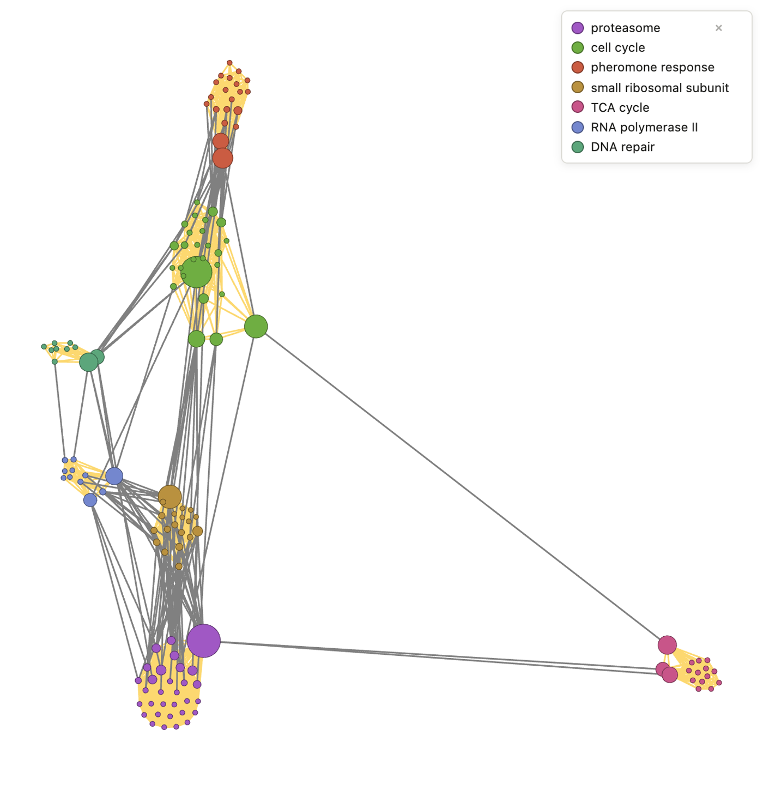
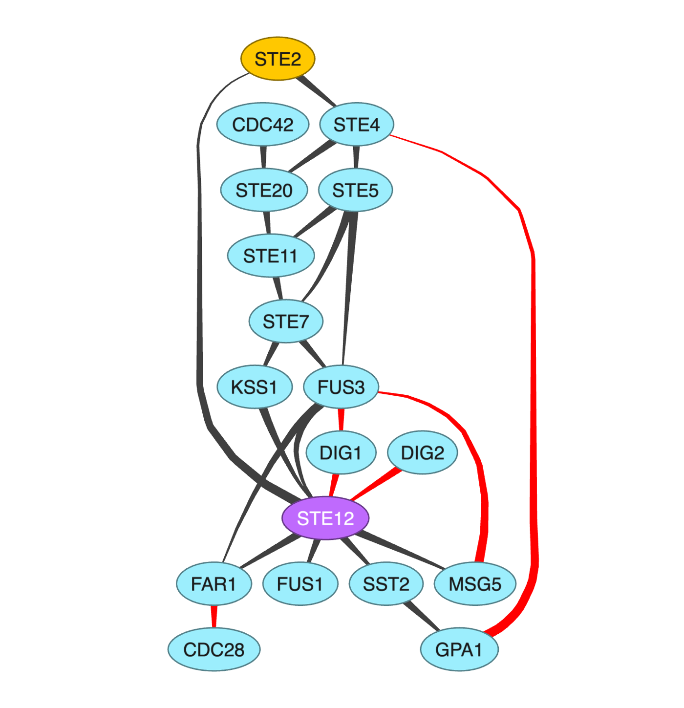
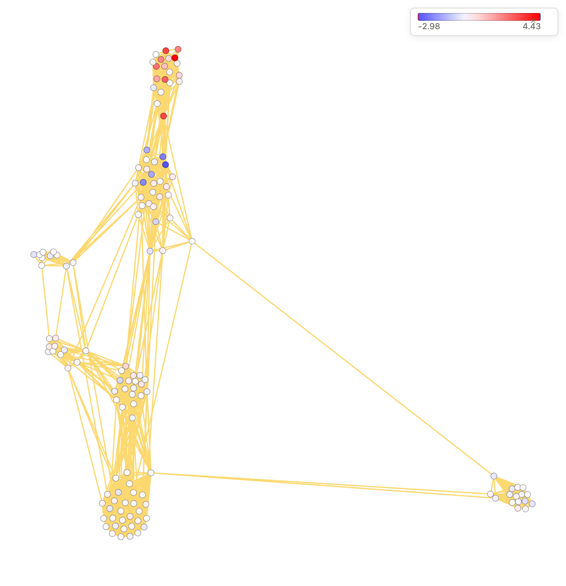
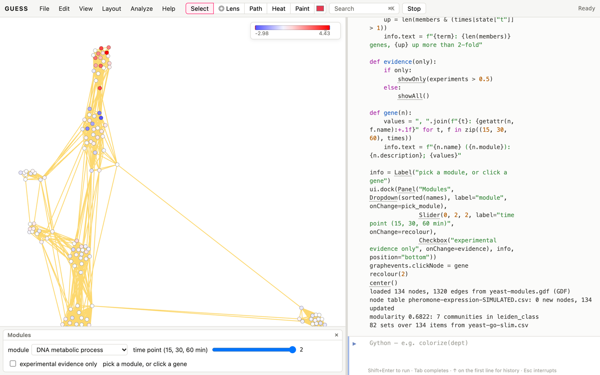

# Why networks?

Molecular biology is full of relations: proteins bind, kinases
phosphorylate, transcription factors regulate genes, enzymes pass
metabolites along, neurons synapse. A network view asks questions that a
list of genes can't answer:

- Which proteins hold the system together (hubs and bottlenecks)?
- Which genes work together (modules, complexes)?
- How does a signal travel from receptor to response, and where does it
  loop back (pathways, feedback)?
- How does a measurement, such as expression after a treatment, map onto
  that structure?

This book assumes the Kitchen for loading, querying and drawing. Its data
are in the cookbooks' `data` folder:

| file | what it is |
|---|---|
| `yeast-modules.gdf` | 134 budding-yeast genes from seven well-known complexes and pathways (`module`), with the 1,320 interactions STRING scores at 0.7 or more. Edge `score` is STRING's combined confidence, and `experiments`, `databases`, `textmining` and `coexpression` are the evidence behind it. From string-db.org, CC BY 4.0. |
| `yeast-go-slim.csv` | Gene Ontology slim terms for those genes (gene, aspect, term), from the Saccharomyces Genome Database, CC BY 4.0. |
| `pheromone-pathway.csv` | A simplified, directed and signed map of the yeast mating-pheromone pathway, drawn from textbook accounts: who `activates` or `inhibits` whom. For teaching, not a curated resource. |
| `pheromone-expression-SIMULATED.csv` | **Simulated** log2 fold changes at 15, 30 and 60 minutes after pheromone, for the 134 genes. They are shaped like the known response (mating genes up, G1 cyclins down) but invented: use them to learn the recipes, never as results. |

# Getting the data in

## Fetch interactions for a gene list [Basic]{.level}

**You have** a list of genes (a screen's hits, a differential-expression
list). **You want** the known interactions among them.

::: ingredients
**Ingredients:** an internet connection · `makeFromSTRING`
:::

```{.python .norun}
makeFromSTRING("TP53 MDM2 ATM CHEK2 CDKN1A BAX", score=0.7, add=10)
colorize(query)
```

**How it works.** `makeFromSTRING(genes)` asks the STRING database for
interactions among the genes. `species` is an NCBI taxon number (9606
human, the default; 10090 mouse; 4932 yeast; 7227 fly; 6239 worm; 3702
Arabidopsis), and `score` is the minimum combined confidence (0.4 medium,
0.7 high, 0.9 highest). `add=10` also brings in the ten proteins that
interact most with your list, marked `query = false`. That's how a screen's
hits get connected through genes the screen missed. Every edge records
the evidence behind its score: `experiments`, `databases`, `textmining`,
`coexpression` and others.

**Variations.** `makeFromNDEx(uuid)` opens a published network from the
NDEx repository (Cytoscape's network commons). Files from Cytoscape open
with `makeFromGraphML`, `makeFromGML` or `makeFromCSV` (for SIF-like tables).

**Pitfalls.** A STRING edge means "associated", not "binds". Text mining and
co-expression edges link genes that are studied together or switched on
together. For physical interactions, keep the edges with strong
experimental evidence, `showOnly(experiments > 0.5)`, or build from
a physical-interaction database.

## Open the yeast network and add measurements [Basic]{.level}

```python
makeFromGDF("yeast-modules.gdf")
makeFromCSV("pheromone-expression-SIMULATED.csv")
FUS1.description, FUS1.lfc60
```

**How it works.** The second file is a node table (an `Id` column plus
values), so GUESS adds its columns to the matching nodes instead of
replacing the graph (*Kitchen: Add attributes from a second table*). The
same works for any per-gene table: expression, essentiality, abundance,
mutation counts. Gene names must match node names. Check the message
("134 updated"), since unmatched IDs become new, unconnected nodes.

# Hubs and bottlenecks

## Find the hubs [Basic]{.level}

```python
makeFromGDF("yeast-modules.gdf")
plotDistrib(degree)
[(n.name, n.module, n.degree) for n in sortBy(degree)[-5:]]
```

**How it works.** In most molecular networks a few proteins have many
partners and most have few. `plotDistrib` shows the shape. The biggest
hubs here are proteasome subunits (RPN11 has 45 partners), because a
large complex makes every member a partner of many others. The cell-cycle
kinase CDC28 is the only hub outside a complex.

**Pitfalls.** Hubs are partly an artefact of attention: well-studied
proteins have more recorded interactions. Compare against `experiments`
evidence, or against a less biased data source, before concluding that a
hub is biologically central.

## Find the bottlenecks between modules [Intermediate]{.level}

**You want** the proteins that connect otherwise separate parts of the
network, which are often signalling or regulatory links.

```python
makeFromGDF("yeast-modules.gdf")
colorize(module)
legendFor(module)
sizeBy(betweenness, 6, 40)
forceAtlas2Layout()
interEdges(module).color = gray
[(n.name, n.module, round(n.betweenness)) for n in sortBy(betweenness)[-6:]]
```



**How it works.** High betweenness means many shortest paths run through a
protein. Here the list mixes two kinds of bottleneck. RPN11 (proteasome)
and RPS3 (ribosome) are hubs of big complexes that touch many others.
CDC28, FAR1 and SKP1 sit where modules meet. FAR1 is the pheromone
response's link to the cell cycle: all 11 of its partners outside its own
module are cell-cycle proteins.

**Variations.** `mixingMatrix(module)` counts the edges between each pair of
modules. The largest cross-module count here is proteasome–ribosome (48),
and 41 of those edges have strong experimental evidence. That isn't
necessarily function: very abundant complexes tend to turn up together in
pull-down experiments. Check the evidence channels before reading a
cross-module edge as cross-talk.

# Modules and complexes

## Find modules and name them [Intermediate]{.level}

**You want** groups of genes that work together, and to know what each
group does.

::: ingredients
**Ingredients:** `yeast-modules.gdf`, `yeast-go-slim.csv` · `leidenClusters` · `readSets` · `enrichment`
:::

```python
makeFromGDF("yeast-modules.gdf")
leidenClusters()
go = readSets("yeast-go-slim.csv", item="gene", set="term",
              where={"aspect": "process"})
r = enrichment(leiden_class == 0, go, top=5)
```

**How it works.** `leidenClusters()` finds communities (*Kitchen:
Communities*). `readSets` reads a table with one row per gene and term into
a dictionary of gene sets. `where=` keeps only biological-process terms.
`enrichment(nodes, sets)` asks, for each term, whether the community has
more of its genes than chance. For each term it reports:

| column | meaning |
|---|---|
| `k/n` | community genes with the term / annotated community genes |
| `K/N` | genes with the term / annotated genes overall |
| `fold` | (k/n) ÷ (K/N): how over-represented |
| `p` | the chance of so many or more by chance (hypergeometric) |
| `q` | the false discovery rate over all terms tested (Benjamini–Hochberg) |

The largest community has 28 of its 31 genes in "protein catabolic process"
(q ≈ 2e-15): it's the proteasome. `r` holds every row, and
`r[0]["members"]` is a set of the genes, so `r[0]["members"].color = red`
shows them.

**Variations.** Name every community at once:

```python
makeFromGDF("yeast-modules.gdf")
leidenClusters()
go = readSets("yeast-go-slim.csv", item="gene", set="term",
              where={"aspect": "process"})
for grp in groupBy(leiden_class):
    best = enrichment(grp, go, show=False)[0]
    print(grp[0].leiden_class, len(grp), best["set"], "%.0e" % best["q"])
```

**Pitfalls.**

- **Choose the background deliberately.** By default it's every node that
  has at least one annotation. Against the whole genome, everything in a
  hand-picked network looks enriched. Pass `background=` to choose.
- **These data are unrealistically clean.** The genes were picked from known
  complexes, so communities match them exactly
  (`compareClusters(leiden_class, module)` is 1.0). Real gene lists give
  messier modules, and that's when enrichment earns its keep.

## Find protein complexes with MCODE and MCL [Intermediate]{.level}

**You want** the tightly knit complexes in an interaction network, the way
Cytoscape users do with MCODE or MCL.

::: ingredients
**Ingredients:** `yeast-modules.gdf` · `mcodeClusters` · `mclClusters` · `compareClusters`
:::

```python
makeFromGDF("yeast-modules.gdf")
mcodeClusters()
colorize(mcode_class)
(mcode_class == 0).labelvisible = true
[(c, len(mcode_class == c), sorted({n.module for n in (mcode_class == c)})) for c in range(4)]
```

**How it works.** MCODE (Bader and Hogue, 2003) was designed for protein
networks. It weights each protein by how dense the core of its
neighbourhood is, grows complexes outward from the heaviest seeds, and
scores each complex by density × size. Here it finds nine; the best
(`mcode_class == 0`, score 31) is the proteasome, all 31 of its genes, and
the next is the small ribosomal subunit. `mcode_score` holds each protein's
weight. Four proteins belong to no complex (`mcode_class == -1`).

MCL (van Dongen, 2000) takes a different route: it simulates random walks,
alternately spreading them out and sharpening them, until the flow stays
inside clusters. Every protein ends up in exactly one cluster:

```python
makeFromGDF("yeast-modules.gdf")
mclClusters(inflation=2)
compareClusters(mcl_class, module)
```

**Variations.** Higher `inflation` gives more, smaller clusters. MCODE's
`fluff=true` adds the dense neighbours of each complex, and `haircut=false`
keeps proteins with a single tie into it.

**Pitfalls.**

- **These modules are easy.** MCL reproduces the seven modules exactly
  (`compareClusters` is 1.0), because the genes were chosen from well-known
  complexes. MCODE splits the cell-cycle genes into three complexes and
  merges one with the pheromone pathway, which is closer to what real
  data look like: the complexes it reports are dense cores, not whole
  pathways.
- **MCL needs memory.** It refuses connected pieces of more than 3,000
  proteins; filter by `score` first on big networks.

# Pathways and regulation

## Draw a signalling pathway [Basic]{.level}

**You have** a directed, signed pathway. **You want** a readable picture,
from receptor to response.

::: ingredients
**Ingredients:** `pheromone-pathway.csv` · `dotLayout` · edge queries
:::

```python
makeFromCSV("pheromone-pathway.csv")
labelBy(name)
g.nodes.labelpos = "inside"
fitNodesToLabels()
dotLayout()
(effect == "inhibits").color = red
(effect == "activates").color = darkgray
STE2.color = orange
STE12.color = purple
```



**How it works.** `dotLayout()` (Graphviz) ranks nodes top to bottom by
following the arrows. Feedback edges point back up, which makes loops
easy to spot. `fitNodesToLabels()` sizes each node to hold its name. Do it
*before* the layout, so the layout leaves room for the bigger nodes.

**Variations.** `descendants(STE2)` is everything downstream of the
receptor. `ancestors(CDC28)` is everything that can influence the cell-cycle
kinase. `shortestPath(STE2, CDC28)` is the most direct route.

## Find the feedback loops [Advanced]{.level}

**You want** the cycles in a pathway, and whether each one amplifies the
signal (positive feedback) or damps it (negative feedback).

```python
makeFromCSV("pheromone-pathway.csv")
import networkx as nx
G = toNetworkX()
for cyc in sorted(nx.simple_cycles(G), key=len)[:6]:
    steps = list(zip(cyc, cyc[1:] + cyc[:1]))
    signs = [G.edges[a, b]["effect"] for a, b in steps]
    kind = "negative" if signs.count("inhibits") % 2 else "positive"
    print(kind, " -> ".join(cyc))
```

**How it works.** `toNetworkX()` hands the graph to networkx, whose
`simple_cycles` lists every cycle. A loop's sign is the product of its
edges' signs, so an odd number of inhibitions makes it negative. The
shortest loop, FUS3 → STE12 → MSG5 -| FUS3, is negative: the response
switches on a phosphatase that turns the kinase off. The loop through the
receptor (STE12 → STE2) is positive: responding cells make more receptor.

**Pitfalls.** Real pathways have many overlapping cycles (24 in this
small map). List the shortest, and look at which edges they share:
`feedbackEdges()` gives the fewest edges whose removal breaks every cycle.

# Measurements on the network

## Colour genes by expression [Basic]{.level}

```python
makeFromGDF("yeast-modules.gdf")
makeFromCSV("pheromone-expression-SIMULATED.csv")
forceAtlas2Layout()
colorBy(lfc60, blue, red, center=0)
legendFor(lfc60)
```



**How it works.** `colorBy(field, low, high)` maps numbers to a gradient.
`center=0` makes it *diverging*: zero is white, and the two ends are equally
far from zero, so a gene down 2 is as deep a blue as a gene up 2 is red.
That's the right choice for fold changes, where zero means "no change" and
both directions matter.

**Pitfalls.** Without `center=`, a three-colour gradient puts its middle
colour halfway between the lowest and highest values. Here the values run
from −3.0 to 4.4, so "white" would fall at +0.7 and every unchanged gene
would be tinted. Always pin the centre for signed data.

## Animate a time course [Intermediate]{.level}

```python
makeFromGDF("yeast-modules.gdf")
makeFromCSV("pheromone-expression-SIMULATED.csv")
forceAtlas2Layout()
for t in (lfc15, lfc30, lfc60):
    colorBy(t, blue, red, center=0)
    ss(t.name)
ls("lfc15")
morph("lfc30", 1500)
```

**How it works.** Each time point is saved as a state with its own colours,
and `morph` animates between them, so the response is seen spreading
through the network. `addSlide` instead of `ss` makes a presentation.
To show all time points at once, `pieChart([lfc15, lfc30, lfc60])` draws
each gene as a pie of its values. Pies work best with positive amounts
(abundances, counts), not signed changes.

# Case studies

## Case study: how pheromone stops the cell cycle [Intermediate]{.level}

A haploid yeast cell that senses mating pheromone stops dividing in G1, so
it can fuse with a partner. Starting from the network alone, how does the
signal reach the cell-cycle machinery?

```python
makeFromGDF("yeast-modules.gdf")
colorize(module)
p = shortestPath(STE2, CDC28)
[n.name for n in p if n in g.nodes]
```

In the STRING network the shortest route from the receptor STE2 to the
cyclin-dependent kinase CDC28 runs through BEM1, a polarity scaffold shared
by mating and budding. Shortest paths in an association network are
suggestive, not mechanistic: an association can be any kind of link.

```python
showOnly((module == "pheromone response") | (module == "cell cycle"))
forceAtlas2Layout()
sizeBy(betweenness, 6, 40)
bridging = interEdges(module)
bridging.color = red
ends = [n for e in bridging for n in (e.node1, e.node2)]
sorted(set(n.name for n in ends if n.module == "pheromone response"))
```

The 28 edges between the two modules touch ten pheromone genes, but
FAR1 alone accounts for 11 of them, all to cell-cycle proteins.
That points to the known mechanism (FUS3 activates FAR1, which inhibits
CDC28 with its G1 cyclins), which the directed pathway map makes explicit:

```python
makeFromCSV("pheromone-pathway.csv")
[n.name for n in shortestPath(STE2, CDC28) if n in g.nodes]
```

Following the arrows, the route is STE2 → STE4 → STE5 → FUS3 → FAR1 -|
CDC28: receptor, G-protein, scaffold, MAP kinase, then the CDK inhibitor.

## Case study: from a hit list to modules [Advanced]{.level}

A screen gives you genes. With a network connection, the full workflow is:

```{.python .norun}
hits = "RPN11 RPT5 PRE1 CDC28 CLN2 FAR1 FUS3 STE12 RPO21 MSH2"
makeFromSTRING(hits, species=4932, add=20)
leidenClusters()
```

The bundled network stands in for that result here:

```python
makeFromGDF("yeast-modules.gdf")
subgraph(experiments > 0.5, "physical")
leidenClusters()
go = readSets("yeast-go-slim.csv", item="gene", set="term",
              where={"aspect": "process"})
for grp in groupBy(leiden_class)[:5]:
    best = enrichment(grp, go, show=False)[0]
    print(len(grp), best["set"], "q=%.0e" % best["q"])
```

`subgraph(experiments > 0.5, "physical")` opens a graph of just the edges
with strong experimental evidence (1,028 of 1,320) and the genes they join
(`use("main")` goes back). Communities are then re-found and
named by their top term. Which modules survive with physical evidence
alone, and which were held together by co-expression and text mining? Ask
that of any network built from mixed evidence. Here all seven survive,
each still enriched for the right process. With a real hit list, expect
some modules to dissolve.

::: pitfall
**Pitfall.** A subgraph of edges loses any gene left with no strong edge.
`subgraph(experiments > 0.5)` keeps 134 genes here, but on noisier data
count the nodes before and after, and treat those that drop out as "no
physical evidence", not "no interaction".
:::

# Capstone

## Capstone: a module browser for a time course [Advanced]{.level}

**The problem.** A lab has a time course after a treatment and wants to
browse it through the interaction network. Which modules respond? When?
Which genes lead? This recipe builds a module browser:

- modules are found and named by their top GO term, and a drop-down picks one;
- a slider steps through the time points, recolouring every gene;
- a checkbox switches between all evidence and experimental evidence only;
- a click on a gene shows its description and its values at every time point;
- a legend shows the diverging scale.

```python
makeFromGDF("yeast-modules.gdf")
makeFromCSV("pheromone-expression-SIMULATED.csv")
forceAtlas2Layout()
_ = leidenClusters()
go = readSets("yeast-go-slim.csv", item="gene", set="term", where={"aspect": "process"})
names = {}
for grp in groupBy(leiden_class):
    names[enrichment(grp, go, show=False)[0]["set"]] = grp[0].leiden_class
times = [lfc15, lfc30, lfc60]
state = {"t": 2}

def recolour(i):
    state["t"] = int(i)
    colorBy(times[state["t"]], blue, red, center=0)
    legendFor(times[state["t"]], title=f"log2 change at {[15, 30, 60][state['t']]} min")

def pick_module(term):
    members = (leiden_class == names[term])
    g.nodes.labelvisible = false
    members.labelvisible = true
    center(members)
    up = len(members & (times[state["t"]] > 1))
    info.text = f"{term}: {len(members)} genes, {up} up more than 2-fold"

def evidence(only):
    if only:
        showOnly(experiments > 0.5)
    else:
        showAll()

def gene(n):
    values = ", ".join(f"{t}: {getattr(n, f.name):+.1f}" for t, f in zip((15, 30, 60), times))
    info.text = f"{n.name} ({n.module}): {n.description}; {values}"

info = Label("pick a module, or click a gene")
ui.dock(Panel("Modules", Dropdown(sorted(names), label="module", onChange=pick_module),
              Slider(0, 2, 2, label="time point (15, 30, 60 min)", onChange=recolour),
              Checkbox("experimental evidence only", onChange=evidence), info, position="bottom"))
graphevents.clickNode = gene
recolour(2)
center()
```



**How it works.**

- **Naming the modules.** The modules come from `leidenClusters()`, and
  each is named by its top enriched term (the module-naming recipe), so the
  drop-down lists biology ("signal transduction", "protein catabolic
  process"), not numbers.
- **The slider.** It indexes the three expression fields. `colorBy(...,
  center=0)` and `legendFor` redraw the diverging scale for each time point.
- **The checkbox.** It toggles `showOnly(experiments > 0.5)`, the
  physical-evidence view from the second case study.
- **The click.** It reads a gene's fields into the label.

As before, the expression values are **simulated**: substitute your own
table, with an `Id` column of gene names, in the second line.
