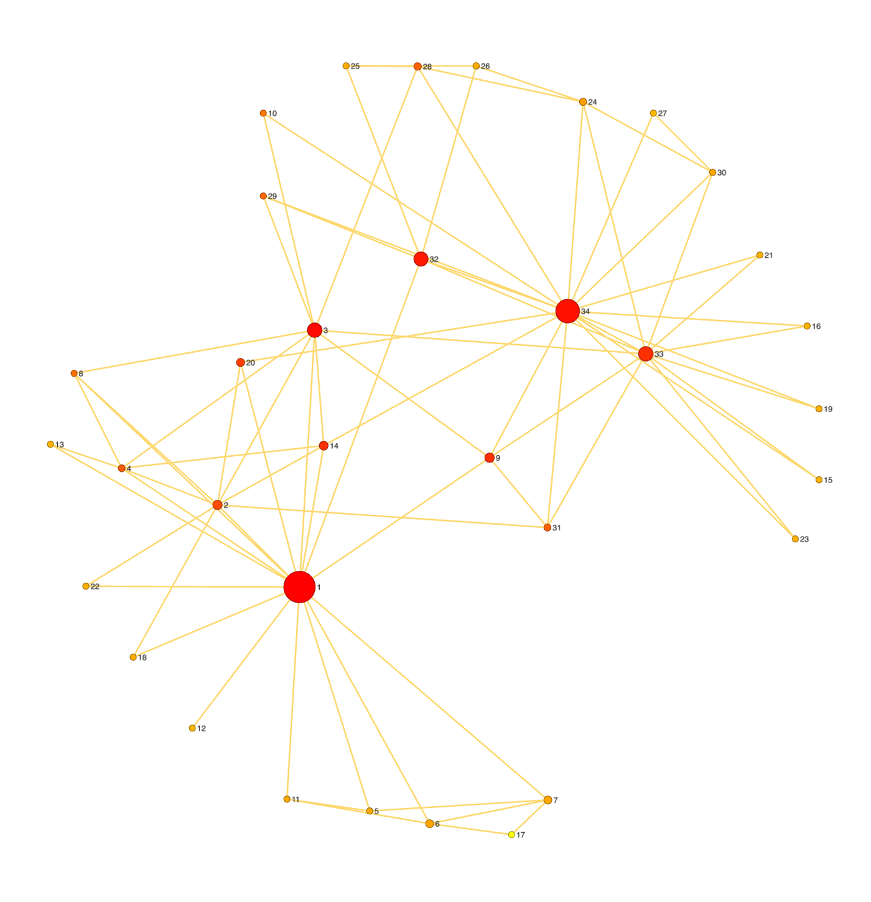
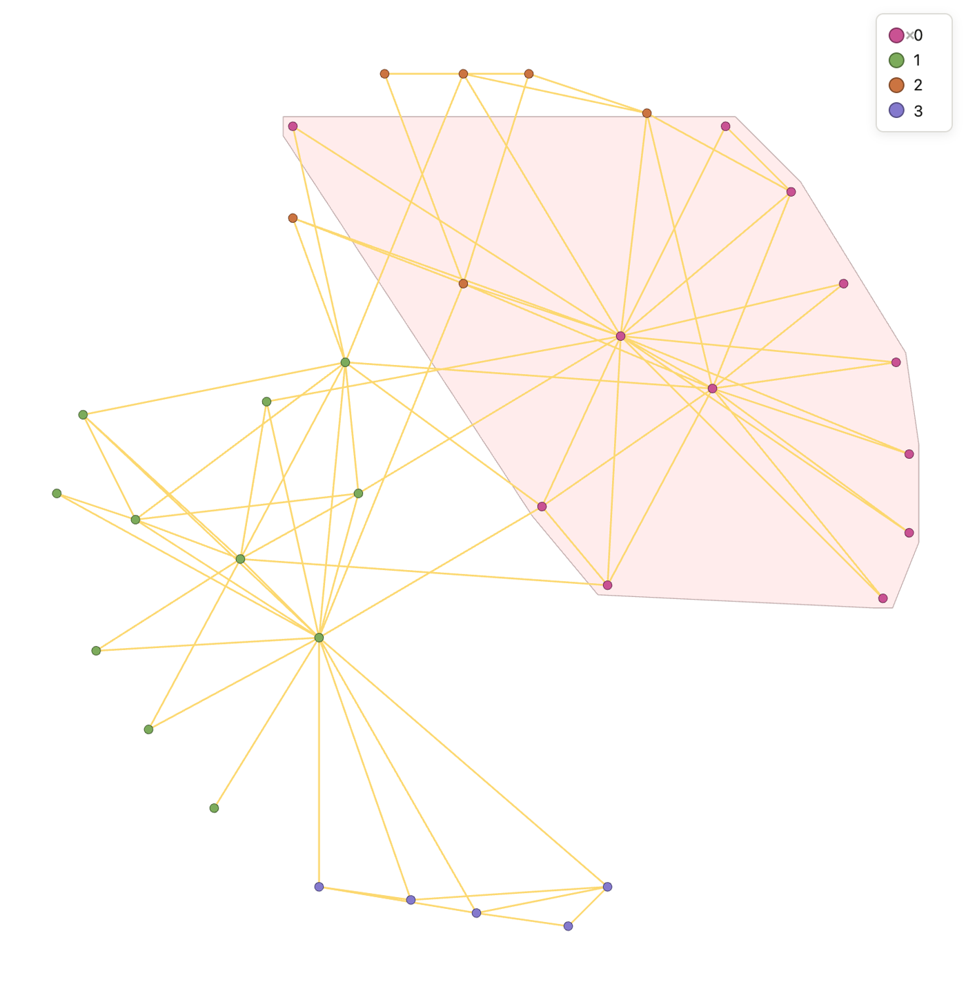
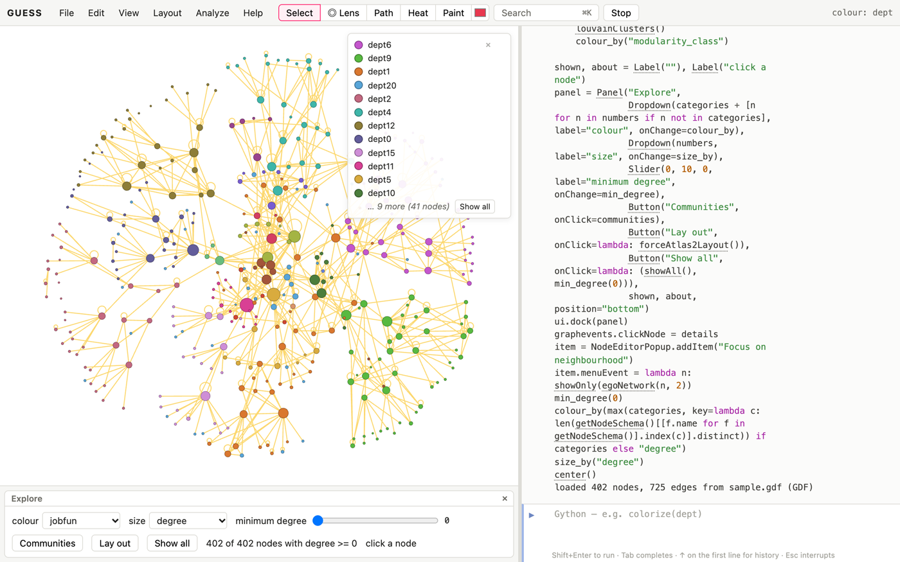

# About these cookbooks

Each "GUESS for X" cookbook is a set of short recipes for one field. This
one, the Kitchen, holds what they all share. The field books link back here
instead of repeating it.

Every recipe has the same parts:

- **You have / you want**: the situation and the goal, so you can tell
  quickly whether the recipe is the one you need.
- **Ingredients**: the data and commands it uses.
- **Steps**: code to type into the GUESS console (or paste, then
  Shift+Enter). Each recipe starts from scratch and loads its own data.
- **How it works**: what the commands did, and what the result means.
- **Variations** and **pitfalls**: related tasks, and where the method misleads.

Recipes are tagged *Basic*, *Intermediate* or *Advanced*. The data files
named in the steps are in the cookbooks' `data` folder. Open them with
*File → Open* (or drag them onto the page) and GUESS keeps a copy, so
`makeFromGDF("karate.gdf")` finds it afterwards. `sample.gdf` is the graph
GUESS opens with.

Every code sample in these books is run by the build, so if a recipe doesn't
work as printed, that's a bug: please report it.

# Getting data in

## Open a network file [Basic]{.level}

**You have** a network saved by another tool. **You want** it in GUESS.

::: ingredients
**Ingredients:** `karate.gdf` · `makeFromGDF` and friends
:::

```python
makeFromGDF("karate.gdf")
```

**How it works.** Each format has its own loader. All of them replace the
current graph, turn the file's attributes into fields, and keep the file's
positions if it has them:

| format | command |
|---|---|
| GDF (GUESS, GUESS 2006) | `makeFromGDF` |
| GraphML (yEd, Cytoscape, networkx) | `makeFromGraphML` |
| GEXF (Gephi) | `makeFromGEXF` |
| GML | `makeFromGML` |
| DOT (Graphviz) | `makeFromDOT` |
| Pajek `.net` | `makeFromPajek` |
| UCINET DL | `makeFromDL` |
| CSV / TSV | `makeFromCSV` (next recipe) |

*File → Open* picks the loader from the file's extension. In a script,
`makeFromURL("https://…/graph.gexf")` downloads and opens a file in one step.

**Variations.** `makeSample()` lists the classic networks GUESS has built in
(the karate club, *Les Misérables*, Florentine families, Davis's southern
women…). `makeSample("karate")` opens one without a file.

## Build a network from a spreadsheet [Basic]{.level}

**You have** a table of who is linked to whom. **You want** a network.

::: ingredients
**Ingredients:** `friends.csv` (columns Source, Target, Weight) · `makeFromCSV`
:::

```python
makeFromCSV("friends.csv")
getEdgeSchema()
```

**How it works.** A CSV whose first two columns are named Source and Target
(as Gephi expects) is read as an edge table: one row per edge, and every
other column becomes an edge field (`weight` here). A first row of node
names and a first column of the same names is read as an adjacency matrix
instead. Edges are undirected unless the table has a Type column saying
`Directed`, or you pass `directed=true`.

**Pitfalls.** Spreadsheets often list a tie once in each direction, or repeat
it per contact. Here, `ana,ben` appears three times. See *Merge duplicate
edges into weights*.

## Add attributes from a second table [Basic]{.level}

**You have** a network, plus a spreadsheet of facts about the nodes (age,
team, gene expression…). **You want** those facts as node fields.

::: ingredients
**Ingredients:** `friends.csv` · `friends-nodes.csv` (columns Id, team, age)
:::

```python
makeFromCSV("friends.csv")
makeFromCSV("friends-nodes.csv")
ana.team, ana.age
```

**How it works.** Opening a CSV with an `Id` column but no Source/Target
doesn't replace the graph. It adds the columns to the nodes whose names
match the Id, and creates nodes for Ids that aren't in the network yet
(`ivy`, who has no ties). Numbers become numeric fields, so `age > 30` works
straight away.

**Variations.** `makeFromCSV("edges.csv", "nodes.csv")` reads both tables at
once.

## Bring in a networkx or igraph graph [Intermediate]{.level}

**You have** a graph built in Python, or want an algorithm GUESS doesn't
have. **You want** to move between GUESS and networkx.

::: ingredients
**Ingredients:** `toNetworkX` · `fromNetworkX` · `setField`
:::

```python
makeFromGDF("karate.gdf")
import networkx as nx
G = toNetworkX()
setField(nx.load_centrality(G), "load")
sortBy(load)[-3:]
```

**How it works.** `toNetworkX()` hands you the current graph with every
field as an attribute. `setField(result, "name")` stores what a networkx
function returns: a dict of node values becomes a node field, a dict of
node pairs becomes an edge field, and a list of node sets (communities)
becomes a field holding each node's group number. `fromNetworkX(G)` goes
the other way and replaces the graph.

# Cleaning

## Merge duplicate edges into weights [Basic]{.level}

**You have** the same tie listed many times. **You want** one edge per pair,
weighted by how often (or how much) it occurred.

::: ingredients
**Ingredients:** `friends.csv` · `simplify`
:::

```python
makeFromCSV("friends.csv")
simplify()
(ana <-> ben).weight
```

**How it works.** `simplify()` merges edges joining the same two nodes (in
the same direction, for directed edges) and adds up their weights. It also
removes self-loops (`fay` to `fay`). `combine="max"`, `"mean"`, `"min"` or
`"first"` combine weights differently. It's one undo step.

## Drop isolates and keep the main component [Basic]{.level}

**You have** a network with stray nodes and small fragments. **You want** to
analyse the connected core.

::: ingredients
**Ingredients:** `friends.csv`, `friends-nodes.csv` · `giantComponent` · `removeDisconnected`
:::

```python
makeFromCSV("friends.csv"); makeFromCSV("friends-nodes.csv"); simplify()
removeDisconnected()                # ivy, who has no ties
showOnly(giantComponent())          # hide gus and hal's pair
```

**How it works.** `removeDisconnected()` deletes nodes with no edges and
returns them. `giantComponent()` is the largest connected piece.
`showOnly` hides the rest without deleting it (`showAll()` brings it back),
while `remove(g.nodes - giantComponent())` deletes it.

**Pitfalls.** Measures like closeness and average path length are only
meaningful within a component. Decide whether fragments are noise or
findings before you drop them.

## Make, rename and fill fields [Basic]{.level}

**You have** values to store or derive. **You want** them as fields you can
query, colour and size by.

```python
makeFromGDF("sample.gdf")
addNodeField("senior", BOOLEAN, false)
(dept == "dept4").senior = true
addEdgeField("heavy", BOOLEAN, false)
(freq > 50).heavy = true
getNodeSchema()
```

**How it works.** `addNodeField(name, type, default)` and `addEdgeField`
create a field with a default value. Assigning to a set (`(… ).senior =
true`) sets it on every member. The types are `VARCHAR` (text), `INTEGER`,
`DOUBLE`, `BOOLEAN`. Python works too:
`for n in g.nodes: n.senior = n.degree > 5`.

**Pitfalls.** Field, node and colour names are reserved, so they can't
be used as variable names. `x = 5` is an error because `x` is the field
holding each node's position, and so are `size`, `color`, `label` and your
own fields' names. Pick another name (`xs = …`).

# Asking questions

## Select by value [Basic]{.level}

**You have** a field. **You want** the nodes or edges that match.

```python
makeFromGDF("sample.gdf")
dept4 = (dept == "dept4")
busy = (freq > 100)
dept.find("dept9")                 # the same as dept == "dept9"
(dept like "dept1%")               # SQL patterns: % any run, _ one character
len(dept4), len(busy)
```

**How it works.** In GUESS, comparing a field with a value doesn't give
`True`/`False`; it gives the set of matching elements. Sets can be coloured,
hidden, counted or passed to any command. `field.find(value)` is a
plain-method spelling of `field == value`.

## Combine and subtract sets [Basic]{.level}

```python
makeFromGDF("sample.gdf")
a = (dept == "dept4")
b = (degree > 5)
(a & b).color = red                 # in dept4 and well connected
(a | b).size = 20                   # either
a.difference(b).color = orange      # in dept4 but not well connected
```

**How it works.** `&` is intersection and `|` union, and `.difference()`
removes members. They work on any GUESS sets, including edges. Assigning a
field on a set assigns it on every member.

**Pitfalls.** Between sets of nodes, `-` doesn't subtract: `a - b` is the
*edges* joining `a` and `b` (see the next recipe). Use `.difference()`.

## Find the edges between groups [Basic]{.level}

**You want** the ties linking two sets of nodes, or the ties of one node.

```python
makeFromGDF("sample.gdf")
a = (dept == "dept4"); b = (dept == "dept9")
(a <-> b).color = red               # edges between the two departments (also a - b)
(v1 -> g.nodes).width = 4            # v1's outgoing edges
interEdges(dept).color = gray        # every edge that crosses departments
```

**How it works.** `->`, `<-` and `<->` between nodes or sets give the
edges in that direction (`<->` either way). `interEdges(field)` and
`intraEdges(field)` give the edges that cross between values of a field or
stay within one.

## Rank and group [Basic]{.level}

```python
makeFromGDF("sample.gdf")
sortBy(betweenness)[-5:]                    # the top five
[(grp[0].dept, len(grp)) for grp in groupBy(dept)]
dept.distinct                               # every value once
table(dept == "dept4")                      # look at them in the data table
```

**How it works.** `sortBy(field)` sorts ascending, so the largest values
are at the end. `groupBy(field)` returns one set per value, and
`groupAndSortBy` orders the groups by size. `table(seq)` opens the data
table on just those rows, where you can sort columns and edit values.

# Measuring

## Size, density and the usual summary [Basic]{.level}

```python
makeFromGDF("karate.gdf")
graphStats()
```

**How it works.** `graphStats()` prints the measures most papers report:
nodes, edges, density, mean degree, components, diameter, average path
length, average clustering, transitivity and degree assortativity (plus
reciprocity for directed graphs). Each is also a command on its own
(`density()`, `diameter()`, `transitivity()`…).

## Who is central? [Basic]{.level}

**You want** to find the important nodes, and to know which kind of
important you mean.

```python
makeFromGDF("karate.gdf")
frLayout()
sizeBy(betweenness, 8, 40)
colorBy(closeness, yellow, red)
labelBy(label)
```



**How it works.** These centrality fields are computed the first time you
use them:

| field | high when a node… |
|---|---|
| `degree`, `indegree`, `outdegree` | has many ties |
| `strength` | has heavy ties (sum of weights) |
| `betweenness` | lies on many shortest paths: a broker or gatekeeper |
| `closeness`, `harmonic` | is few steps from everyone (`harmonic` copes with fragments) |
| `eigenvector` | is tied to nodes that are themselves well tied |
| `pagerank` | is pointed to by important nodes (directed) |
| `hub`, `authority` | points to good authorities / is pointed to by good hubs |
| `constraint`, `effsize` | spans structural holes (Burt): low constraint = broker |
| `coreness` | sits in a deep k-core |

**Pitfalls.** Centralities disagree, and the disagreement is informative: a
node with low degree but high betweenness is a bridge between groups. Don't
report "the most central" node without saying which measure.

## Look at distributions [Basic]{.level}

```python
makeFromGDF("lesmis.gdf")
plotHistogram(degree)
plotDistrib(betweenness)
```

**How it works.** `plotHistogram(field)` counts values in bins.
`plotDistrib(field)` plots each node's value in rank order, which makes
heavy tails (a few hubs, many small nodes) obvious. The charts appear in a
panel and can be saved as images.

## Paths and distances [Basic]{.level}

```python
makeFromGDF("lesmis.gdf")
p = shortestPath(Napoleon, Javert)
p.color = red
heatMap(Valjean)                       # colour everyone by hops from Valjean
averagePathLength(), diameter()
```

**How it works.** `shortestPath(a, b)` returns the nodes and edges of one
shortest path. `weighted=true` treats the edge weight as a length (so
heavier means farther; invert weights first if they measure strength).
`heatMap(node)` colours by distance and stores it in `hops`.

# Finding structure

## Components, bridges and cut points [Basic]{.level}

```python
makeFromGDF("sample.gdf")
colorize(component)
bridges().color = red                   # edges whose removal splits a part
cutNodes().size = 25                    # nodes whose removal splits a part
```

**How it works.** `component` numbers each connected piece (0 = largest).
`strongcomponent` is the directed version. A bridge is the only link
between two parts. A cut node holds two parts together. Both are where a
network is fragile.

## Cores and cliques [Intermediate]{.level}

```python
makeFromGDF("karate.gdf")
colorBy(coreness, lightgray, red)
largestCliques()
showOnly(kCore(4))
```

**How it works.** The *k*-core is what remains after repeatedly removing
nodes with fewer than *k* ties. `coreness` is the deepest core each node
belongs to. A clique is a group in which everyone is tied to everyone.
`largestCliques()` returns the biggest ones. Cores are robust and
cliques are brittle (one missing tie breaks a clique), so prefer cores for
noisy data.

## Communities [Basic]{.level}

**You want** groups of nodes more tied to each other than to the rest.

```python
makeFromGDF("karate.gdf")
frLayout()
leidenClusters()
colorize(leiden_class)
createConvexHull(leiden_class == 0, "255,200,200,90")
legendFor(leiden_class)
```



**How it works.** GUESS has many community methods. Each stores the result as
a field (0 = the largest community):

| command | field | good for |
|---|---|---|
| `louvainClusters()` | `modularity_class` | fast, standard (Gephi's "Modularity") |
| `leidenClusters()` | `leiden_class` | like Louvain, but every community is connected |
| `infomapClusters()` | `infomap_class` | directed flow: citations, web links |
| `walktrapClusters()`, `fastGreedyClusters()`, `labelPropagationClusters()`, … | | alternatives to compare |
| `edgeBetweennessClusters(n)` | | small graphs; a hierarchy you can cut |

`resolution=` (Louvain, Leiden) above 1 gives more, smaller communities.
`modularity(field)` scores any partition, including one you supply
(`modularity(dept)`).

**Pitfalls.** Every method finds communities, even in random graphs. Check
that the modularity is well above what you get after `rewire()`, and that
the result is stable (`seed=None`, run again, then `compareClusters`).

## Compare two groupings [Intermediate]{.level}

```python
makeFromGDF("sample.gdf")
louvainClusters()
compareClusters(modularity_class, dept)               # 0 = unrelated, 1 = identical
compareClusters(modularity_class, dept, method="ari")
mixingMatrix(dept)
```

**How it works.** `compareClusters` gives normalized mutual information (or
the adjusted Rand index) between two partitions, such as found communities
and a known attribute. `mixingMatrix(field)` counts edges between each pair
of values, which shows *which* groups mix.

## Collapse groups into single nodes [Intermediate]{.level}

```python
makeFromGDF("sample.gdf")
collapseBy(dept)
```

**How it works.** Each department becomes one meta-node, with edges summarising
the ties between departments. `expand(node)` or `expandAll()` opens them
again. Double-clicking a meta-node in the display does the same.

# Laying out

## Choose a layout [Basic]{.level}

```python
makeFromGDF("lesmis.gdf")
forceAtlas2Layout()
```

**How it works.** No layout is "correct". Choose by what you want to see:

| you want | try |
|---|---|
| clusters to separate | `forceAtlas2Layout()`, `frLayout()`, `sfdpLayout()` (large graphs) |
| distances to mean graph distance | `kkLayout()`, `neatoLayout()`, `mdsLayout()` |
| a hierarchy or flow, top to bottom | `dotLayout()`, `sugiyamaLayout()`, `dagLayout()` |
| one node's view of the world | `radialLayout(node)`, `twopiLayout()` |
| groups on a circle | `circleLayout()`, `circoLayout()`, `hiveLayout(field)` |
| two kinds of node | `bipartiteLayout(field)` |
| attributes as coordinates | `scatterLayout(xfield, yfield)` |

Layouts start from the current positions, so running one twice refines it.
`removeOverlap()` (or `noverlapLayout()`) pushes overlapping nodes apart
afterwards.

## Pin nodes while the rest moves [Basic]{.level}

```python
makeFromGDF("karate.gdf")
m1.x, m1.y = 100, 500
m34.x, m34.y = 900, 500
(m1, m34).fixed = true
frLayout()
```

**How it works.** Nodes with `fixed = true` stay put during layouts, and the
others arrange themselves around them. Here the two rival leaders anchor
the two ends of the picture. Dragging a node with the mouse also moves it.

# Drawing

## Colour, size and shape by data [Basic]{.level}

```python
makeFromGDF("sample.gdf")
colorize(dept)                     # a distinct colour per value
sizeBy(degree, 6, 30)              # proportional to a number
shapeBy(jobfun)                    # a shape per value
sizeBy(freq, 1, 6)                 # edge widths, for an edge field
legendFor(dept)
```

**How it works.** `colorize` is for categories; `colorBy(field, low, high)`
is a gradient for numbers. `sizeBy(field, min, max)` scales sizes
(`scale="log"` or `"sqrt"` for skewed values). `resizeLinear` spaces
sizes by rank. Legends follow the colours: re-run `colorize` and the legend
updates.

## Labels that don't collide [Basic]{.level}

```python
makeFromGDF("lesmis.gdf")
forceAtlas2Layout()
sizeBy(degree, 5, 30)
g.nodes.labelvisible = true
g.nodes.labelpos = "outside"
optimizeLabels()
hideOverlappingLabels()
```

**How it works.** `labelpos` is where a node's label goes: `"right"`,
`"left"`, `"above"`, `"below"`, `"inside"` (fitted into the shape), or `"outside"`, which lets
GUESS choose a free spot. `optimizeLabels()` runs a longer search for
positions, and `hideOverlappingLabels()` drops the labels that still
collide, smallest nodes first. `labelSizeBy(degree)` makes important labels
bigger.

## Outline groups and bundle the hairball [Intermediate]{.level}

```python
makeFromGDF("lesmis.gdf")
forceAtlas2Layout()
louvainClusters(); colorize(modularity_class)
for grp in groupBy(modularity_class): createConvexHull(grp)
bundleEdges()
```

**How it works.** `createConvexHull(set)` shades the area around a set of
nodes. `bundleEdges()` gathers edges that run in the same direction into
bundles (MINGLE). `method="fdeb"` gives smoother curves, and passing a
field (`bundleEdges(modularity_class)`) bundles within groups.
`unbundleEdges()` undoes it.

## Explore a crowded area with the lens [Basic]{.level}

Press **L** (or the Lens button in the toolbar) and move over a dense area: the lens
lists the labels of everything under it, in a column beside the cursor,
with lines to each node. The mouse wheel resizes it, Shift+wheel scrolls
long lists, and a click pins it. `excentricLens(true, radius=80)` turns it
on from the console.

# Change over time

## Save, compare and animate states [Intermediate]{.level}

```python
makeFromGDF("karate.gdf")
frLayout()
ss("before")
remove(m1)                        # what if the instructor leaves?
colorize(component)
ss("after")
morph("before", 1500)
```

**How it works.** `ss(name)` saves the whole graph (membership, positions,
every field) as a named state. `ls(name)` returns to it, and
`morph(name, ms)` animates the change. Fields can be read in a state:
`betweenness["before"]`, `m2["before"].color`. States can be named with
numbers (`ss(1999)`), which suits snapshots over time.

## Show a network as of a date [Intermediate]{.level}

```python
makeFromGDF("sample.gdf")
addEdgeField("since", INTEGER, 0)
for e in g.edges: e.since = e.freq          # pretend freq is a year
showTime(60, since)                         # edges that exist by "60"
showTime(150, since, window=50)             # only the last 50
```

**How it works.** `showTime(t, field)` shows only elements whose numeric
field is at most `t` (and within `window` of it, if given). For
elements that come and go, give them ranges with `addRange(node,
"1999-2003,2007")` and use `showTime(t)`. *View → Timeline* gives a slider.

# Sharing

## Export a figure [Basic]{.level}

```python
makeFromGDF("karate.gdf")
frLayout(); colorize(club)
exportSVG("karate.svg")
exportPDF("karate.pdf")
exportPNG("karate.png")
```

**How it works.** SVG and PDF are vector: the whole graph, at any size, with
labels and legends, ready for a paper. PNG is the current view as you see it.

## Tell a story with slides [Intermediate]{.level}

```python
makeFromGDF("karate.gdf")
frLayout()
addSlide("The club before the split")
colorize(club)
addSlide("The two factions")
slides()
```

**How it works.** `addSlide(note)` saves the graph and the camera as a
slide, and the Slides panel plays them, morphing from one to the next.

## Save your work and your method [Basic]{.level}

```python
makeFromGDF("karate.gdf")
louvainClusters(); colorize(modularity_class)
saveSession("karate-analysis.guess")
history()
```

**How it works.** `saveSession` writes everything (graph, fields, states,
view) to one file that `makeFromSession` (or *File → Open*) restores.
`history()` lists the commands you ran, which is your method: save it as a
`.py` file and `execfile` replays it on new data.

# Capstone

## Capstone: an explorer for any network [Advanced]{.level}

**The problem.** You've just been handed a network file and want a quick,
reusable way to look at it from every angle without typing a command for
each view. This recipe builds a small explorer that works on any graph:

- drop-downs to colour by any field and size by any numeric field;
- a slider that hides weakly connected nodes;
- buttons to find communities, lay out again and reset;
- a click shows everything known about a node, and a right-click focuses
  on its neighbourhood;
- the legend and status bar keep track of what's shown.

```python
makeFromGDF("sample.gdf")
fields = [f for f in getNodeSchema() if not f.builtin]          # the data's own fields
categories = [f.name for f in fields if len(f.distinct) <= 30]
numbers = [f.name for f in fields if all(isinstance(v, (int, float)) for v in f.values()) and len(f.distinct) > 1]
numbers = numbers + ["degree", "betweenness", "pagerank"]

def colour_by(name):
    fld = getNodeSchema()[[f.name for f in getNodeSchema()].index(name)]
    if name in numbers and name not in categories:
        colorBy(fld, lightgray, red)
    else:
        colorize(fld)
    legendFor(fld)
    StatusBar.setStatus(f"colour: {name}")

def size_by(name):
    sizeBy(getNodeSchema()[[f.name for f in getNodeSchema()].index(name)], 4, 30)

def min_degree(v):
    showOnly(degree >= int(v))
    shown.text = f"{len(degree >= int(v))} of {len(g.nodes)} nodes with degree >= {int(v)}"

def details(n):
    vals = ", ".join(f"{f.name}={getattr(n, f.name)}" for f in fields[:8])
    about.text = f"{n.name}: degree {n.degree}; {vals}"

def communities():
    louvainClusters()
    colour_by("modularity_class")

shown, about = Label(""), Label("click a node")
panel = Panel("Explore",
              Dropdown(categories + [n for n in numbers if n not in categories], label="colour", onChange=colour_by),
              Dropdown(numbers, label="size", onChange=size_by),
              Slider(0, 10, 0, label="minimum degree", onChange=min_degree),
              Button("Communities", onClick=communities),
              Button("Lay out", onClick=lambda: forceAtlas2Layout()),
              Button("Show all", onClick=lambda: (showAll(), min_degree(0))),
              shown, about, position="bottom")
ui.dock(panel)
graphevents.clickNode = details
item = NodeEditorPopup.addItem("Focus on neighbourhood")
item.menuEvent = lambda n: showOnly(egoNetwork(n, 2))
min_degree(0)
colour_by(max(categories, key=lambda c: len(getNodeSchema()[[f.name for f in getNodeSchema()].index(c)].distinct)) if categories else "degree")
size_by("degree")
center()
```



**How it works.**

- **Reading the fields.** `getNodeSchema()` lists the graph's fields, and
  `builtin` marks GUESS's own (position, colour, visibility). The recipe
  sorts the data's fields into categories (few distinct values) and
  numbers, adds three computed measures, and offers them in two
  `Dropdown`s. Choosing one calls `colorize` or
  `colorBy` (with a live legend), or `sizeBy`.
- **Filtering.** The `Slider` calls `showOnly(degree >= v)`, a query
  built from its value.
- **The rest.** The buttons wrap commands from this book. `graphevents`
  and `NodeEditorPopup` add click and right-click behaviour. Because
  nothing in it names a field of the sample data, the explorer works
  unchanged on any file: replace the first line.
