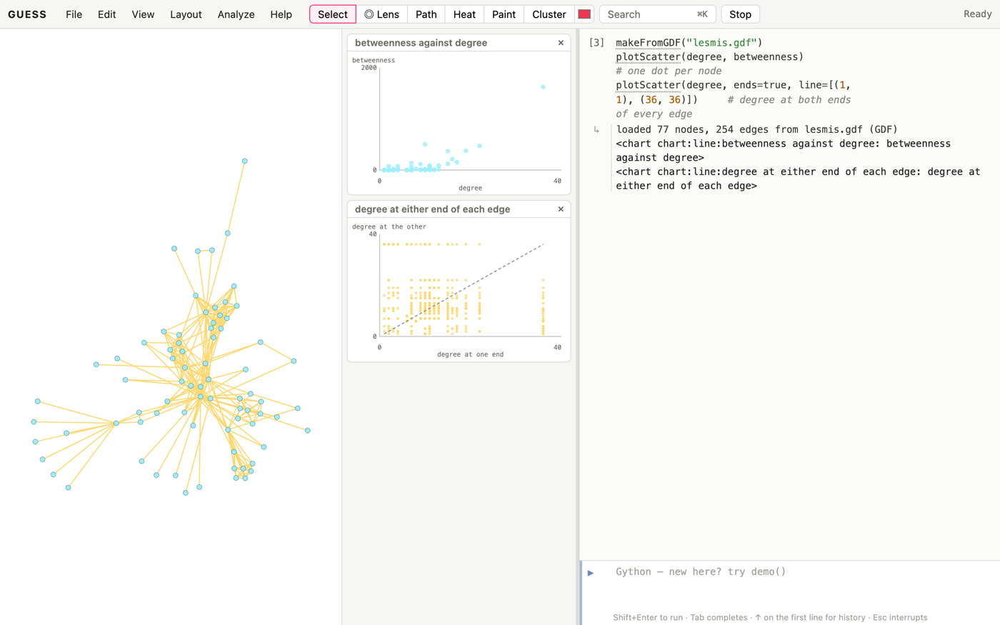
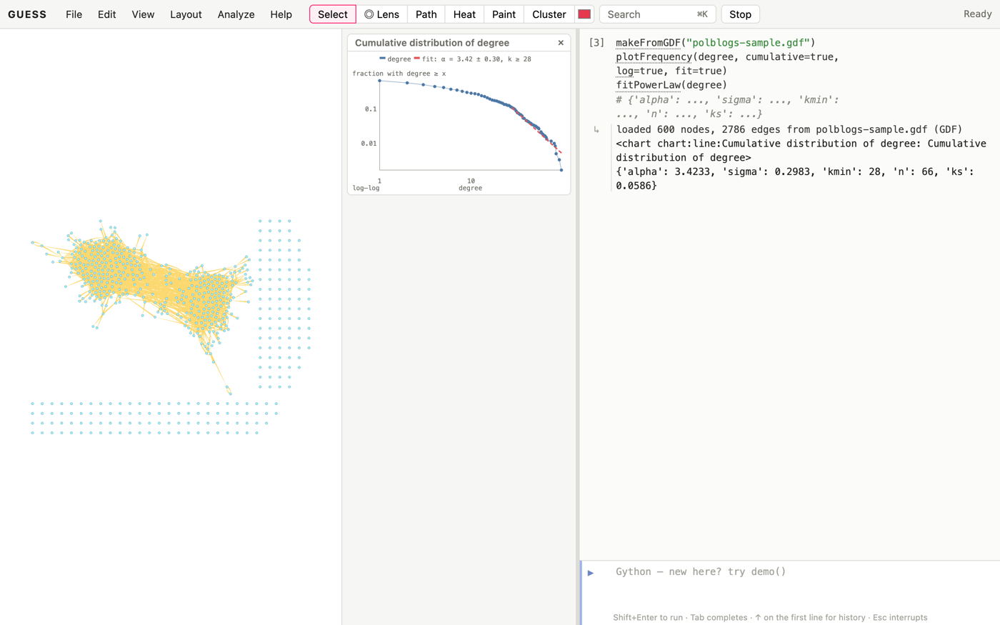
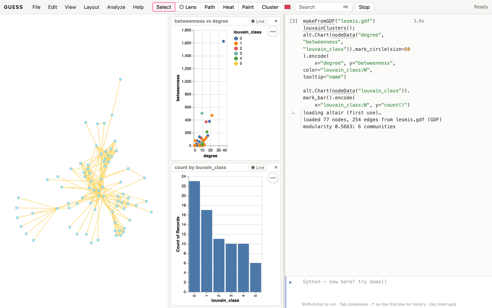
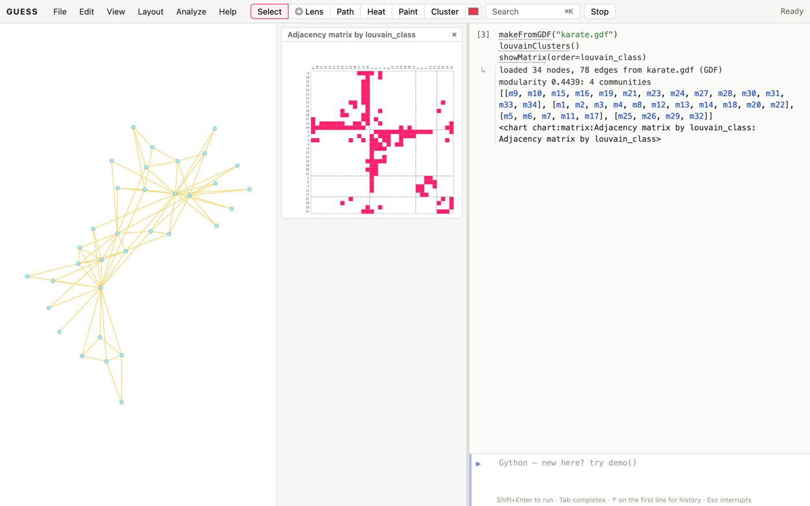
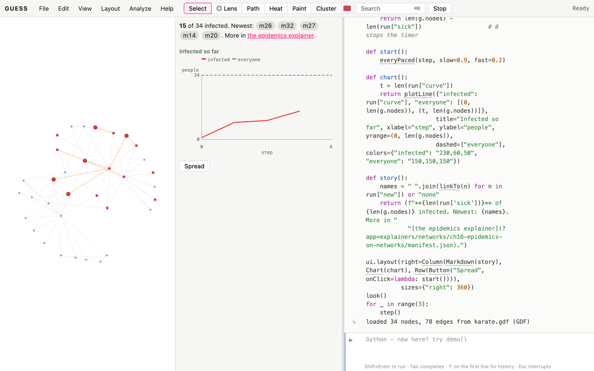

# About these cookbooks

Each "GUESS for X" cookbook is a set of short recipes for one field. This
one, the Kitchen, holds what they all share. The field books link back here
instead of repeating it.

Every recipe has the same parts:

- **You have / you want**: the situation and the goal, so you can tell
  quickly whether the recipe is the one you need.
- **Ingredients**: the data and commands it uses.
- **Steps**: code to type into the GUESS console (or paste, then
  Shift+Enter). Each recipe starts from scratch and loads its own data.
- **How it works**: what the commands did, and what the result means.
- **Variations** and **pitfalls**: related tasks, and where the method misleads.

Recipes are tagged *Basic*, *Intermediate* or *Advanced*. The data files
named in the steps are in the cookbooks' `data` folder. Open them with
*File → Open* (or drag them onto the page) and GUESS keeps a copy, so
`makeFromGDF("karate.gdf")` finds it afterwards. `sample.gdf` is the graph
GUESS opens with.

Every code sample in these books is run by the build, so if a recipe doesn't
work as printed, that's a bug: please report it.

# Getting data in

## Open a network file [Basic]{.level}

**You have** a network saved by another tool. **You want** it in GUESS.

::: ingredients
**Ingredients:** `karate.gdf` · `makeFromGDF` and friends
:::

```python
makeFromGDF("karate.gdf")
```

**How it works.** Each format has its own loader. All of them replace the
current graph, turn the file's attributes into fields, and keep the file's
positions if it has them:

| format | command |
|---|---|
| GDF (GUESS, GUESS 2006) | `makeFromGDF` |
| GraphML (yEd, Cytoscape, networkx) | `makeFromGraphML` |
| GEXF (Gephi) | `makeFromGEXF` |
| GML | `makeFromGML` |
| DOT (Graphviz) | `makeFromDOT` |
| Pajek `.net` | `makeFromPajek` |
| UCINET DL | `makeFromDL` |
| CSV / TSV | `makeFromCSV` (next recipe) |
| Excel `.xlsx` | `makeFromExcel` |
| Cytoscape: SIF, Cytoscape.js JSON, CX / CX2, XGMML, session `.cys`, nested networks | `makeFromSIF`, `makeFromCYJS`, `makeFromCX`, `makeFromXGMML`, `makeFromCYS`, `makeFromNNF` |
| Biology: PSI-MI TAB and XML, SBML, BioPAX, KEGG, WikiPathways | `makeFromMITAB`, `makeFromPSIMI`, `makeFromSBML`, `makeFromBioPAX`, `makeFromKGML`, `makeFromGPML` |
| RDF (Turtle, N-Triples, RDF/XML) | `makeFromRDF` |

`makeFromFile` picks the loader for you: from the extension, or from the
content when the extension doesn't say (`.xml`, `.txt`, `.json`), and
*File → Open* and dropping a file use it. In a script,
`makeFromURL("https://…/graph.gexf")` downloads and opens a file in one step.
`exportCYJS("g.cyjs")` writes a file Cytoscape opens.

**Variations.** `makeSample()` lists the classic networks GUESS has built in
(the karate club, *Les Misérables*, Florentine families, Davis's southern
women…). `makeSample("karate")` opens one without a file.

## Build a network from a spreadsheet [Basic]{.level}

**You have** a table of who is linked to whom. **You want** a network.

::: ingredients
**Ingredients:** `friends.csv` (columns Source, Target, Weight) · `makeFromCSV`
:::

```python
makeFromCSV("friends.csv")
getEdgeSchema()
```

**How it works.** A CSV whose first two columns are named Source and Target
(as Gephi expects) is read as an edge table: one row per edge, and every
other column becomes an edge field (`weight` here). A first row of node
names and a first column of the same names is read as an adjacency matrix
instead. Edges are undirected unless the table has a Type column saying
`Directed`, or you pass `directed=true`.

**Pitfalls.** Spreadsheets often list a tie once in each direction, or repeat
it per contact. Here, `ana,ben` appears three times. See *Merge duplicate
edges into weights*.

## Add attributes from a second table [Basic]{.level}

**You have** a network, plus a spreadsheet of facts about the nodes (age,
team, gene expression…). **You want** those facts as node fields.

::: ingredients
**Ingredients:** `friends.csv` · `friends-nodes.csv` (columns Id, team, age)
:::

```python
makeFromCSV("friends.csv")
makeFromCSV("friends-nodes.csv")
ana.team, ana.age
```

**How it works.** Opening a CSV with an `Id` column but no Source/Target
doesn't replace the graph. It adds the columns to the nodes whose names
match the Id, and creates nodes for Ids that aren't in the network yet
(`ivy`, who has no ties). Numbers become numeric fields, so `age > 30` works
straight away.

**Variations.** `makeFromCSV("edges.csv", "nodes.csv")` reads both tables at
once.

## Bring in a networkx or igraph graph [Intermediate]{.level}

**You have** a graph built in Python, or want an algorithm GUESS doesn't
have. **You want** to move between GUESS and networkx.

::: ingredients
**Ingredients:** `toNetworkX` · `fromNetworkX` · `setField`
:::

```python
makeFromGDF("karate.gdf")
import networkx as nx
G = toNetworkX()
setField(nx.load_centrality(G), "load")
sortBy(load)[-3:]
```

**How it works.** `toNetworkX()` hands you the current graph with every
field as an attribute. `setField(result, "name")` stores what a networkx
function returns: a dict of node values becomes a node field, a dict of
node pairs becomes an edge field, and a list of node sets (communities)
becomes a field holding each node's group number. `fromNetworkX(G)` goes
the other way and replaces the graph.

# Cleaning

## Merge duplicate edges into weights [Basic]{.level}

**You have** the same tie listed many times. **You want** one edge per pair,
weighted by how often (or how much) it occurred.

::: ingredients
**Ingredients:** `friends.csv` · `simplify`
:::

```python
makeFromCSV("friends.csv")
simplify()
(ana <-> ben).weight
```

**How it works.** `simplify()` merges edges joining the same two nodes (in
the same direction, for directed edges) and adds up their weights. It also
removes self-loops (`fay` to `fay`). `combine="max"`, `"mean"`, `"min"` or
`"first"` combine weights differently. It's one undo step.

## Drop isolates and keep the main component [Basic]{.level}

**You have** a network with stray nodes and small fragments. **You want** to
analyse the connected core.

::: ingredients
**Ingredients:** `friends.csv`, `friends-nodes.csv` · `giantComponent` · `removeDisconnected`
:::

```python
makeFromCSV("friends.csv"); makeFromCSV("friends-nodes.csv"); simplify()
removeDisconnected()                # ivy, who has no ties
showOnly(giantComponent())          # hide gus and hal's pair
```

**How it works.** `removeDisconnected()` deletes nodes with no edges and
returns them. `giantComponent()` is the largest connected piece.
`showOnly` hides the rest without deleting it (`showAll()` brings it back),
while `remove(g.nodes - giantComponent())` deletes it.

**Pitfalls.** Measures like closeness and average path length are only
meaningful within a component. Decide whether fragments are noise or
findings before you drop them.

## Make, rename and fill fields [Basic]{.level}

**You have** values to store or derive. **You want** them as fields you can
query, colour and size by.

```python
makeFromGDF("sample.gdf")
addNodeField("senior", BOOLEAN, false)
(dept == "dept4").senior = true
addEdgeField("heavy", BOOLEAN, false)
(freq > 50).heavy = true
getNodeSchema()
```

**How it works.** `addNodeField(name, type, default)` and `addEdgeField`
create a field with a default value. Assigning to a set (`(… ).senior =
true`) sets it on every member. The types are `VARCHAR` (text), `INTEGER`,
`DOUBLE`, `BOOLEAN`. Python works too:
`for n in g.nodes: n.senior = n.degree > 5`.

**Pitfalls.** Field, node and colour names are reserved, so they can't
be used as variable names. `x = 5` is an error because `x` is the field
holding each node's position, and so are `size`, `color`, `label` and your
own fields' names. Pick another name (`xs = …`).

# Asking questions

## Select by value [Basic]{.level}

**You have** a field. **You want** the nodes or edges that match.

```python
makeFromGDF("sample.gdf")
dept4 = (dept == "dept4")
busy = (freq > 100)
dept.find("dept9")                 # the same as dept == "dept9"
(dept like "dept1%")               # SQL patterns: % any run, _ one character
len(dept4), len(busy)
```

**How it works.** In GUESS, comparing a field with a value doesn't give
`True`/`False`; it gives the set of matching elements. Sets can be coloured,
hidden, counted or passed to any command. `field.find(value)` is a
plain-method spelling of `field == value`.

## Combine and subtract sets [Basic]{.level}

```python
makeFromGDF("sample.gdf")
a = (dept == "dept4")
b = (degree > 5)
(a & b).color = red                 # in dept4 and well connected
(a | b).size = 20                   # either
a.difference(b).color = orange      # in dept4 but not well connected
```

**How it works.** `&` is intersection and `|` union, and `.difference()`
removes members. They work on any GUESS sets, including edges. Assigning a
field on a set assigns it on every member.

**Pitfalls.** Between sets of nodes, `-` doesn't subtract: `a - b` is the
*edges* joining `a` and `b` (see the next recipe). Use `.difference()`.

## Find the edges between groups [Basic]{.level}

**You want** the ties linking two sets of nodes, or the ties of one node.

```python
makeFromGDF("sample.gdf")
a = (dept == "dept4"); b = (dept == "dept9")
(a <-> b).color = red               # edges between the two departments (also a - b)
(v1 -> g.nodes).width = 4            # v1's outgoing edges
interEdges(dept).color = gray        # every edge that crosses departments
```

**How it works.** `->`, `<-` and `<->` between nodes or sets give the
edges in that direction (`<->` either way). `interEdges(field)` and
`intraEdges(field)` give the edges that cross between values of a field or
stay within one.

## Rank and group [Basic]{.level}

```python
makeFromGDF("sample.gdf")
sortBy(betweenness)[-5:]                    # the top five
[(grp[0].dept, len(grp)) for grp in groupBy(dept)]
dept.distinct                               # every value once
table(dept == "dept4")                      # look at them in the data table
```

**How it works.** `sortBy(field)` sorts ascending, so the largest values
are at the end. `groupBy(field)` returns one set per value, and
`groupAndSortBy` orders the groups by size. `table(seq)` opens the data
table on just those rows, where you can sort columns and edit values.

# Measuring

## Size, density and the usual summary [Basic]{.level}

```python
makeFromGDF("karate.gdf")
graphStats()
```

**How it works.** `graphStats()` prints the measures most papers report:
nodes, edges, density, mean degree, components, diameter, average path
length, average clustering, transitivity and degree assortativity (plus
reciprocity for directed graphs). Each is also a command on its own
(`density()`, `diameter()`, `transitivity()`…).

## Who is central? [Basic]{.level}

**You want** to find the important nodes, and to know which kind of
important you mean.

```python
makeFromGDF("karate.gdf")
frLayout()
sizeBy(betweenness, 8, 40)
colorBy(closeness, yellow, red)
labelBy(label)
```


**How it works.** These centrality fields are computed the first time you
use them:

| field | high when a node… |
|---|---|
| `degree`, `indegree`, `outdegree` | has many ties |
| `strength` | has heavy ties (sum of weights) |
| `betweenness` | lies on many shortest paths: a broker or gatekeeper |
| `closeness`, `harmonic` | is few steps from everyone (`harmonic` copes with fragments) |
| `eigenvector` | is tied to nodes that are themselves well tied |
| `pagerank` | is pointed to by important nodes (directed) |
| `hub`, `authority` | points to good authorities / is pointed to by good hubs |
| `constraint`, `effsize` | spans structural holes (Burt): low constraint = broker |
| `coreness` | sits in a deep k-core |

**Pitfalls.** Centralities disagree, and the disagreement is informative: a
node with low degree but high betweenness is a bridge between groups. Don't
report "the most central" node without saying which measure.

## Look at distributions [Basic]{.level}

```python
makeFromGDF("lesmis.gdf")
plotHistogram(degree)
plotDistrib(betweenness)
```

**How it works.** `plotHistogram(field)` counts values in bins.
`plotDistrib(field)` plots each node's value in rank order, which makes
heavy tails (a few hubs, many small nodes) obvious. The charts appear in a
panel and can be saved as images.

## Scatter two measures [Basic]{.level}

**You want** to see how two measures go together: are the best-connected
characters also the ones on most shortest paths?

```python
makeFromGDF("lesmis.gdf")
plotScatter(degree, betweenness)                            # one dot per node
plotScatter(degree, ends=true, line=[(1, 1), (36, 36)])     # degree at both ends of every edge
```



**How it works.** `plotScatter(x, y)` draws one dot per node (or edge, for
edge fields) in the element's own colour. Pointing at a dot highlights its
node in the graph, and clicking selects it, so the outliers are a click
away: here, characters with modest degree but high betweenness are the
brokers between parts of the story. `plotScatter(field, ends=true)` plots
the value at one end of every edge against the other end (both ways round
for undirected edges). Dots near the diagonal mean like links to like,
which is what `assortativity(field)` measures. `line=` adds a dashed
reference line, `log=true` (or `logX=`, `logY=`) uses log axes, and
`xrange=`/`yrange=` fix the axes.

**Pitfalls.** Many dots on top of each other look like one: use log axes for
heavy-tailed measures, or colour the nodes first (`colorize(...)`) so the
dots carry a third variable.

## Fit a power law [Intermediate]{.level}

**You want** to know whether a degree distribution has a power-law tail,
p(k) ∝ k^−α, and what α is.

```python
makeFromGDF("polblogs-sample.gdf")
plotFrequency(degree, cumulative=true, log=true, fit=true)
fitPowerLaw(degree)                       # {'alpha': ..., 'sigma': ..., 'kmin': ..., 'n': ..., 'ks': ...}
```



```python
import csv
rows = list(csv.DictReader(open("degree-sequences.csv")))
internet = [int(r["degree"]) for r in rows if r["network"].startswith("Internet")
            for _ in range(int(r["count"]))]
fitPowerLaw(internet)                     # the whole 2006 Internet: alpha about 2.08, from k = 5
```

**How it works.** `plotFrequency(field, cumulative=true, log=true)` plots
the share of nodes with at least each degree, which is much less noisy in
the tail than a histogram. `fit=true` adds the fitted power law as a dashed
line. `fitPowerLaw` estimates α by maximum likelihood (not by drawing a
line through the log-log plot, which is biased) and gives its standard
error `sigma`. Unless you pass `kmin=`, it chooses where the tail starts
by the Kolmogorov–Smirnov method; `n` is how many values the fit used. It
also takes a plain list of numbers, as for the Internet's 22,963 degrees in
`degree-sequences.csv`, a network too big to draw.

**Pitfalls.**

- A tail of a few dozen nodes can't establish a power law: look at `n` and
  `sigma` before quoting α.
- A small KS distance doesn't rule out other heavy tails, such as an
  exponential or log-normal one; compare them before claiming a power law.
- Some growth models give a power law in k + a rather than k (Price's model,
  for one). `fitPowerLaw(degree, shift=a)` fits that form; fitting k
  directly then reads too low.

## Charts of your own with Altair [Intermediate]{.level}

**You want** a chart GUESS has no command for, such as one measure plotted
against another, and you want it linked to the graph like the built-in charts.

::: ingredients
**Ingredients:** `lesmis.gdf` · `nodeData` · Altair (`alt`)
:::

```python
makeFromGDF("lesmis.gdf")
louvainClusters();
alt.Chart(nodeData("degree", "betweenness", "louvain_class")).mark_circle(size=60).encode(
    x="degree", y="betweenness", color="louvain_class:N", tooltip="name")
```

```python
alt.Chart(nodeData("louvain_class")).mark_bar().encode(
    x="louvain_class:N", y="count()")
```



**How it works.** `nodeData(...)` gives one row per character with the
fields you name, and [Altair](https://altair-viz.github.io) turns rows into
any chart. A cell whose value is a chart shows it in the dock. `alt` is
imported the first time you use it. GUESS knows `degree` is a number and
`louvain_class` a field, so plain `x="degree"` works; the `:N` asks for the
community numbers to be treated as categories. Valjean stands far above
everyone in the scatter: betweenness 1624 with 36 contacts. Each row carries
its character's id, so pointing at a dot highlights that character in the
graph and clicking selects them. A bar stands for the query it counts
(`louvain_class == 2`): pointing at it lights up the whole community, and
clicking selects it.

**Variations.** Add `.add_params(alt.selection_interval())` to the scatter
and drag a box over it: the characters inside are selected, and `sel` holds
them. Click *● Live* on a chart and it redraws after every change. Run
`louvainClusters();` again and the bar chart follows. `nodeData(dept ==
"x", ...)` charts just some nodes, and `edgeData("weight")` gives one row
per edge.

## Read the adjacency matrix [Intermediate]{.level}

**You want** the network as a matrix, with groups as blocks.

```python
makeFromGDF("karate.gdf")
louvainClusters()
showMatrix(order=louvain_class)
```



```python
makeFromGDF("southern-women.gdf")
showMatrix(rows=(kind == "event"), cols=(kind == "woman"), numbers=true)
```

**How it works.** `showMatrix()` draws a row and a column per node and a
dark cell for each edge. `order=field` sorts the rows and columns by a
field, with lines between its groups, so communities show as dense blocks
on the diagonal. `weight=` shades cells by an edge field, and
`numbers=true` writes each cell's value (for small matrices). `rows=` and
`cols=` give a rectangular matrix, such as the incidence matrix of people
and the events they attended. Pointing at a cell highlights its edge and
two nodes.

**Pitfalls.** Without an order the matrix looks like noise even when the
network has strong groups: the blocks only appear once rows are sorted by
something meaningful. Above a few hundred nodes, cells shrink below a pixel.

## Paths and distances [Basic]{.level}

```python
makeFromGDF("lesmis.gdf")
p = shortestPath(Napoleon, Javert)
p.color = red
heatMap(Valjean)                       # colour everyone by hops from Valjean
averagePathLength(), diameter()
```

**How it works.** `shortestPath(a, b)` returns the nodes and edges of one
shortest path. `weighted=true` treats the edge weight as a length (so
heavier means farther; invert weights first if they measure strength).
`heatMap(node)` colours by distance and stores it in `hops`.

## Coordinates for machine learning [Advanced]{.level}

**You want** to feed network position into a statistical model or a
classifier, which needs numbers per node, not a graph.

```python
makeFromGDF("karate.gdf")
embed(8, seed=1)
scatterLayout(emb0, emb1)
colorize(club)
```

**How it works.** `embed(dims)` gives each node coordinates (fields `emb0`,
`emb1`…) such that nodes in similar network positions are close
(node2vec). It takes many short random walks and factorises how often
nodes appear near each other. `scatterLayout(emb0, emb1)` draws the first
two coordinates. In the karate club the first coordinate alone separates
the two sides fairly well (its correlation with `club` is about −0.6). The
fields export with the rest of the data (`exportCSV`) for use in any
modelling tool. `p` and `q` tune the walks: low `q` explores outwards
(communities), low `p` stays local (roles).

# Finding structure

## Components, bridges and cut points [Basic]{.level}

```python
makeFromGDF("sample.gdf")
colorize(component)
bridges().color = red                   # edges whose removal splits a part
cutNodes().size = 25                    # nodes whose removal splits a part
```

**How it works.** `component` numbers each connected piece (0 = largest).
`strongcomponent` is the directed version. A bridge is the only link
between two parts. A cut node holds two parts together. Both are where a
network is fragile.

## Cores and cliques [Intermediate]{.level}

```python
makeFromGDF("karate.gdf")
colorBy(coreness, lightgray, red)
largestCliques()
showOnly(kCore(4))
```

**How it works.** The *k*-core is what remains after repeatedly removing
nodes with fewer than *k* ties. `coreness` is the deepest core each node
belongs to. A clique is a group in which everyone is tied to everyone.
`largestCliques()` returns the biggest ones. Cores are robust and
cliques are brittle (one missing tie breaks a clique), so prefer cores for
noisy data.

## Communities [Basic]{.level}

**You want** groups of nodes more tied to each other than to the rest.

```python
makeFromGDF("karate.gdf")
frLayout()
leidenClusters()
colorize(leiden_class)
createConvexHull(leiden_class == 0, "255,200,200,90")
legendFor(leiden_class)
```


**How it works.** GUESS has many community methods. Each stores the result as
a field (0 = the largest community):

| command | field | good for |
|---|---|---|
| `louvainClusters()` | `louvain_class` | fast, standard (Gephi's "Modularity") |
| `leidenClusters()` | `leiden_class` | like Louvain, but every community is connected |
| `infomapClusters()` | `infomap_class` | directed flow: citations, web links |
| `walktrapClusters()`, `fastGreedyClusters()`, `labelPropagationClusters()`, … | | alternatives to compare |
| `edgeBetweennessClusters(n)` | | small graphs; a hierarchy you can cut |

`resolution=` (Louvain, Leiden) above 1 gives more, smaller communities.
`modularity(field)` scores any partition, including one you supply
(`modularity(dept)`).

Hierarchical methods (walktrap, fast greedy) build a tree of merges. Draw
it to choose how many communities to keep:

```python
walktrapClusters()
showDendrogram(cut=4, paint=true)         # the tree, cut into 4 groups, nodes coloured to match
```

Pointing at a branch highlights its nodes; `cut=k` colours the k groups,
`paint=true` gives the nodes the same colours, and `field="name"` stores
the groups. `cutDendrogram(k)` re-cuts the stored field.

**Pitfalls.** Every method finds communities, even in random graphs. Check
that the modularity is well above what you get after `rewire()`, and that
the result is stable (`seed=None`, run again, then `compareClusters`).

## Compare two groupings [Intermediate]{.level}

```python
makeFromGDF("sample.gdf")
louvainClusters()
compareClusters(louvain_class, dept)               # 0 = unrelated, 1 = identical
compareClusters(louvain_class, dept, method="ari")
mixingMatrix(dept)
```

**How it works.** `compareClusters` gives normalized mutual information (or
the adjusted Rand index) between two partitions, such as found communities
and a known attribute. `mixingMatrix(field)` counts edges between each pair
of values, which shows *which* groups mix.

To test a method where the right answer is known, run it on a benchmark
network with planted communities:

```python
makeLFR(250, mu=0.3, seed=1)              # 30% of each node's edges leave its community
louvainClusters()
compareClusters(louvain_class, community) # near 1 for small mu; falls as mu grows
```

`makeLFR` gives the planted groups in the field `community`. Every method
finds them when `mu` is small and fails somewhere between about 0.3 and 0.5.
Where it fails, and how gracefully, is the fair comparison between methods.

## Compare with a random network [Intermediate]{.level}

**You want** to know whether a measure is surprising, or just what any
network with the same degrees would give.

```python
makeFromGDF("karate.gdf")
real = (averageClustering(), assortativity())
makeConfigurationModel(degree, simple=true)      # the same degrees, wired at random
wired = (averageClustering(), assortativity())
makeErdosRenyiRandom(34, 0.139)                  # only the same size and density
plain = averageClustering()
print(real, wired, plain)
```

**How it works.** A random network with the same degrees as the real one
(the configuration model) is the usual baseline: whatever it shares with the
real network comes from the degrees alone. The karate club's clustering
(0.57) is more than twice the rewired network's (about 0.23): the club's
triangles are real structure, not an effect of its hubs.
`makeConfigurationModel(degree)` copies the current graph's degrees (any
numeric field or list works); `simple=true` removes the self-loops and
repeated edges the random wiring makes. `makeExpectedDegree(weights)` joins
each pair independently with probability w_i w_j / Σw instead.
`makeErdosRenyiRandom(n, p)` keeps only the size and density. `rewire()`
does the same as the configuration model in place, by swapping edge ends.

**Pitfalls.**

- One random network is one sample: repeat with different seeds and compare
  with the spread, not a single value.
- Random generators are seeded (`seed=0` by default), so the same call gives
  the same network every time. Pass `seed=None` for a new one each time, or
  other numbers for a set of samples.
- The generators replace the current graph; save it first (`saveState`) or
  use a separate graph (`newGraph`).

## Collapse groups into single nodes [Intermediate]{.level}

```python
makeFromGDF("sample.gdf")
collapseBy(dept)
```

**How it works.** Each department becomes one meta-node, with edges summarising
the ties between departments. `expand(node)` or `expandAll()` opens them
again. Double-clicking a meta-node in the display does the same.

# Laying out

## Choose a layout [Basic]{.level}

```python
makeFromGDF("lesmis.gdf")
forceAtlas2Layout()
```

**How it works.** No layout is "correct". Choose by what you want to see:

| you want | try |
|---|---|
| clusters to separate | `forceAtlas2Layout()`, `frLayout()`, `sfdpLayout()` (large graphs) |
| distances to mean graph distance | `kkLayout()`, `neatoLayout()`, `mdsLayout()` |
| a hierarchy or flow, top to bottom | `dotLayout()`, `sugiyamaLayout()`, `dagLayout()` |
| one node's view of the world | `radialLayout(node)`, `twopiLayout()` |
| groups on a circle | `circleLayout()`, `circoLayout()`, `hiveLayout(field)` |
| two kinds of node | `bipartiteLayout(field)` |
| attributes as coordinates | `scatterLayout(x, y)` |

Layouts start from the current positions, so running one twice refines it.
`removeOverlap()` (or `noverlapLayout()`) pushes overlapping nodes apart
afterwards. For a hand-drawn look, `lombardiLayout()` draws edges as
circular arcs that leave each node at evenly spread angles (a "Lombardi
drawing"), and `lombardiEdges()` rounds the edges of any layout without
moving the nodes:

```python
makeFromGDF("karate.gdf")
lombardiLayout()                          # returns how even the angles were, before and after
```

Layouts are seeded, so the same network and starting positions give the
same picture every time.

## Pin nodes while the rest moves [Basic]{.level}

```python
makeFromGDF("karate.gdf")
m1.x, m1.y = 100, 500
m34.x, m34.y = 900, 500
(m1, m34).fixed = true
frLayout()
```

**How it works.** Nodes with `fixed = true` stay put during layouts, and the
others arrange themselves around them. Here the two rival leaders anchor
the two ends of the picture. Dragging a node with the mouse also moves it.

# Drawing

## Colour, size and shape by data [Basic]{.level}

```python
makeFromGDF("sample.gdf")
colorize(dept)                     # a distinct colour per value
sizeBy(degree, 6, 30)              # proportional to a number
shapeBy(jobfun)                    # a shape per value
sizeBy(freq, 1, 6)                 # edge widths, for an edge field
legendFor(dept)
```

**How it works.** `colorize` is for categories; `colorBy(field, low, high)`
is a gradient for numbers. `sizeBy(field, min, max)` scales sizes
(`scale="log"` or `"sqrt"` for skewed values). `resizeLinear` spaces
sizes by rank. Legends follow the colours: re-run `colorize` and the legend
updates.

```python
directedEdges("arrow")       # arrowheads on directed edges
directedEdges("taper")       # back to the default: wide at the source, a point at the target
v1.strokewidth = 4           # a thicker outline marks one node
```

Directed edges are drawn tapered by default, with no arrowhead: in a user
study (Holten and van Wijk, CHI 2009), tapered edges were read fastest and
most accurately, and arrowheads among the worst. `directedEdges("fade")`
uses a dark-to-light ramp instead. A node's `strokewidth` field sets its
outline (0 = the display's default), which is a good way to mark a state
without changing the fill. For a cyclic value, such as a phase or an angle,
`colorByPhase(field, period=)` colours around a colour wheel so the two ends
of the cycle match.

## Labels that don't collide [Basic]{.level}

```python
makeFromGDF("lesmis.gdf")
forceAtlas2Layout()
sizeBy(degree, 5, 30)
g.nodes.labelvisible = true
g.nodes.labelpos = "outside"
optimizeLabels()
hideOverlappingLabels()
```

**How it works.** `labelpos` is where a node's label goes: `"right"`,
`"left"`, `"above"`, `"below"`, `"inside"` (fitted into the shape), or `"outside"`, which lets
GUESS choose a free spot. `optimizeLabels()` runs a longer search for
positions, and `hideOverlappingLabels()` drops the labels that still
collide, smallest nodes first. `labelSizeBy(degree)` makes important labels
bigger. `constantLabelSize(size=14)` keeps labels the same size on screen as
you zoom, so they stay readable on a big graph (zooming in then reveals
more of them).

## Outline groups and bundle the hairball [Intermediate]{.level}

```python
makeFromGDF("lesmis.gdf")
forceAtlas2Layout()
louvainClusters(); colorize(louvain_class)
for grp in groupBy(louvain_class): createConvexHull(grp)
bundleEdges()
```

**How it works.** `createConvexHull(set)` shades the area around a set of
nodes. `bundleEdges()` gathers edges that run in the same direction into
bundles (MINGLE). `method="fdeb"` gives smoother curves, and passing a
field (`bundleEdges(louvain_class)`) bundles within groups.
`removeBundles()` undoes it.

## Simplify a hairball with motifs [Intermediate]{.level}

```python
makeFromGDF("sample.gdf")
findMotifs("fan", 3)
collapseMotifs("fan", 3)
len(g.nodes)
```

**How it works.** Big drawings are cluttered by small repeated shapes:
*fans* (several leaves hanging off one node), *connectors* (nodes that all
link to the same few others and nothing else) and *cliques*.
`findMotifs(kind, minimum)` finds them, and `collapseMotifs` replaces each
with a single meta-node labelled with its kind and size. Here the
organisation's 26 fans collapse, taking it from 402 nodes to 303 without
losing anything: double-click a meta-node, or `expandAll()`, to open it.

## Explore a crowded area with the lens [Basic]{.level}

Press **L** (or the Lens button in the toolbar) and move over a dense area: the lens
lists the labels of everything under it, in a column beside the cursor,
with lines to each node. The mouse wheel resizes it, Shift+wheel scrolls
long lists, and a click pins it. `excentricLens(true, radius=80)` turns it
on from the console.

# Change over time

## Save, compare and animate states [Intermediate]{.level}

```python
makeFromGDF("karate.gdf")
frLayout()
ss("before")
remove(m1)                        # what if the instructor leaves?
colorize(component)
ss("after")
morph("before", 1500)
```

**How it works.** `ss(name)` saves the whole graph (membership, positions,
every field) as a named state. `ls(name)` returns to it, and
`morph(name, ms)` animates the change. Fields can be read in a state:
`betweenness["before"]`, `m2["before"].color`. States can be named with
numbers (`ss(1999)`), which suits snapshots over time.

## Show a network as of a date [Intermediate]{.level}

```python
makeFromGDF("sample.gdf")
addEdgeField("since", INTEGER, 0)
for e in g.edges: e.since = e.freq          # pretend freq is a year
showTime(60, since)                         # edges that exist by "60"
showTime(150, since, window=50)             # only the last 50
```

**How it works.** `showTime(t, field)` shows only elements whose numeric
field is at most `t` (and within `window` of it, if given). For
elements that come and go, give them ranges with `addRange(node,
"1999-2003,2007")` and use `showTime(t)`. *View → Timeline* gives a slider.

To replay how a network grew, lay out the *final* network once and reveal
it in arrival order, so every node appears where it will stay:

```python
makePriceModel(200, c=2, a=1)             # a citation network; born = when each paper arrived
center(g.nodes)                           # frame the final picture
revealUpTo(20)                            # the first 20 papers and their citations
revealUpTo(199)                           # everything
```

`revealUpTo(step)` shows the nodes whose `born` field (or `field=`) is at
most `step`, and the edges between them, and returns what arrived at exactly
that step, ready to highlight. The growth models (`makePriceModel`,
`makeBarabasiAlbertRandom`, `makeGrowingNetwork`, `makeCopyingModel`) set
`born` themselves; for your own data, store the step or year in a field.

# Sharing

## Export a figure [Basic]{.level}

```python
makeFromGDF("karate.gdf")
frLayout(); colorize(club)
exportSVG("karate.svg")
exportPDF("karate.pdf")
exportPNG("karate.png")
```

**How it works.** SVG and PDF are vector: the whole graph, at any size, with
labels and legends, ready for a paper. PNG is the current view as you see it.

## Tell a story with slides [Intermediate]{.level}

```python
makeFromGDF("karate.gdf")
frLayout()
addSlide("The club before the split")
colorize(club)
addSlide("The two factions")
slides()
```

**How it works.** `addSlide(note)` saves the graph and the camera as a
slide, and the Slides panel plays them, morphing from one to the next.

## A one-page report [Basic]{.level}

```python
makeFromGDF("karate.gdf")
louvainClusters()
report()
report("karate-report.html")
```

**How it works.** `report()` prints a summary of the graph: size, density,
components, the degree distribution, path lengths, clustering,
assortativity, the top nodes by degree, betweenness and PageRank, and any
communities found so far. `report("name.html")` (or `.md`) saves it as a
page to share. In the browser, it's offered as a download.

## A web page anyone can open [Basic]{.level}

**You want** to share an interactive network with people who don't use
GUESS.

```python
makeFromGDF("karate.gdf")
louvainClusters(); colorize(louvain_class)
legendFor(louvain_class)
sizeBy(betweenness, 8, 30)
exportHTML("karate.html", title="The karate club")
```

**How it works.** `exportHTML` writes one self-contained page: the graph,
its fields and legends, and a small viewer, with nothing to install and no
connection needed. Readers can pan and zoom, search for a node, hover to
read its fields and click to see its neighbours. It follows their light or
dark setting. Email it, or put it on any web server.
`exportJSON("karate.json")` writes the same graph for sigma.js and other
web libraries.

**Pitfalls.** The page holds all the data fields. `fields=false` leaves
them out when some shouldn't travel.

## Work with an AI assistant [Basic]{.level}

**You want** an assistant such as Claude to help explore a network, in
your session, where you can see and undo what it does.

```python
connectAssistant()
```

**How it works.** The assistant reaches GUESS through `mcp/guess-mcp.mjs`,
a small bridge it starts itself once you add it to its MCP settings (see
the manual, *Working with an AI assistant*). After `connectAssistant()`,
*● assistant* shows in the toolbar. The assistant can run Gython, read a
summary of the graph and the command help, and look at the view.
Everything it runs appears in the console as a cell marked **assistant**,
so `undo()` and *Edit → History…* work on its steps as on yours.
`disconnectAssistant()` ends it.

**Pitfalls.** The assistant's service sees what its tools return, including
screenshots and summaries of your data. Don't connect it to data you
couldn't share with that service.

## Save your work and your method [Basic]{.level}

```python
makeFromGDF("karate.gdf")
louvainClusters(); colorize(louvain_class)
saveSession("karate-analysis.guess")
history()
```

**How it works.** `saveSession` writes everything (graph, fields, states,
view) to one file that `makeFromSession` (or *File → Open*) restores.
`history()` lists the commands you ran, which is your method: save it as a
`.py` file and `execfile` replays it on new data.

# Capstone

## Animate a process step by step [Advanced]{.level}

**You want** an app that runs a process on the network (here, an infection
spreading from the best-connected member of the karate club) slowly enough
to watch, with a live chart and a running commentary.

```python
import random
makeFromGDF("karate.gdf")
frLayout()
constantLabelSize(size=14)
rnd = random.Random(4)
first = max(g.nodes, key=lambda n: n.degree)
run = {"sick": {first.name}, "new": [first], "curve": [(0, 1)]}

def look():
    for n in g.nodes:
        ill = n.name in run["sick"]
        n.color = "230,60,50" if ill else "120,160,220"
        n.width = n.height = 26 if n in run["new"] else (18 if ill else 12)
        n.strokewidth = 3 if n in run["new"] else 0          # the newest cases stand out
    fresh = {n.name for n in run["new"]}
    for e in g.edges:                                        # the edges the infection just crossed
        hit = (e.node1.name in fresh) != (e.node2.name in fresh) \
            and e.node1.name in run["sick"] and e.node2.name in run["sick"]
        e.color, e.width, e.linestyle = ("240,140,30", 3, "flow") if hit else ("160,160,160,120", 1, "solid")

def step():
    new = [m for n in g.nodes if n.name in run["sick"] for m in n.getNeighbors()
           if m.name not in run["sick"] and rnd.random() < 0.25]
    new = list({m.name: m for m in new}.values())
    run["sick"] |= {m.name for m in new}
    run["new"] = new
    run["curve"].append((len(run["curve"]), len(run["sick"])))
    look()
    return len(g.nodes) - len(run["sick"])                   # 0 stops the timer

def start():
    everyPaced(step, slow=0.9, fast=0.2)

def chart():
    t = len(run["curve"])
    return plotLine({"infected": run["curve"], "everyone": [(0, len(g.nodes)), (t, len(g.nodes))]},
                    title="Infected so far", xlabel="step", ylabel="people", yrange=(0, len(g.nodes)),
                    dashed=["everyone"], colors={"infected": "230,60,50", "everyone": "150,150,150"})

def story():
    names = " ".join(linkTo(n) for n in run["new"]) or "none"
    return (f"**{len(run['sick'])}** of {len(g.nodes)} infected. Newest: {names}. More in "
            "[the epidemics explainer](?app=explainers/networks/ch16-epidemics-on-networks/manifest.json).")

ui.layout(right=Column(Markdown(story), Chart(chart), Row(Button("Spread", onClick=lambda: start()))),
          sizes={"right": 360})
look()
for _ in range(3):
    step()
```



**How it works.**

- **Pacing.** `everyPaced(step, slow=, fast=)` calls `step` on a timer that
  starts slow, speeds up, and slows down again as `step`'s return value (the
  steps left) runs out, so the start and end of a process can be watched
  and the middle doesn't drag. Returning 0 or `False` stops it; `steps=`
  fixes the number of steps instead.
- **Making changes visible.** The newest cases are bigger and outlined
  (`strokewidth`), and the edges the infection just crossed flow orange. A
  colour change alone is easy to miss on small nodes.
  `constantLabelSize(size=14)` keeps labels readable at any zoom.
- **Live text and charts.** `Markdown(story)` and `Chart(chart)` take
  functions, which run again after every step. `linkTo(n)` writes a chip
  that highlights its node when pointed at and selects it when clicked. A
  Markdown link to `?app=…/manifest.json` opens another app on the same
  site. In `plotLine`, `dashed=` and `colors=` mark a reference or theory
  curve and give it a matching colour.
- **Growth.** For a network that grows, build the final network first, lay it
  out once, and give each node and edge the step it arrives in a `born`
  field. Then call `revealUpTo(step)` from the timer, so each node appears
  where it will stay.

**Pitfalls.** A process that runs at full speed is over before anyone sees
it, which is what the pacing is for. Keep the work in `step` small: it runs
inside the timer, and in the browser a slow step stalls the whole page. Do
expensive simulations off screen and chart the results.

## Capstone: an explorer for any network [Advanced]{.level}

**The problem.** You've just been handed a network file and want a quick,
reusable way to look at it from every angle without typing a command for
each view. This recipe builds a small explorer that works on any graph:

- drop-downs to colour by any field and size by any numeric field;
- a slider that hides weakly connected nodes;
- buttons to find communities, lay out again and reset;
- a click shows everything known about a node, and a right-click focuses
  on its neighbourhood;
- the legend and status bar keep track of what's shown.

```python
makeFromGDF("sample.gdf")
fields = [f for f in getNodeSchema() if not f.builtin]          # the data's own fields
categories = [f.name for f in fields if len(f.distinct) <= 30]
numbers = [f.name for f in fields if all(isinstance(v, (int, float)) for v in f.values()) and len(f.distinct) > 1]
numbers = numbers + ["degree", "betweenness", "pagerank"]

def colour_by(name):
    if name in numbers and name not in categories:
        colorBy(name, lightgray, red)
    else:
        colorize(name)
    legendFor(name)
    StatusBar.setStatus(f"colour: {name}")

def size_by(name):
    sizeBy(name, 4, 30)

def min_degree(v):
    showOnly(degree >= int(v))
    shown.text = f"{len(degree >= int(v))} of {len(g.nodes)} nodes with degree >= {int(v)}"

def details(n):
    vals = ", ".join(f"{f.name}={getattr(n, f.name)}" for f in fields[:8])
    about.text = f"{n.name}: degree {n.degree}; {vals}"

def communities():
    louvainClusters()
    colour_by("louvain_class")

shown, about = Label(""), Label("click a node")
panel = Panel("Explore",
              Dropdown(categories + [n for n in numbers if n not in categories], label="colour", onChange=colour_by),
              Dropdown(numbers, label="size", onChange=size_by),
              Slider(0, 10, 0, label="minimum degree", onChange=min_degree),
              Button("Communities", onClick=communities),
              Button("Lay out", onClick=lambda: forceAtlas2Layout()),
              Button("Show all", onClick=lambda: (showAll(), min_degree(0))),
              shown, about, position="bottom")
ui.dock(panel)
graphevents.clickNode = details
item = NodeEditorPopup.addItem("Focus on neighbourhood")
item.menuEvent = lambda n: showOnly(egoNetwork(n, 2))
min_degree(0)
colour_by(max(categories, key=lambda c: len(getattr(Node, c).distinct)) if categories else "degree")
size_by("degree")
center()
```


**How it works.**

- **Reading the fields.** `getNodeSchema()` lists the graph's fields, and
  `builtin` marks GUESS's own (position, colour, visibility). The recipe
  sorts the data's fields into categories (few distinct values) and
  numbers, adds three computed measures, and offers them in two
  `Dropdown`s. Choosing one calls `colorize` or
  `colorBy` (with a live legend), or `sizeBy`, with the field's name:
  every command that takes a field also takes its name as a string.
- **Filtering.** The `Slider` calls `showOnly(degree >= v)`, a query
  built from its value.
- **The rest.** The buttons wrap commands from this book. `graphevents`
  and `NodeEditorPopup` add click and right-click behaviour. Because
  nothing in it names a field of the sample data, the explorer works
  unchanged on any file: replace the first line.
