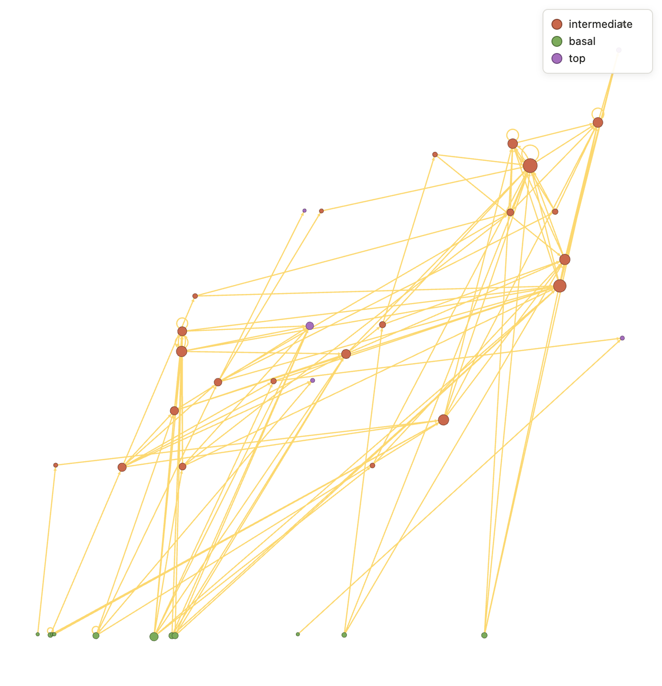
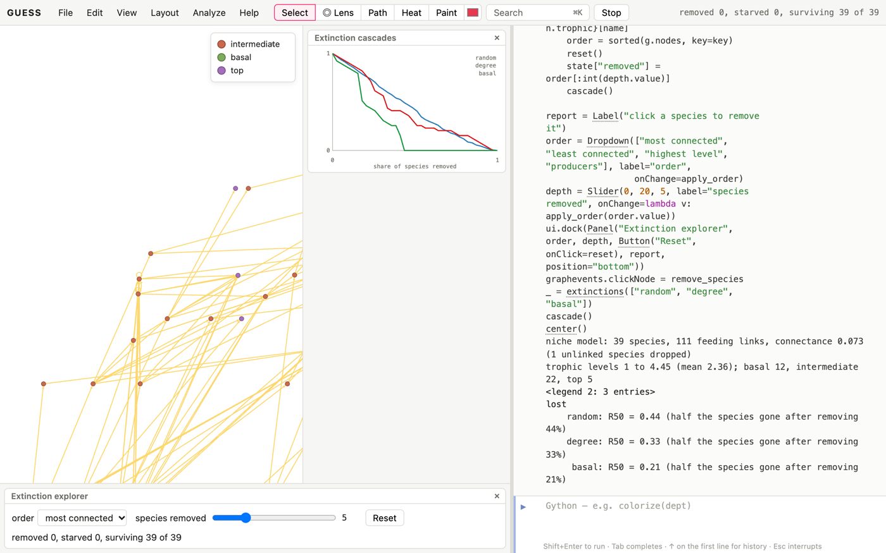

# Why networks?

An ecosystem is a network of who eats whom, who pollinates whom, who
parasitises whom. The network view asks questions about the whole that no
single species' biology answers:

- How long are the food chains, and who sits at the top?
- Which species does everything else depend on?
- If a species disappears, how many others follow it?
- Do communities split into compartments?
- Are mutualisms organised (nested), or random?

This book assumes the Kitchen. In its food webs, **edges run from food to
eater**, the direction energy flows. A species' `indegree` is how many
things it eats (its *generality*) and its `outdegree` how many things eat
it (its *vulnerability*).

Most recipes use model food webs that GUESS generates, so the numbers are
reproducible and need no data files. The niche model (first recipe)
produces webs with the structure of real ones. The real-data recipe uses
the Global Biotic Interactions database (GloBI), which needs an internet
connection.

# Food webs

## Build a food web and draw it by level [Basic]{.level}

**You want** a food web to work with, drawn so that the producers are at
the bottom and the top predators at the top.

::: ingredients
**Ingredients:** `makeNicheModel` · `trophicLevels` · `scatterLayout`
:::

```python
makeNicheModel(40, 0.12, seed=1)
trophicLevels()
scatterLayout(niche, trophic)
colorize(role)
sizeBy(degree, 6, 24)
legendFor(role)
```



**How it works.** `makeNicheModel(species, connectance)` places each
species on a niche axis from 0 to 1 and lets it eat every species whose
niche falls within a range below its own: the *niche model* of Williams
and Martinez (2000). It's simple, but its webs match many statistics of
real ones. Connectance is links ÷ species², the share of possible
feeding links that exist (0.05–0.3 in nature). The web you get varies
around it: this one has 39 species and 111 links, connectance 0.073.
`trophicLevels()` then computes each species' trophic level: 1 for
species that eat nothing in the web, otherwise one more than the average
level of what it eats. `scatterLayout(niche, trophic)` draws the classic
food-web picture.

## Who eats whom: roles and levels [Basic]{.level}

```python
makeNicheModel(40, 0.12, seed=1)
trophicLevels()
[(grp[0].role, len(grp)) for grp in groupBy(role)]
for n in sortBy(trophic)[-3:]: print(n.name, round(n.trophic, 2), n.role, n.indegree, n.outdegree, round(n.omnivory, 2))
```

**How it works.** `role` classifies species as *basal* (eats nothing in
the web: producers, or detritus), *top* (nothing in the web eats it) or
*intermediate*. Here there are 12 basal, 22 intermediate and 5 top species,
with trophic levels from 1 to 4.45 (mean 2.36). `omnivory` is the spread
of the levels a species eats from. A strict herbivore has 0, and a species
eating plants and carnivores alike has a high value. Omnivory is common in
real webs, and it blurs the textbook picture of neat levels.

**Pitfalls.** Trophic levels depend on resolution. A web that lumps
"phytoplankton" into one node and splits fish into twenty species will
have long chains at the top and short ones at the bottom, whatever nature
does. Compare webs only at similar resolution.

## What does a predator depend on? [Basic]{.level}

```python
makeNicheModel(40, 0.12, seed=1)
trophicLevels()
top = sortBy(trophic)[-1]
needs = ancestors(top)
needs.color = orange
top.color = red
len(needs), len(g.nodes)
```

**How it works.** Following edges backwards from a predator, `ancestors`
gives everything upstream: its food, its food's food, down to the
producers. The highest predator here depends, directly or indirectly, on
33 of the 39 species. `descendants(species)` goes the other way: every
species that eats it, or eats something that does.

# Keystones and extinctions

## Extinction cascades [Intermediate]{.level}

**You want** to know how a web responds to species loss, and which losses
hurt most.

::: ingredients
**Ingredients:** a food web · `extinctions`
:::

```python
makeNicheModel(40, 0.12, seed=1)
r = extinctions(["random", "degree", "least", "basal"])
```

**How it works.** `extinctions()` removes species one by one (*primary*
extinctions), and any species left with nothing to eat dies out too
(*secondary* extinctions). Basal species never starve. It plots the share
of species surviving as removals proceed, and prints **R50**, the share
of primary removals that costs half the species. Higher is more robust.
For this web:

| removal order | R50 |
|---|---|
| random | 0.44 |
| least connected first | 0.44 |
| most connected first (`"degree"`) | 0.33 |
| producers first (`"basal"`) | 0.21 |

Losing the most connected species first does more harm than random loss,
and losing producers first does the most. The most connected species
here are intermediate predators, and many species depend on them
through few routes. The graph isn't changed, so try any order, including
a field of your own (`extinctions(threat)`).

**Pitfalls.** This is a topological model. Real secondary extinctions also
happen through population dynamics: a predator released from control, a
competitor freed. Those can make cascades worse than topology predicts
(when a top predator goes) or better (when consumers switch prey).

## Find the keystone species [Intermediate]{.level}

```python
makeNicheModel(40, 0.12, seed=1)
addNodeField("cascade", INTEGER, 0)
import networkx as nx
G = toNetworkX()
for n in g.nodes:
    H = G.copy()
    H.remove_node(n.name)
    gone = 1
    changed = True
    while changed:
        changed = False
        for sp in list(H):
            if G.in_degree(sp) > 0 and H.in_degree(sp) == 0:
                H.remove_node(sp)
                gone += 1
                changed = True
    n.cascade = gone - 1
for n in sortBy(cascade)[-5:]: print(n.name, n.cascade, n.degree)
sizeBy(cascade, 6, 30)
```

**How it works.** A *keystone* is a species whose loss causes losses out of
proportion to its abundance or links. This recipe removes each species in
turn from a copy of the web (`toNetworkX()`), lets the starving consumers
die out, and stores how many species followed it in `cascade`. Sizing by
`cascade` shows the keystones at once. In this web no single loss is
catastrophic: the worst, `s17`, takes three other species with it. The
species that set off cascades are producers and low-level consumers
(trophic levels 1 to 2.5) that some consumers depend on entirely. They
are not the best-connected species, which have 11 to 16 links and set off
no cascade at all.

# Structure

## Compartments [Basic]{.level}

```python
makeNicheModel(40, 0.12, seed=1)
trophicLevels()
louvainClusters()
colorize(modularity_class)
scatterLayout(niche, trophic)
```

**How it works.** Food webs are often *compartmentalised*: groups of
species that interact mostly among themselves, such as a soil web and a
canopy web. Compartments slow the spread of disturbances. Here Louvain
finds four compartments (modularity 0.44). In a niche-model web they are
overlapping stretches of the niche axis (from 0–0.65 up to 0.5–0.94),
because species eat near their own niche.

# Mutualistic networks

## Is a pollination network nested? [Advanced]{.level}

**You have** a plant–pollinator (or seed-disperser, or host–parasite)
network. **You want** to know whether it's *nested*: specialists
interacting with subsets of the generalists' partners.

::: ingredients
**Ingredients:** a two-mode network · `nestedness` · `rewire(keep=…)`
:::

```python
import random
addNodeField("kind", VARCHAR, None)
rng = random.Random(4)
plants = [addNode(f"plant{i}") for i in range(15)]
bees = [addNode(f"bee{i}") for i in range(25)]
for p in plants: p.kind = "plant"
for b in bees: b.kind = "pollinator"
ap = [rng.paretovariate(1.2) for _ in plants]
ab = [rng.paretovariate(1.2) for _ in bees]
for i, p in enumerate(plants):
    for j, b in enumerate(bees):
        if rng.random() < min(1, 0.08 * ap[i] * ab[j]):
            addEdge(p, b)
removeDisconnected()
bipartiteLayout(kind)
nestedness(kind, rows="plant")
rewire(keep=kind)
nestedness(kind, rows="plant")
```

**How it works.** The first block builds a model pollination network: 15
plants and 25 bees with very uneven abundances (`paretovariate`), and each
pair interacts with a probability proportional to their two abundances.
`nestedness(kind)` computes NODF (Almeida-Neto et al., 2008), from 0 (no
nesting) to 100 (perfect). Here it's 67.6. Is that high? It depends on
the null model:

- **Against random links**, it's high. A two-mode network with the same
  number of links placed at random scores about 47.
- **Against the same degrees**, it isn't. `rewire(keep=kind)` shuffles links
  while keeping every species' number of partners and keeping plants
  linked only to pollinators, and scores 67.5, the same as the original.

The nestedness of this network is fully explained by its uneven
abundances, which is how it was built. Whether real networks are more
nested than their degrees imply is a live question in ecology, and the
answer depends on exactly this choice.

**Pitfalls.** `rewire()` without `keep=` would happily link plants to
plants, which a pollination network can't contain, and would score a
misleading 36. Always constrain a null model to what's possible in the
system.

# Real data

## Fetch observed interactions [Intermediate]{.level}

```{.python .norun}
makeFromGloBI(["Vulpes vulpes", "Lynx lynx", "Canis lupus"], limit=300)
colorize(query)
sizeBy(degree, 4, 30)
forceAtlas2Layout()
```

**How it works.** `makeFromGloBI(taxa, interaction)` asks the Global
Biotic Interactions database for recorded interactions of each taxon:
`"eats"` (the default), `"preysOn"`, `"pollinates"`, `"parasiteOf"`,
`"visitsFlowersOf"` and more. Feeding links run from food to eater, like
the model webs. GloBI aggregates studies, museum records and
observations. A single request for the red fox returns nearly 200
recorded foods, from squirrels and chipmunks to nightshade and elder
berries. Querying
several predators shows which prey they share: the start of a regional
web.

**Pitfalls.** GloBI records what was observed and reported, which mixes
studies of different places, seasons and methods. It's a literature
database, not a food web of one place and time. Cite GloBI and its
underlying sources (each record has one).

# Case study

## Case study: top-down or bottom-up? [Intermediate]{.level}

```python
makeNicheModel(40, 0.12, seed=1)
trophicLevels()
top = sortBy(trophic)[-1]
ss("web")
remove(top)
recompute()
len(g.nodes)
ls("web")
r = extinctions(["basal"], show=False)
next(x for x, y in r["basal"] if y <= 0.5)
```

Removing the top predator costs exactly one species, itself: in a
topological model nothing depends on a predator. Removing producers
first, the web loses half its species after a fifth of the removals.
Topologically, food webs are fragile from the bottom up. Field ecology
shows top-down effects are real too: the loss of predators can transform
an ecosystem through cascading changes in abundance, such as sea otters,
urchins and kelp forests. That's the limit of a who-eats-whom network.
It shows dependence, not dynamics. Pair it with population models when
abundance matters.

# Capstone

## Capstone: an extinction explorer [Advanced]{.level}

**The problem.** A conservation planner wants to ask "what if?" of a food
web: what happens if this species is lost, or that one, or those three?
This recipe builds a small explorer:

- the web drawn by trophic level;
- click a species to remove it, and watch the consumers that starve turn grey;
- a running count of species lost, against those removed directly;
- a drop-down to apply a whole removal order at once, and a slider for
  how far to go;
- a reset button, and the cascade curves in a chart beside the web.

```python
makeNicheModel(40, 0.12, seed=1)
trophicLevels()
scatterLayout(niche, trophic)
colorize(role)
legendFor(role)
addNodeField("lost", VARCHAR, None)
prey = {n: [e.node1 for e in n.getInEdges()] for n in g.nodes}
state = {"removed": []}

def cascade():
    gone = set(state["removed"])
    changed = True
    while changed:
        changed = False
        for n in g.nodes:
            if n not in gone and prey[n] and all(p in gone for p in prey[n]):
                gone.add(n)
                changed = True
    for n in g.nodes:
        n.lost = None if n not in gone else ("removed" if n in state["removed"] else "starved")
    (lost == "removed").color = black
    (lost == "starved").color = "200,200,200"
    report.text = f"removed {len(state['removed'])}, starved {len(gone) - len(state['removed'])}, surviving {len(g.nodes) - len(gone)} of {len(g.nodes)}"
    StatusBar.setStatus(report.text)

def remove_species(n):
    if n not in state["removed"]:
        state["removed"].append(n)
    cascade()

def reset():
    state["removed"] = []
    colorize(role)
    cascade()

def apply_order(name):
    key = {"most connected": lambda n: -n.degree, "least connected": lambda n: n.degree,
           "highest level": lambda n: -n.trophic, "producers": lambda n: n.trophic}[name]
    order = sorted(g.nodes, key=key)
    reset()
    state["removed"] = order[:int(depth.value)]
    cascade()

report = Label("click a species to remove it")
order = Dropdown(["most connected", "least connected", "highest level", "producers"], label="order",
                 onChange=apply_order)
depth = Slider(0, 20, 5, label="species removed", onChange=lambda v: apply_order(order.value))
ui.dock(Panel("Extinction explorer", order, depth, Button("Reset", onClick=reset), report, position="bottom"))
graphevents.clickNode = remove_species
_ = extinctions(["random", "degree", "basal"])
cascade()
center()
```



**How it works.**

- **The cascade.** `prey` records what each species eats, once.
  `cascade()` repeats the extinction rule until nothing changes: a
  consumer whose food is all gone starves. It writes the outcome into the
  `lost` field and colours by it, which shows the result on the drawing.
- **Clicking.** `graphevents.clickNode = remove_species` turns every click
  on a species into a removal.
- **The controls.** `Dropdown` and `Slider` apply a whole removal order
  to a chosen depth. The `Label` and `StatusBar` keep the count in view.
- **The chart.** `extinctions()` draws the cascade curves of standard
  orders in the chart panel, for comparison.

**Variations.**

- Swap the model web for real data from `makeFromGloBI`, or for your own
  web from a file.
- Give species a `threat` field (an extinction-risk category) and add it
  to the drop-down's orders.
- `exportApp()` shares the explorer as a page.
