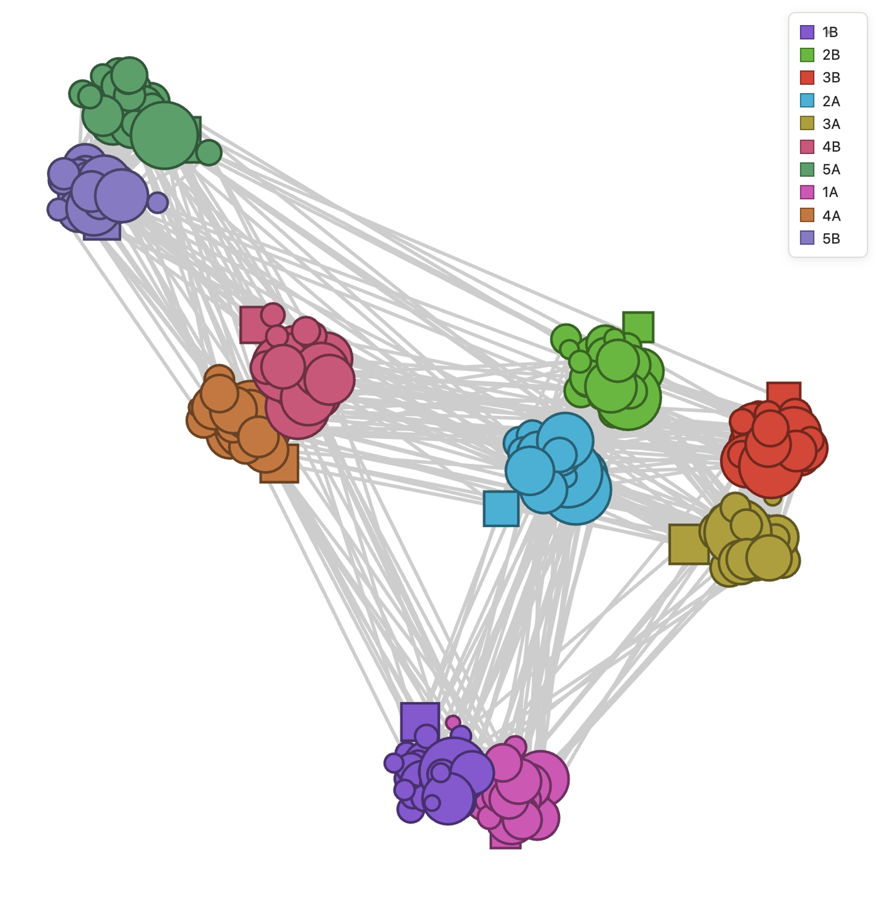
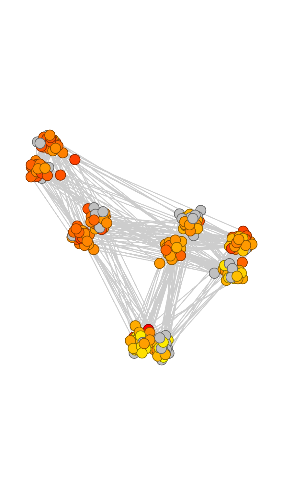
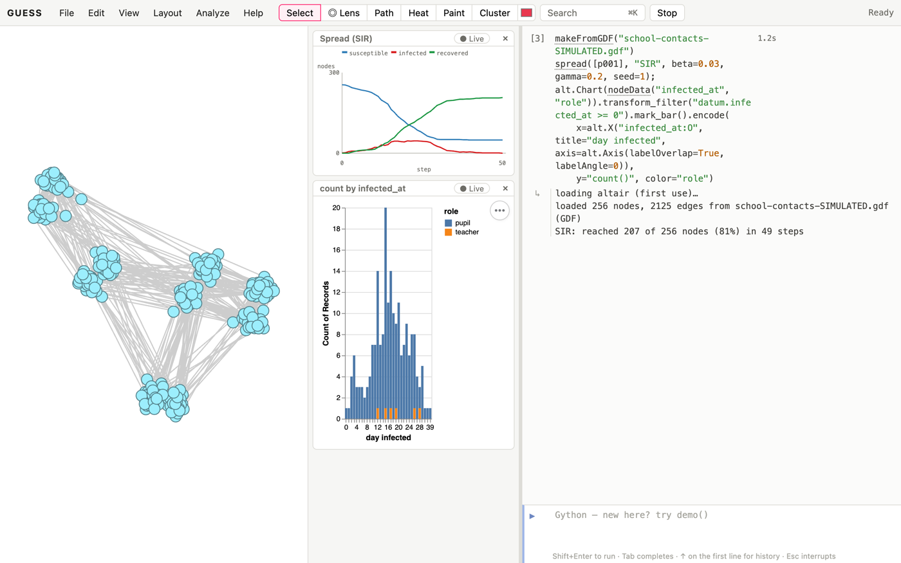
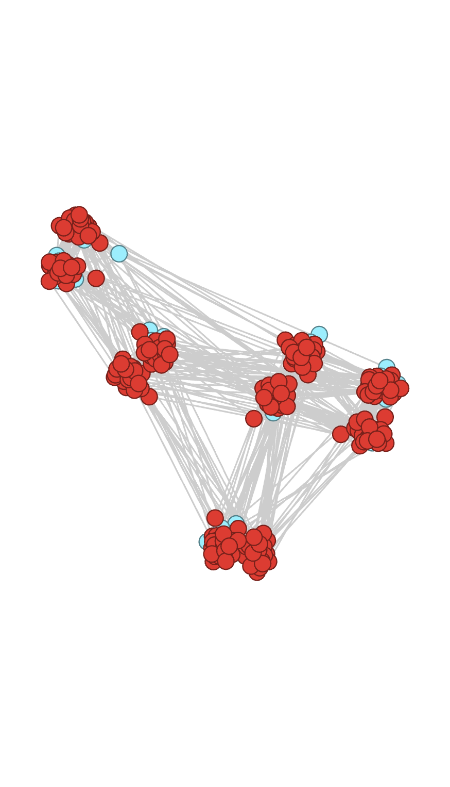
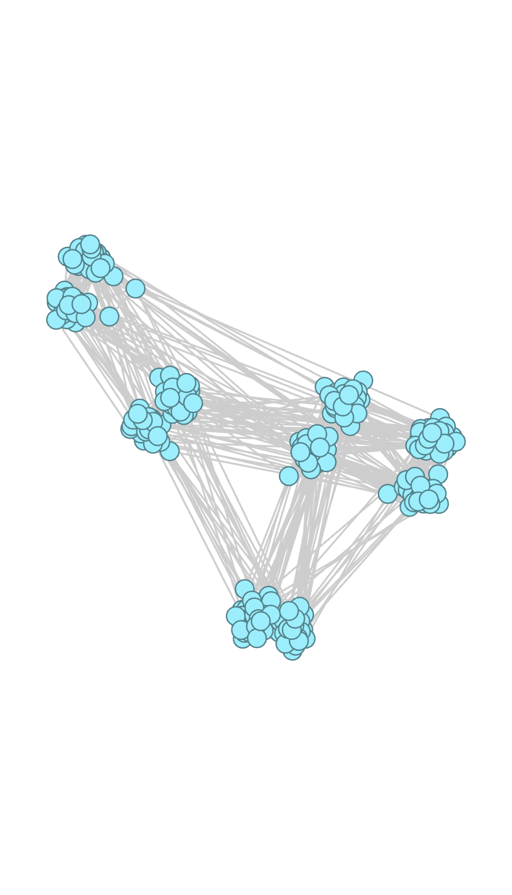
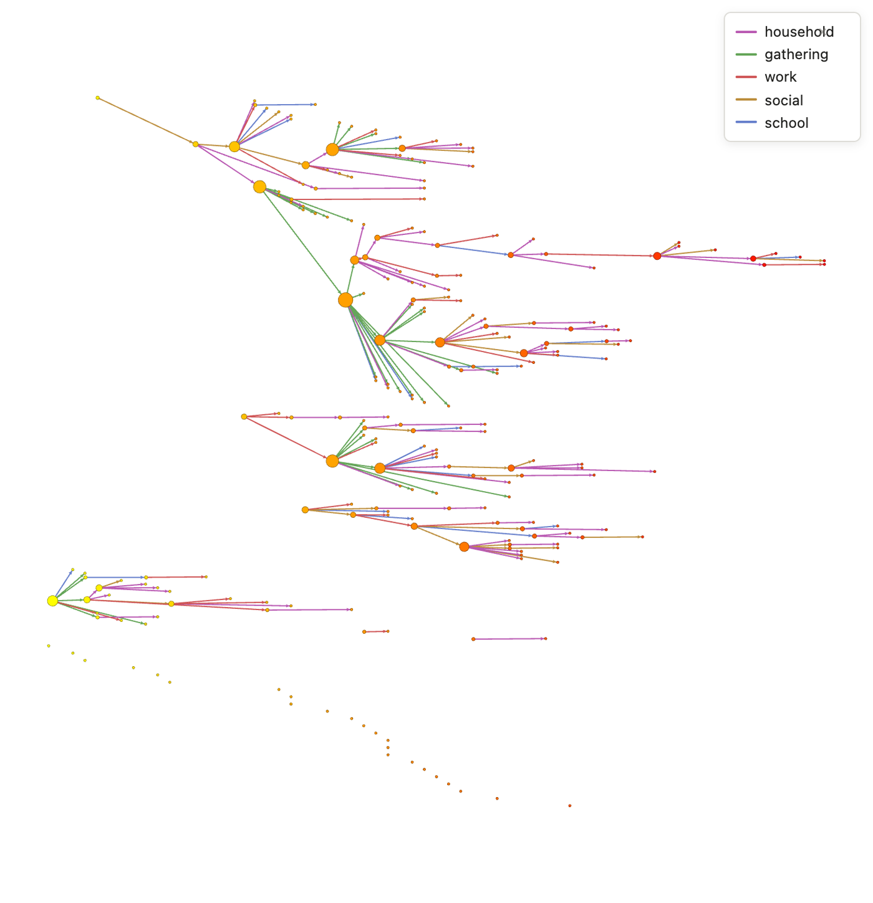
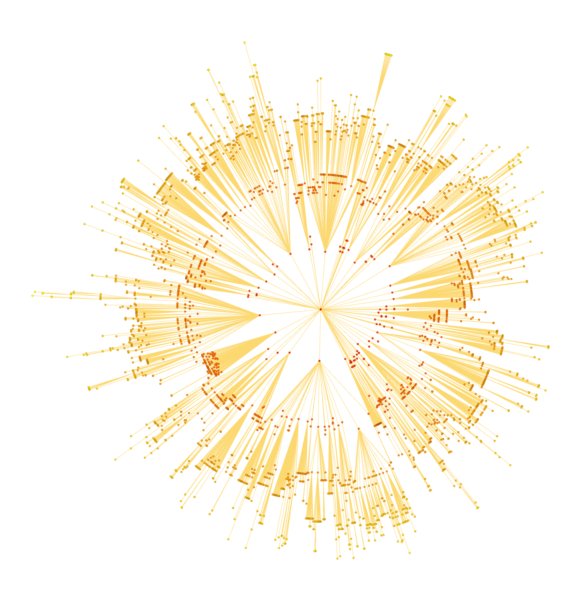
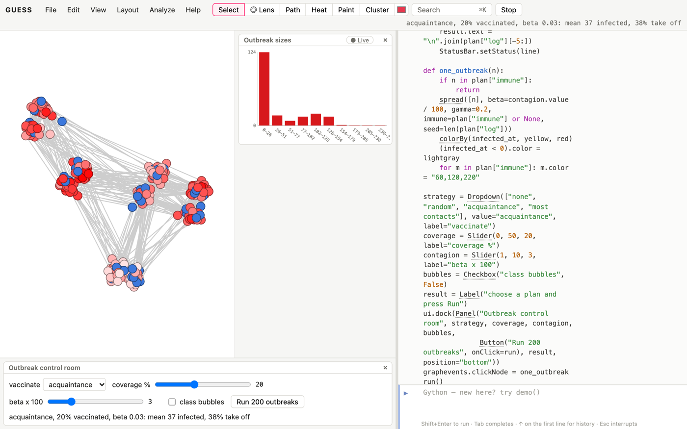

# Why networks?

Classic epidemic models assume everyone mixes with everyone: each
infected person is equally likely to meet each susceptible one. Real
infections travel along contacts: a classroom, a household, a flight.
The network view asks questions those models can't:

- Who is most at risk, and who would spread an infection furthest?
- How contagious must a disease be to cause a large outbreak *in this
  population*?
- Whom should we vaccinate first, and does keeping classes apart work?
- In an outbreak that has happened, who infected whom, and how uneven
  was it?
- Which cities will an epidemic reach next?

This book assumes the Kitchen. Its datasets are **simulated**, so they
can be shared freely and the patterns in them are known:

- `school-contacts-SIMULATED.gdf`: a primary school of 246 pupils in ten
  classes (1A to 5B) and their ten teachers. Edge `weight` is minutes of
  close contact in a day, as studies with wearable sensors record. Its
  structure follows what those studies report: most contact within a
  class, less within a grade, little between grades.
- `outbreak-cases-SIMULATED.csv` and
  `outbreak-transmissions-SIMULATED.csv`: a line list of a 64-day
  respiratory outbreak in a town. Gatherings were banned on day 28.

The travel recipe uses the real world airline network from *GUESS for
Infrastructure*.

In the simulations, one step is one day. With `gamma=0.2`, an infected
person stays infectious for five days on average.

# Contact networks

## Load a school's contact network [Basic]{.level}

**You want** to see who meets whom at school, and how much.

::: ingredients
**Ingredients:** `school-contacts-SIMULATED.gdf` · `colorize` · `sizeBy`
:::

```python
makeFromGDF("school-contacts-SIMULATED.gdf")
colorize(room)
sizeBy(degree, 4, 20)
(role == "teacher").style = 1
legendFor(room)
[(grp[0].room, len(grp)) for grp in groupBy(room)][:3]
```



**How it works.** Each node is a person, and each edge a pair who were in
close contact during the day. `room` is the class (`1A` to `5B`), `grade`
the year, and `role` pupil or teacher. The classes are plain to see: 1,633
of the 2,125 contacts, and 91% of the contact minutes, are within a class.
The rest, between classes, is what lets an infection leave one. A
person has 16.6 contacts on average, from 2 to 38.

**Pitfalls.** A contact network is a sample of a day. Sensors miss short
or distant contacts, and a different day gives a different network.
Studies that recorded several days find the strong, within-class ties
repeat and the weak ones change.

## Your contacts have more contacts than you [Basic]{.level}

```python
makeFromGDF("school-contacts-SIMULATED.gdf")
mine = g.nodes.degree.avg
theirs = sum(n.getNeighbors().degree.avg for n in g.nodes) / len(g.nodes)
round(mine, 1), round(theirs, 1)
```

**How it works.** The average person here has 16.6 contacts, but the
average contact of a person has 19.9. That's the *friendship paradox*
(Feld 1991): well-connected people appear in many contact lists, so a
contact chosen at random is likely to be one of them. It holds for 68% of
the people in this school.

It matters for epidemics, because an infection reaches people through
their contacts too. The people an outbreak reaches early are
better connected than average, and the paradox gives two practical
tricks used below: vaccinating a random person's *contact* (acquaintance
immunisation) and tracing a case's *infector* (backward tracing).

# Simulating outbreaks

## Simulate an outbreak [Basic]{.level}

**You want** to watch an infection spread through the school from one
pupil.

::: ingredients
**Ingredients:** a contact network · `spread` · `showTime`
:::

```python
makeFromGDF("school-contacts-SIMULATED.gdf")
counts = spread([p001], "SIR", beta=0.03, gamma=0.2, seed=1)
colorBy(infected_at, yellow, red)
(infected_at < 0).color = lightgray
center()
```



**How it works.** `spread` runs an SIR model: each day, each infected
person infects each susceptible contact with probability `beta`, and
recovers with probability `gamma`. It stores the day each person was
infected (`infected_at`, −1 for never) and the final `state`, and plots
the susceptible, infected and recovered counts in the chart panel. This
run started in class 1A and reached 207 of the 256 people, in every
class, over 49 days. 46 people were infectious at the peak, on day 20.
With `seed=0` it fizzles out at once: chance matters most at the start.

**Variations.** `showTime(10, infected_at)` shows only the people
infected by day 10; drag a slider over it to replay the outbreak.
`spread(..., weight=weight, beta=0.002)` makes the risk depend on contact
minutes: an edge of 20 minutes then transmits with probability
1 − 0.998²⁰, about 4% a day.

## An epidemic curve you can click [Basic]{.level}

**You want** the classic epidemic curve, new cases per day, split by who
they were, and to find the people behind each bar.

::: ingredients
**Ingredients:** a contact network · `spread` · `nodeData` · Altair (`alt`)
:::

```python
makeFromGDF("school-contacts-SIMULATED.gdf")
spread([p001], "SIR", beta=0.03, gamma=0.2, seed=1);
alt.Chart(nodeData("infected_at", "role")).transform_filter("datum.infected_at >= 0").mark_bar().encode(
    x=alt.X("infected_at:O", title="day infected", axis=alt.Axis(labelOverlap=True, labelAngle=0)),
    y="count()", color="role")
```



**How it works.** `nodeData` gives one row per person with the day they were
infected and their role; the filter drops those never infected (−1), and
`count()` stacks the rest by day. The busiest day is day 15, with 20 new
cases, 19 of them pupils. 6 of the 10 teachers are infected, and the last new case is
on day 39. Each bar segment stands for a query, such as
`(infected_at == 15) & (role == 'pupil')`. Pointing at it lights those
people up in the school network, and clicking selects them, ready for
`center(sel)` or a closer look at whom they were in contact with.

**Variations.** Click *● Live* on the chart, then run `spread` again from
another pupil or with another `seed`: the curve redraws for each run.

## One run is an anecdote [Intermediate]{.level}

**You want** the distribution of outcomes, not one story, and to know who
is most at risk.

::: ingredients
**Ingredients:** a contact network · `outbreaks`
:::

```python
makeFromGDF("school-contacts-SIMULATED.gdf")
sizes = outbreaks(300, beta=0.03, gamma=0.2)
sizes.mean, sizes.large, sizes.meanLarge
colorBy(risk, white, red)
```

**How it works.** `outbreaks(runs)` repeats the simulation from a random
pupil or teacher each time and charts the final sizes. The chart has two
humps. 44% of the outbreaks fizzle out after a few cases. The other 56%
take off and reach 204 people on average, four in five of the school.
The mean, 116, describes almost no actual outbreak, which is why the
result also reports `.large`, the share that take off (reaching more than
10% of the nodes), and `.meanLarge`.

`outbreaks` also stores each person's `risk`: the share of runs that
reached them. Risk follows contacts closely here (correlation 0.86 with
`degree`): the best-connected pupils were infected in 56% of the runs,
the least connected in 12% to 19%.

**Pitfalls.** The model knows nothing about immunity, age or symptoms,
and real outbreaks are seeded by someone who caught it elsewhere, not by
a random pupil. Use simulations to compare options on the same network,
not to forecast case counts.

## The epidemic threshold [Intermediate]{.level}

**You want** to know how contagious an infection must be to cause a
large outbreak in this school.

```python
makeFromGDF("school-contacts-SIMULATED.gdf")
k = degree.avg
k2 = sum(d ** 2 for d in degree) / len(g.nodes)
for b in [0.01, 0.02, 0.03, 0.05]:
    T = b / (b + 0.2 - b * 0.2)
    sz = outbreaks(200, beta=b, gamma=0.2, show=False)
    print(b, round(T * (k2 - k) / k, 2), sz.large)
```

**How it works.** The *basic reproduction number* R₀ is the number of
people a typical case infects in a fully susceptible population. Above 1,
an outbreak can take off. On a network it depends on two things:

- the *transmissibility* T, the chance an infected person passes it to a
  given contact before recovering: T = β / (β + γ − βγ) in this model;
- the spread of contacts: R₀ = T (⟨k²⟩ − ⟨k⟩) / ⟨k⟩, where ⟨k⟩ is the
  mean number of contacts and ⟨k²⟩ the mean of its square.

| beta | R₀ | share of outbreaks that take off |
|---|---|---|
| 0.01 | 0.90 | 4% |
| 0.02 | 1.73 | 45% |
| 0.03 | 2.50 | 54% |
| 0.05 | 3.89 | 77% |

Below the threshold, large outbreaks are rare. Above it, they become
likely, but never certain: an outbreak can still die out by chance in its
first few cases.

Why ⟨k²⟩? Someone infected was reached through a contact, so is likely
well connected (the friendship paradox again), and passes it on to more
people than the average person would. The more uneven the contacts, the
bigger ⟨k²⟩ and the lower the threshold. In networks with very uneven
contacts, like sexual contact networks, the threshold can be close to
zero (Pastor-Satorras and Vespignani 2001).

**An outbreak is a percolation cluster.** If everyone stays infectious for
exactly the same time, say 5 days, each contact passes the infection on
with the same chance T = 1 − (1 − β)⁵, independently of every other
contact. Toss that coin once for every edge in advance and keep the edges
that come up heads: the people an outbreak reaches are exactly the cluster
of kept edges around the first case. So outbreak sizes can be read off
*bond percolation*, which `percolation(bond=True)` computes in one pass:

```python
makeFromGDF("school-contacts-SIMULATED.gdf")
percolation(bond=True, trials=20)        # largest cluster against the share of edges kept
for b in [0.01, 0.02, 0.03, 0.05]:
    T = 1 - (1 - b) ** 5
    sz = outbreaks(200, beta=b, duration=5, show=False)
    print(b, round(T, 3), sz.large, round(sz.meanLarge / len(g.nodes), 2))
```



`duration=5` makes every infection last exactly 5 steps, instead of ending
with chance γ each step. The threshold is then T_c = ⟨k⟩/(⟨k²⟩ − ⟨k⟩),
0.054 here; the outbreaks take off where the curve rises:

| beta | T | share of outbreaks that take off | their mean size |
|---|---|---|---|
| 0.01 | 0.049 | 3% | 12% of the school |
| 0.02 | 0.096 | 57% | 58% |
| 0.03 | 0.141 | 83% | 84% |
| 0.05 | 0.226 | 93% | 95% |

The large outbreaks are as big as the giant cluster at the same T (63% at
T = 0.1, 85% at 0.15). The two questions, "how likely?" and "how big?",
have one answer here because contacts are symmetric; with a random
infectious period they come apart a little.

## Diseases without lasting immunity [Intermediate]{.level}

**You want** to model an infection people can catch again, or one with a
quiet stage before they become infectious.

```python
makeFromGDF("school-contacts-SIMULATED.gdf")
c = spread(g.nodes[:3], model="SIS", beta=0.03, gamma=0.2, steps=300)
plotScatter(degree, infected_steps, title="Time spent infected, by contacts")
```



**How it works.** `spread` has three more models:

| model | course of an infection | what happens |
|---|---|---|
| `"SIS"` | S → I → S | no immunity: the infection settles at an *endemic* level |
| `"SIRS"` | S → I → R → S | immunity wanes (chance `waning` each step): it comes back in waves |
| `"SEIR"` | S → E → I → R | a latent stage, left with chance `sigma` each step, delays the peak |

In this school, SIS with γ = 0.2 dies out at β = 0.02 but settles with
about half the school infected at any time at β = 0.03 (53%), and two
thirds at β = 0.05. `infected_steps` records how many steps each person
spent infected: over 300 steps the 59 best-connected people (22 or more
contacts) were infected for 182 on average, the 80 least connected (12 or
fewer) for 111. In SEIR, `spread` returns the number exposed at each step
as `c.exposed`, and the chart gets an *exposed* line.

**Pitfalls.** An SIS run never finishes by itself while the infection is
endemic: `steps` sets how long it goes on. A small population can lose an
endemic infection by chance in a trough, as SIRS waves often do in a
school this size.

## Where an outbreak starts matters [Intermediate]{.level}

```python
makeFromGDF("school-contacts-SIMULATED.gdf")
for n in highest(degree, 2) + lowest(degree, 2):
    print(n.name, n.degree, outbreaks(100, seeds=[n], beta=0.03, gamma=0.2, show=False).large)
```

**How it works.** `seeds=[n]` starts every run from the same person, and
`highest(degree, 2)` and `lowest(degree, 2)` pick the two best and least
connected.
Started from one of the best-connected pupils (38 or 37 contacts), 75%
to 81% of outbreaks take off. Started from the least connected (2 or 3
contacts), 14% to 20% do. A well-connected first case gets many chances
before recovering.

**Variations.** Seeding from each person in turn and storing the share
(`n.reach = ...`) maps who would spread an infection furthest. Kitsak et
al. (2010) found that `coreness` (the k-core a node is in) predicts it
better than degree in many networks. Try both.

# Interventions

## Whom to vaccinate first? [Intermediate]{.level}

**You have** enough vaccine for 20% of the school. **You want** to know
whom to give it to.

::: ingredients
**Ingredients:** a contact network · `outbreaks(immune=...)`
:::

```python
makeFromGDF("school-contacts-SIMULATED.gdf")
import random
rng = random.Random(1)
dose = round(0.2 * len(g.nodes))
chosen = {"random": rng.sample(list(g.nodes), dose), "most contacts": highest(degree, dose)}
acq = set()
while len(acq) < dose:
    acq.add(rng.choice(list(rng.choice(list(g.nodes)).getNeighbors())))
chosen["acquaintance"] = list(acq)
for how, who in chosen.items():
    print(how, outbreaks(300, beta=0.03, gamma=0.2, immune=who, show=False))
```

**How it works.** `immune=` marks people who can't be infected. With no
vaccine, outbreaks reach 116 people on average:

| who gets the 51 doses | mean outbreak | share that take off |
|---|---|---|
| nobody | 116 | 56% |
| 51 people at random | 62 | 48% |
| a random contact of 51 random people | 42 | 42% |
| the 51 with the most contacts | 14 | 17% |

Targeting the best-connected people is by far the best, but it needs the
whole contact network, which is rarely known. *Acquaintance immunisation*
(Cohen, Havlin and ben-Avraham 2003) needs none: pick people at random
and vaccinate one of their contacts. The friendship paradox does the
targeting. Those chosen here have 20.4 contacts on average, against 16.3
for random choice.

**Pitfalls.** "Most contacts" is measured on one day's network. Targets
chosen on one day protect less on another, when the weak ties have
changed. And vaccines aren't perfect: remove a random share of `immune`
to model that.

## Do class bubbles work? [Intermediate]{.level}

**You want** to know what keeping classes apart (no mixing at breaks and
lunch) would do.

```python
makeFromGDF("school-contacts-SIMULATED.gdf")
cross = interEdges(room)
len(cross), len(g.edges)
with scratch():
    remove(cross)
    outbreaks(300, beta=0.03, gamma=0.2)
import random
with scratch():
    remove(random.Random(2).sample(list(g.edges), len(cross)))
    outbreaks(300, beta=0.03, gamma=0.2)
```

**How it works.** The 492 contacts between classes are 23% of all
contacts. Removing them leaves ten separate classes, and the mean outbreak
falls from 116 to 10: an outbreak stays in the class it starts in.
Removing the same number of contacts at random barely helps (72). What
matters is not how many contacts are cut but *which*: the between-class
contacts are the bridges. `interEdges(room)` gives the edges whose ends
differ in `room`, and each `with scratch():` block puts the school back as
it was when it ends.

**Variations.** Cut only the contacts between grades (`e.node1.grade !=
e.node2.grade`) and see how much of the benefit remains, or keep
teachers' contacts across classes.

# Case data

## A transmission tree from a line list [Basic]{.level}

**You have** a *line list*, one row per case, and the results of contact
tracing: who infected whom, and where. **You want** the outbreak as a
network.

::: ingredients
**Ingredients:** `outbreak-cases-SIMULATED.csv` (Id, onset, age,
ward) · `outbreak-transmissions-SIMULATED.csv` (Source, Target, setting) ·
`makeFromCSV`
:::

```python
makeFromCSV("outbreak-transmissions-SIMULATED.csv", "outbreak-cases-SIMULATED.csv", directed=true)
treeLayout(horizontal=true, spacing=6)
for n in g.nodes: n.x = 20 * n.onset
colorize(setting)
colorBy(onset, yellow, red)
sizeBy(outdegree, 4, 24)
legendFor(setting)
center()
```



**How it works.** The transmissions table is an edge list (Source
infected Target), and the cases table adds each case's fields, including
cases with no known infector. Of 234 cases, 29 are roots: the first three,
and those contact tracing couldn't link. `treeLayout(horizontal=true)`
draws each chain of transmission as a tree growing to the right, and the
loop then moves each case to its onset day, so the drawing is also a
timeline.

```python
plotHistogram(onset, 13)
```

The histogram of `onset` is the *epidemic curve*: cases rise to a peak
around day 30 and fall after the ban on gatherings on day 28, with a lag of about one serial interval.

A *serial interval*, the days from an infector's symptoms to their
case's, is one line per edge:

```python
addEdgeField("interval", INTEGER, 0)
for e in g.edges: e.interval = e.node2.onset - e.node1.onset
plotHistogram(interval)
```

They average 5.0 days here (1 to 15), in every setting.

**Pitfalls.** Contact tracing mixes evidence and guesswork. When two
possible infectors are in the same household, the one recorded may be
wrong. Treat a transmission tree as a hypothesis, and check it against
onset dates: an infector whose onset is after their case's is a red flag.

## Superspreading: R and k [Intermediate]{.level}

**You want** to know how many people each case infected, and how uneven
that was.

::: ingredients
**Ingredients:** a transmission tree · `offspring`
:::

```python
makeFromCSV("outbreak-transmissions-SIMULATED.csv", "outbreak-cases-SIMULATED.csv", directed=true)
offspring(onset < 28)
offspring((onset >= 28) & (onset < 55))
```

**How it works.** A case's *offspring* is how many it infected, its
outdegree in the tree. `offspring()` reports their mean, the
*reproduction number* R, and fits a negative binomial distribution to
them. Its *dispersion* k measures unevenness: large k means everyone
infects about R people, and k below 1 means a few *superspreaders* cause
most infections. SARS had k ≈ 0.16 (Lloyd-Smith et al. 2005), COVID-19
around 0.1 to 0.5.

| cases with onset | R | k | infected no one | caused by the top 20% |
|---|---|---|---|---|
| before day 28 | 1.39 | 0.21 | 66% | 89% |
| days 28–54 | 0.54 | 0.24 | 75% | 92% |

Before the ban on gatherings, each case infected 1.39 people on average:
the outbreak was growing. After, 0.54: it was shrinking. Throughout, most
cases infected no one and a fifth caused nine in ten infections.
`offspring` also stores the counts in the `offspring` field and charts
them.

**Pitfalls.**

- *Censoring.* Cases near the end of the data haven't had time to infect
  anyone yet, which is why the recipe stops at day 54.
- *Missed links.* Cases whose infector wasn't found (29 here) lower R: an
  infection that tracing missed counts for no one.

# Travel

## How far is it, for an epidemic? [Advanced]{.level}

**You want** to know which cities a new disease will reach first after it
emerges in Mexico City, as H1N1 influenza did in 2009.

::: ingredients
**Ingredients:** `world-airports.gdf` (edge `weight` = airline routes) ·
`effectiveDistance`
:::

```python
makeFromGDF("world-airports.gdf")
effectiveDistance(MEX)
for c in [GDL, CUN, LAX, JFK, MAD, LHR, NRT, SYD]: print(c.name, c.city, c.eff_distance)
radialLayout(MEX, eff_tree == true)
import math
for n in eff_distance != None:
    a = math.atan2(n.y, n.x)
    n.x, n.y = 60 * n.eff_distance * math.cos(a), 60 * n.eff_distance * math.sin(a)
showOnly(eff_tree == true)
colorBy(eff_distance, red, yellow)
center()
```



**How it works.** Brockmann and Helbing (2013) noticed that the dates
on which SARS and H1N1 reached each country fit poorly to distance in
kilometres, but almost perfectly to an *effective distance* through the
air network. From an airport m, if a share P of its traffic goes to n,
the step m → n has length 1 − ln P. Busy routes are short, and a
route among hundreds is long. `effectiveDistance` finds the shortest
total from the origin and marks the tree of shortest routes in
`eff_tree`.

| airport | km from Mexico City | effective distance |
|---|---|---|
| Guadalajara (GDL) | 459 | 5.10 |
| Cancún (CUN) | 1,284 | 4.88 |
| Los Angeles (LAX) | 2,500 | 4.55 |
| New York (JFK) | 3,365 | 5.10 |
| Madrid (MAD) | 9,067 | 5.10 |
| London (LHR) | 8,904 | 5.57 |
| Tokyo (NRT) | 11,254 | 7.18 |
| Sydney (SYD) | 12,983 | 9.95 |

To an epidemic, Madrid is as close to Mexico City as Guadalajara, and
Los Angeles closer than either. The drawing puts each airport at its
effective distance from the centre: the world reorganises into rings,
and arrival dates follow the rings.

**Pitfalls.** The weights here count airline route listings, not
passengers, so they're only a stand-in for traffic. Brockmann and Helbing
used passenger flows. With passenger numbers in `weight`, the same
command gives their measure.

# Case study

## Case study: trace backwards [Advanced]{.level}

**The question.** Contact tracers find a new case. Should they look
*forward*, for the people this case may have infected, or *backward*, for
whoever infected them?

```python
makeFromCSV("outbreak-transmissions-SIMULATED.csv", "outbreak-cases-SIMULATED.csv", directed=true)
o = offspring(show=False)
round(o.R, 2), round(g.edges.node1.offspring.avg, 1)
```

A typical case infected 0.88 people (R over the whole outbreak). The
person who infected a typical case had infected 5.6. That's the
friendship paradox once more: a case is most likely to come from a large
cluster, so its infector is likely a superspreader, and finding the
infector finds their other cases too. Forward tracing from a new case
finds 0.88 more cases on average; backward tracing finds 5.6. When
dispersion is high (small k), backward tracing finds many more cases for
the same effort, as Endo et al. (2020) and Kojaku et al. (2021) argued
for COVID-19.

# Capstone

## Capstone: an outbreak control room [Advanced]{.level}

**The problem.** A school health officer must choose a plan before
the winter: vaccinate some pupils (whom?), keep classes apart, or both.
This recipe builds a small control room:

- the school drawn by class, each person coloured by their risk of
  infection under the current plan;
- a drop-down for the strategy and sliders for vaccine coverage and how
  contagious the infection is;
- a button that runs 200 outbreaks and reports the outcome;
- click a person to watch one outbreak start from them;
- a log of each plan tried, to compare them.

```python
makeFromGDF("school-contacts-SIMULATED.gdf")
import random
ss("school")
plan = {"immune": [], "log": []}

def choose(strategy, share):
    dose = round(share * len(g.nodes))
    rng = random.Random(1)
    if strategy == "random":
        return rng.sample(list(g.nodes), dose)
    if strategy == "most contacts":
        return highest(degree, dose)
    if strategy == "acquaintance":
        acq = set()
        while len(acq) < dose:
            acq.add(rng.choice(list(rng.choice(list(g.nodes)).getNeighbors())))
        return list(acq)
    return []

def setup():
    ls("school")
    if bubbles.checked:
        remove([e for e in g.edges if e.node1.room != e.node2.room])
    plan["immune"] = choose(strategy.value, coverage.value / 100)

def run():
    setup()
    beta = contagion.value / 100
    sz = outbreaks(200, beta=beta, gamma=0.2, immune=plan["immune"] or None)
    colorBy(risk, white, red)
    for n in plan["immune"]: n.color = "60,120,220"
    line = (f"{strategy.value}, {coverage.value:.0f}% vaccinated" + (", bubbles" if bubbles.checked else "")
            + f", beta {beta:.2f}: mean {sz.mean:.0f} infected, {sz.large:.0%} take off")
    plan["log"].append(line)
    result.text = "\n".join(plan["log"][-5:])
    StatusBar.setStatus(line)

def one_outbreak(n):
    if n in plan["immune"]:
        return
    spread([n], beta=contagion.value / 100, gamma=0.2, immune=plan["immune"] or None, seed=len(plan["log"]))
    colorBy(infected_at, yellow, red)
    (infected_at < 0).color = lightgray
    for m in plan["immune"]: m.color = "60,120,220"

strategy = Dropdown(["none", "random", "acquaintance", "most contacts"], value="acquaintance", label="vaccinate")
coverage = Slider(0, 50, 20, label="coverage %")
contagion = Slider(1, 10, 3, label="beta x 100")
bubbles = Checkbox("class bubbles", False)
result = Label("choose a plan and press Run")
ui.dock(Panel("Outbreak control room", strategy, coverage, contagion, bubbles,
              Button("Run 200 outbreaks", onClick=run), result, position="bottom"))
graphevents.clickNode = one_outbreak
run()
center()
```



**How it works.**

- **The plan.** `setup()` restores the school with `ls`, cuts the
  between-class contacts if *class bubbles* is ticked, and chooses whom
  to vaccinate with the same strategies as the recipe above.
- **The button.** `run()` calls `outbreaks` with the vaccinated people
  as `immune`, colours everyone by `risk` (vaccinated people blue), and
  adds a line to the log. The outbreak-size chart updates in place.
- **Clicking.** `graphevents.clickNode = one_outbreak` starts a single
  outbreak from the clicked person under the current plan, coloured by
  day of infection, with its epidemic curve in the chart panel.

**Variations.**

- Add a slider for vaccine efficacy: drop a random share of
  `plan["immune"]` before each run.
- Add "teachers only" as a strategy (`role == "teacher"`).
- `exportApp()` shares the control room as a page.

**As an app.** A capstone like this can be packaged so it opens on its own, without the console, through `?app=` (manual, *Apps*). *Help → Example apps → Outbreak Explorer* is one for this book: click patient zero, set β and γ, and run an SIR outbreak through the simulated school. Its source is `web/public/apps/outbreak/`.
