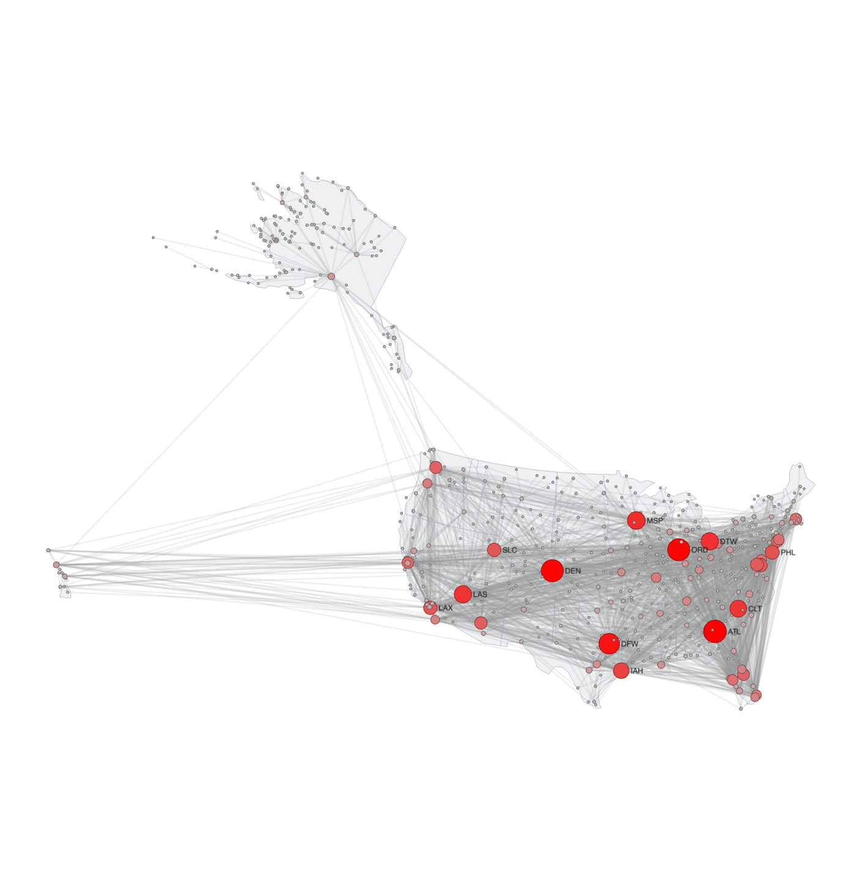
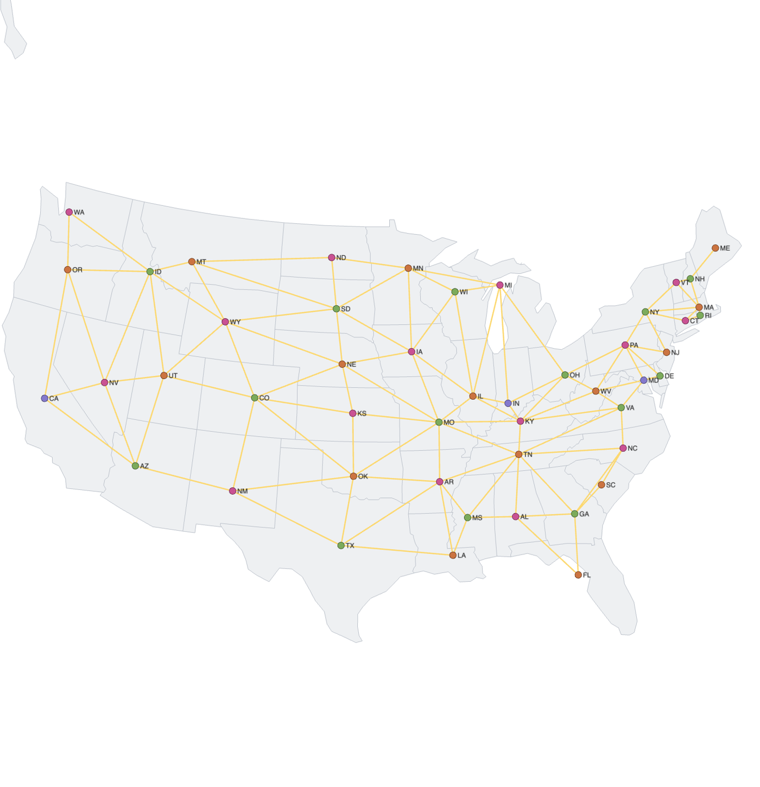
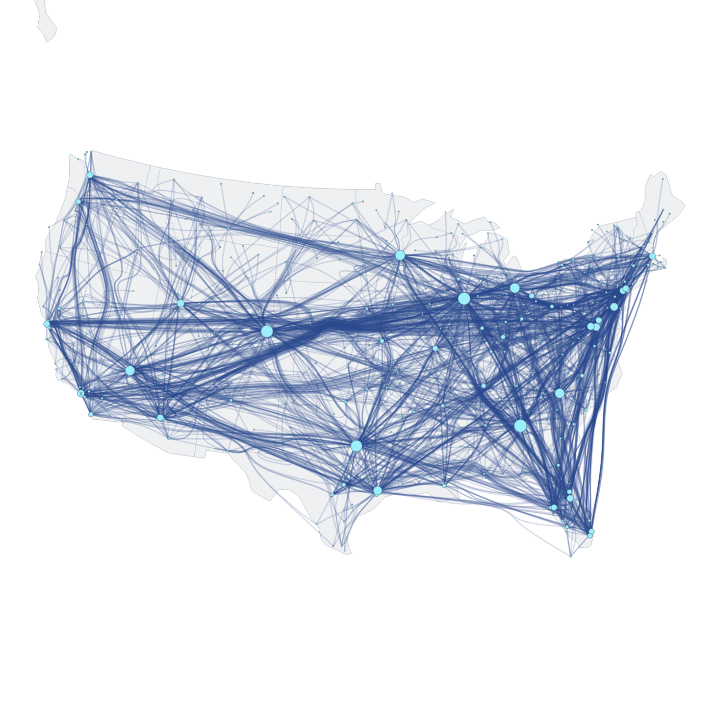
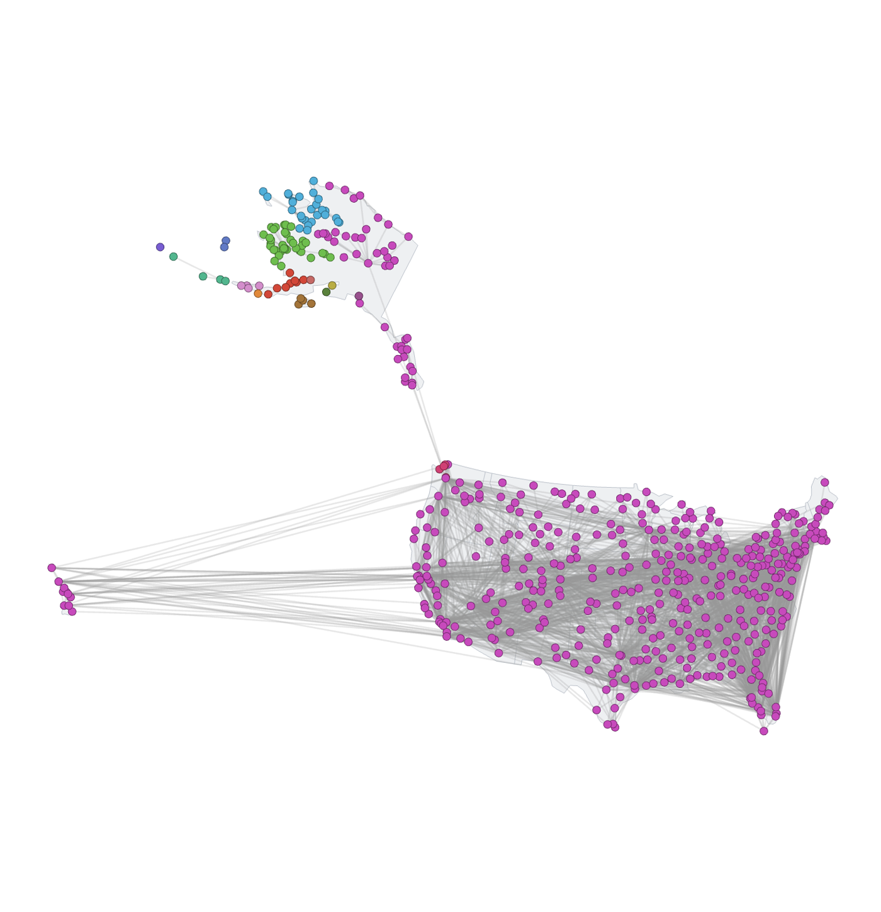
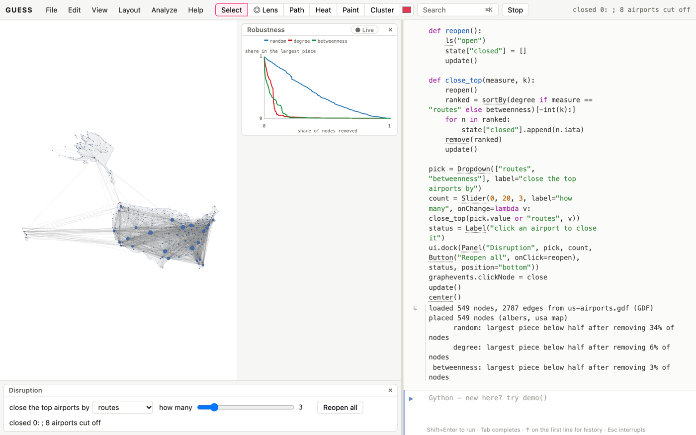

# Why networks?

Airlines, railways, roads, power grids, pipelines and the internet are
networks you can point to on a map. What the network view adds is how
the parts depend on each other:

- Which places are hubs, and which are the bridges whose loss would cut
  regions off?
- How does the system degrade when parts fail at random, or are attacked?
- What is the best route by number of hops, and by distance?
- What regional systems does the network break into?

This book assumes the Kitchen for loading, querying and drawing. Its data
are in the cookbooks' `data` folder:

| file | what it is |
|---|---|
| `us-airports.gdf` | 549 airports in the United States and the 2,787 airport pairs with scheduled domestic service. `weight` is the number of airline routes listed between the two. Node fields: `iata` (code), `city`, `latitude`, `longitude`, `airport` (name). |
| `world-airports.gdf` | The same for the whole world: 3,257 airports and 18,930 pairs, with `country`. |
| `power-grid-region.gdf` | A connected region of 400 of the 4,941 stations of the Western US power grid (Watts and Strogatz), laid out by Kamada–Kawai; positions are not geographic. |
| `internet-as-sample.gdf` | A snowball sample of 300 autonomous systems (the networks that make up the Internet) from a 2006 snapshot, with the links among them. |

Both come from the OpenFlights airport and route databases (Open Database
License), a 2014 snapshot. They record which routes exist, not how often
they're flown or how many seats they carry, so a twice-weekly island
hop counts the same as a shuttle.

# Networks on maps

## Put a network on a map [Basic]{.level}

**You have** nodes with latitude and longitude. **You want** them where
they are, on a map.

::: ingredients
**Ingredients:** `us-airports.gdf` · `geoLayout`
:::

```python
makeFromGDF("us-airports.gdf")
geoLayout(projection="albers")
sizeBy(degree, 3, 30)
colorBy(degree, lightgray, red)
hubs = sortBy(degree)[-12:]
hubs.labelvisible = true
g.edges.color = "150,150,150,40"
```



**How it works.** `geoLayout()` finds the `latitude` and `longitude`
fields (or `lat`/`lon`; name them if yours differ), projects each node, and
draws a map underneath: the states when every node is in the United
States, the world's coastlines otherwise. Its choice of projection
matters:

| projection | keeps | use for |
|---|---|---|
| `"mercator"` (default) | local shapes and directions | world maps, web-map habits |
| `"albers"` | areas; shapes good in mid-latitudes | countries and continents; the US by default (`parallels=`, `center=` for others) |
| `"equirectangular"` | nothing in particular, but simple | quick looks, data already in degrees |

The map is drawn as vector outlines (Natural Earth, public domain). It
stays sharp at any zoom, follows the light or dark theme (or
`land=`/`borders=` colours), and is included in SVG and PDF exports.
`removeMap()` removes it.

**Pitfalls.** The Albers projection tuned for the lower 48 states puts
Alaska and Hawaii where they really are, so the map is wide and mostly
ocean. Published US maps move them into insets. If that matters, open the
lower 48 as a graph of its own,
`subgraph((longitude > -130) & (latitude < 50))`, then run `geoLayout`
again. Alaska gets the same treatment in the first case study.

## A world network [Basic]{.level}

```python
makeFromGDF("world-airports.gdf")
geoLayout()
sizeBy(degree, 2, 24)
colorBy(betweenness, lightgray, red, scale="log")
g.edges.visible = false
```

**How it works.** With 3,257 airports, the routes would cover the map, so
this recipe hides them and lets size (number of routes) and colour (how
often an airport lies on the shortest connections between others) carry
the story. The busiest airports by routes are European: Amsterdam,
Frankfurt, Paris and Istanbul, then Atlanta. By betweenness the list
changes to Paris, Los Angeles, Anchorage, Dubai and Frankfurt. These are
the connectors between world regions.

## Take the network to Google Earth or a GIS [Basic]{.level}

**You want** the airports and routes in Google Earth, QGIS or ArcGIS, with
their data.

::: ingredients
**Ingredients:** `us-airports.gdf` · `exportKML` · `exportSHP` · `geoVectors`
:::

```python
makeFromGDF("us-airports.gdf")
colorBy(betweenness, lightgray, red)
exportKML("us-airports.kml")
exportSHP("us-airports.zip")
geoVectors()
```

**How it works.** Both exports take positions from the `latitude` and
`longitude` fields, not from the layout, so they're right whatever the
picture looks like. `exportKML` writes a placemark per airport and a line
per route, in their GUESS colours, with every field in the placemark's
data: open it in Google Earth. `exportSHP` writes a zip of two shapefiles
(points for airports, lines for routes) in WGS 84, with the fields as
attribute columns: drop it on QGIS or ArcGIS. `geoVectors()` stores each
route's length in `km` and its `bearing`, and prints the mean route length.

**Pitfalls.** Shapefile column names are cut to 10 characters, so long
field names come out shortened (and numbered when two would clash).

## Colour a map [Intermediate]{.level}

**You want** a network of regions that share a border, for questions of
adjacency: how many colours a map needs, which regions are neighbours,
how far apart two regions are in border crossings.

::: ingredients
**Ingredients:** `makeFromMap` · `colorGraph` · `edgeCrossings`
:::

```python
makeFromMap("usa")
colorGraph()
labelBy(abbrev)
edgeCrossings()
```



**How it works.** `makeFromMap("usa")` makes a node for each of the lower
48 states and an edge wherever two share a border: 106 borders. Touching
at a single point (the Four Corners) doesn't count. It places the states on
a map (`geoLayout`) with their outlines behind. `makeFromMap("world")` does
the same for 241 countries. `colorGraph()` gives each node a colour unlike
its neighbours' (the DSATUR method), stores it in `color_class` and colours
by it. A map needs at most four colours (the four-colour theorem), and the
states take four. Region networks like these are *planar*: they can be drawn
without crossing edges, and `edgeCrossings()` counts 0 here.

**Variations.** `colorGraph(strategy="largest_first")` uses a simpler
greedy order and needs five colours on the states: greedy colourings are
not always optimal. `shortestPath(Washington, Florida)` counts border
crossings between two states.

**Pitfalls.** The world map's drawing has 12 crossing edges: borders across
the edges of the projection, and countries in several pieces, drawn at one
point. Adjacency through the sea (ferries, tunnels) isn't a border here.

## Draw flows, not lines [Intermediate]{.level}

**You want** the big corridors of a network to stand out from the clutter
of individual edges.

```python
makeFromGDF("us-airports.gdf")
subgraph((longitude > -130) & (latitude < 50), "lower 48")
geoLayout(projection="albers")
sizeBy(degree, 2, 20)
g.edges.color = "40,70,140,50"
bundleEdges()
```



**How it works.** `subgraph` keeps the lower 48 states' airports and the
routes among them, and running `geoLayout` again fits the map to them.
`bundleEdges()` gathers edges that run alike into shared
bundles, which turns a hairball of routes into a flow map: the
transcontinental corridors, the north–south spines along each coast, and
the fans around each hub (*Kitchen: Outline groups and bundle the
hairball*). `method="fdeb"` gives smoother, more organic curves.
`removeBundles()` goes back to straight lines.

**Pitfalls.** Bundling distorts geography on purpose: a bundled edge no
longer shows the route it takes. Use it to show where flows concentrate,
and draw individual routes straight when the route itself matters.

# Hubs, bridges and weak points

## Hubs are not the same as bridges [Intermediate]{.level}

```python
makeFromGDF("us-airports.gdf")
for n in sortBy(degree)[-5:]: print(n.iata, n.city, n.degree, round(n.betweenness))
for n in sortBy(betweenness)[-5:]: print(n.iata, n.city, n.degree, round(n.betweenness))
```

**How it works.** The airports with the most routes (Atlanta, Chicago
O'Hare, Denver, Dallas–Fort Worth, Minneapolis) are hubs. The airport on
the most shortest paths is Anchorage, with only 34 routes. Most of
Alaska's airports can reach the rest of the country only through it, so
every journey between them and the lower 48 passes through one place.
That's a bridge, and it's the more fragile kind of importance: other hubs
can substitute for Atlanta, but nothing can substitute for Anchorage.

## Do the hubs form a club? [Intermediate]{.level}

```python
makeFromGDF("us-airports.gdf")
rc = richClub()
```

**How it works.** The *rich-club coefficient* for degree *k* is the
density of the links among the nodes with more than *k* links.
`richClub()` normalises it by the same measure in randomised networks with
the same degrees: above 1, the hubs link to each other more than chance
predicts. The US network is only weakly a rich club (1.05 to 1.10 for hubs
with 25–75 routes): the big hubs are connected to each other, but no
more than their sheer number of routes implies. Airline hub systems
feed each hub from its own region rather than tying the hubs into a
tight core.

## Find the weak points [Basic]{.level}

```python
makeFromGDF("us-airports.gdf")
geoLayout(projection="albers")
cuts = cutNodes()
cuts.color = red
cuts.size = 12
bridges().color = red
len(cuts), len(bridges())
```

**How it works.** A *cut node* is one whose loss disconnects part of the
network (60 airports here), and a *bridge* is an edge whose loss does
the same (165 routes). Most of them are small: a regional airport that is
the only link for a still smaller one. A few, like Anchorage, hold up
whole regions. Sort the cut nodes by how much they'd strand (next
recipe) to tell them apart.

## What if a hub closes? [Intermediate]{.level}

```python
makeFromGDF("us-airports.gdf")
geoLayout(projection="albers")
ss("open")
remove(ANC)
colorize(component)
g.edges.color = "150,150,150,60"
len(giantComponent()), len(component.distinct)
```



**How it works.** `ss("open")` saves the network and `remove(ANC)` closes
Anchorage. Computed fields such as `component` follow the change on their
own: they're recalculated the next time they're read. Colouring by
component shows what's left. Eight airports were already off the main network (two small
island systems), and closing Anchorage cuts off 87 more, in 12 new
pieces, nearly all in Alaska. Closing Atlanta, the busiest hub, strands
eleven. `ls("open")` reopens it, and `morph("open", 1500)` animates the
difference.

# Robustness

## Failures versus attacks [Intermediate]{.level}

**You want** to know how the network degrades as parts fail: by
accident (at random), or by targeted attack on its most important parts.

::: ingredients
**Ingredients:** `us-airports.gdf` · `robustness`
:::

```python
makeFromGDF("us-airports.gdf")
r = robustness(["random", "degree", "betweenness", "adaptive"])
```

**How it works.** `robustness()` removes nodes in each given order and
records the share of nodes still in the largest connected piece after
each removal. It plots the curves and leaves the graph untouched. The
orders are:

| order | removes first | models |
|---|---|---|
| `"random"` | random nodes (averaged over `trials`) | failures, weather, accidents |
| `"degree"` | the nodes with the most links | an attack on the hubs |
| `"betweenness"` | the nodes on the most shortest paths | an attack on the bridges |
| `"adaptive"` | the current biggest hub, re-ranked after each removal | a determined attacker |
| a node field | the highest values of that field | any priority: age, cost, risk |

The US airline network loses half its largest piece only after 34% of
airports fail at random. An attack on the hubs does it with 6%, and an
attack on the bridges with 3%. This *robust yet fragile* pattern is
typical of networks with hubs. Random failures mostly hit small airports
that nothing depends on, while a few removals in the right places split
the system. The world network is similar (37% at random, 8% by degree).

**The whole curve, fast.** `percolation()` gives the same kind of curve in
one pass, for every share of nodes at once: it adds the nodes back one at a
time in random (or attack) order and merges the pieces they join (the
Newman–Ziff algorithm), so it suits big networks and many trials. It
returns (share present, largest piece) pairs and charts them:

```python
makeFromFile("power-grid-region.gdf")
percolation(trials=20)                    # random failures
percolation("degree")                     # hubs removed first
percolation(bond=true, trials=20)         # lines fail instead of stations
```

A region of the Western US power grid (400 stations) loses half its
largest piece when 27% of stations fail at random, but when only 6% are
removed hubs first. The Internet sample of 300 networks of the 2006
Internet behaves the same way (41% against 14%), and so do the airports
(37% against 6%). With `bond=true` lines rather than stations fail: the
grid's largest piece falls below half the stations once about 40% of
lines are down.

**Pitfalls.** Connectivity isn't capacity. A network can stay connected
while its remaining hubs are overloaded, so simulate load (or use
`maxFlow`) when capacity matters. In this data, "connected" also counts
a weekly flight the same as a shuttle.

# Routes

## Fewest hops or shortest distance? [Intermediate]{.level}

```python
makeFromGDF("us-airports.gdf")
geoDistance()
hops = shortestPath(BRW, MIA)
[n.iata for n in hops if n in g.nodes], round(sum(e.km for e in hops if e in g.edges))
for e in g.edges: e.weight = e.km
short = shortestPath(BRW, MIA, weighted=true)
[n.iata for n in short if n in g.nodes], round(sum(e.km for e in short if e in g.edges))
```

**How it works.** `geoDistance()` stores each route's great-circle length
in kilometres, as the edge field `km`. `shortestPath` counts hops by
default. With `weighted=true` it uses each edge's `weight` as a length,
so copying `km` into `weight` gives the shortest route by distance. From
Utqiaġvik (Barrow), Alaska, to Miami, both answers take three flights
through Anchorage, but by fewest hops the route goes via Los Angeles
(8,696 km), while the shortest by distance goes via Minneapolis
(7,623 km). The longest domestic route in the data is Honolulu–New York
JFK, 8,007 km.

**Variations.** `spanningTree()` gives the fewest edges that keep
everything connected (with `weight` as cost, the cheapest network).
`maxFlow(a, b)` and `minCut(a, b)` give how many separate routes join two
places, and which few routes' loss would separate them.

## A round trip through several cities [Intermediate]{.level}

```python
makeFromGDF("us-airports.gdf")
geoLayout(projection="albers")
geoDistance()
trip = travelingSalesman([SEA, BOS, MIA, LAX, DEN], weight="km")
trip.color = red
[n.iata for n in trip if n in g.nodes], round(trip.length)
```

**How it works.** `travelingSalesman(stops, weight)` finds a short round
trip through the stops (an approximation: the exact problem is
intractable for many stops), travelling along existing routes with `km` as
the length. It may pass through other airports. The result is the route's
airports and flights in order, and `.length` is its total: here Seattle,
Boston, Miami, Denver, Los Angeles and back, 11,705 km in five flights.
`cycle=False` gives a one-way route that starts at the first stop.

## Send a flow at least cost [Advanced]{.level}

```python
makeFromGDF("us-airports.gdf")
geoDistance()
addEdgeField("capacity", DOUBLE, None)
for e in g.edges: e.capacity = e.weight
minCostFlow(SEA, MIA, 5, cost="km")
[(e.node1.iata, e.node2.iata, e.flow) for e in g.edges if e.flow > 0]
```

**How it works.** `minCostFlow(a, b, amount)` sends `amount` units from
`a` to `b` as cheaply as possible, with each edge limited to its
`capacity` and costing its `cost` field per unit. Here capacity is a
stand-in, the number of airlines on each route, and cost is distance.
The cheapest way to move five units from Seattle to Miami splits them
between the direct route and a route through Tampa. That's the shape of
real logistics problems: freight, evacuation, network bandwidth.

# Regional systems

## Find the regional systems [Intermediate]{.level}

```python
makeFromGDF("us-airports.gdf")
geoLayout(projection="albers")
louvainClusters()
colorize(louvain_class)
for grp in groupBy(louvain_class)[:6]:
    top = sortBy(grp, degree)[-3:]
    print(len(grp), [n.iata for n in top])
```

**How it works.** Communities in a transport network are regions served
mostly from within. Here they follow the airlines' hub systems more than
the map: the East around Atlanta, Charlotte and Detroit; Texas around
Dallas–Fort Worth; the Mountain West and the Pacific coast around Denver
and Las Vegas; the Midwest around Chicago and Minneapolis; and two Alaskan
systems, one around Anchorage and one in the southeast around Juneau. On
the map the communities overlap, because a hub's reach is continental.

# Case studies

## Case study: Alaska's single point of failure [Intermediate]{.level}

```python
makeFromGDF("us-airports.gdf")
alaska = (latitude > 51) & (longitude < -129)
len(alaska)
subgraph(alaska, "Alaska")
geoLayout(projection="albers", parallels=(55, 65), center=(-154, 60))
sizeBy(betweenness, 3, 30)
labelBy(iata)
```

Alaska has 135 airports with scheduled service, a quarter of the
country's, and few roads between them, so the air network *is* the
transport network. `subgraph` opens Alaska's airports and routes on their
own, and `geoLayout` with Alaskan parallels draws them in proportion.
Sized by betweenness, the structure is a hub and spokes of spokes:
Anchorage at the centre, and regional hubs (Bethel, Fairbanks, Nome,
Kotzebue, and Juneau in the southeast) each serving their own villages.
`cutNodes()` finds 22 airports in Alaska whose loss would strand
somebody, and Anchorage would strand nearly everyone. Back in
the national network, `robustness("betweenness")` removes Anchorage first,
which is why the bridge attack does so much damage so quickly.

## Case study: hubs of the world [Intermediate]{.level}

```python
makeFromGDF("world-airports.gdf")
geoLayout()
top_routes = sortBy(degree)[-10:]
top_bridges = sortBy(betweenness)[-10:]
[n.iata for n in top_routes], [n.iata for n in top_bridges]
(top_routes & top_bridges)
```

Six airports are on both top-ten lists (Amsterdam, Frankfurt, Paris,
Istanbul, Chicago O'Hare and Beijing): the great hubs both have many
routes and join regions. The other four on each list tell different
stories. By routes they are Atlanta, Dallas–Fort Worth, Munich and
Moscow Domodedovo, with many routes mostly within their own region. By
betweenness they are Anchorage and Los Angeles across the Pacific, Dubai
between Europe, Africa and Asia, and Toronto, which join continents with
comparatively few routes. A planner asking "which airports matter most?"
needs both lists: the first for traffic, the second for keeping regions
connected at all.

# Capstone

## Capstone: an airport disruption simulator [Advanced]{.level}

**The problem.** An operations planner wants to rehearse disruptions.
Close an airport (weather, a strike, an accident) and see who loses
service. Close the top few by some measure and see how fast the system
fragments. This recipe builds a simulator on the US network:

- the network on a map, airports sized by routes;
- a click closes an airport, and the airports cut off from the main
  network turn red;
- a drop-down and a slider close the top *k* airports by routes or by
  betweenness;
- a reset button reopens everything;
- the robustness curves sit beside the map for reference.

```python
makeFromGDF("us-airports.gdf")
geoLayout(projection="albers")
sizeBy(degree, 2, 22)
g.edges.color = "130,130,130,35"
_ = robustness(["random", "degree", "betweenness"])
ss("open")
state = {"closed": []}

def update():
    main = giantComponent()
    g.nodes.color = "70,110,180"
    stranded = [n for n in g.nodes if n not in main]
    for n in stranded: n.color = red
    status.text = f"closed {len(state['closed'])}: {', '.join(state['closed'][:8])}; {len(stranded)} airports cut off"
    StatusBar.setStatus(status.text)

def close(n):
    state["closed"].append(n.iata)
    remove(n)
    update()

def reopen():
    ls("open")
    state["closed"] = []
    update()

def close_top(measure, k):
    reopen()
    ranked = sortBy(degree if measure == "routes" else betweenness)[-int(k):]
    for n in ranked:
        state["closed"].append(n.iata)
    remove(ranked)
    update()

pick = Dropdown(["routes", "betweenness"], label="close the top airports by")
count = Slider(0, 20, 3, label="how many", onChange=lambda v: close_top(pick.value or "routes", v))
status = Label("click an airport to close it")
ui.dock(Panel("Disruption", pick, count, Button("Reopen all", onClick=reopen), status, position="bottom"))
graphevents.clickNode = close
update()
center()
```



**How it works.**

- **Saving the network.** `ss("open")` saves the full network once.
  `reopen()` returns to it with `ls`.
- **Closing airports.** A click removes that airport. The slider ranks
  airports by routes (`degree`) or `betweenness`, and removes the top *k*.
- **Who's cut off.** After each change, `update()` finds the largest
  connected piece (as in the hub-closure recipe) and colours everyone
  outside it red. With the slider on betweenness, three
  closures are enough to strand most of Alaska.
- **The chart.** The robustness chart beside the map is the same analysis
  as the failures-versus-attacks recipe, for every *k* at once.

**As an app.** A capstone like this can be packaged so it opens on its own, without the console, through `?app=` (manual, *Apps*). *Help → Example apps → Airport Disruption* is one for this book: click an airport, close it, and see which airports are cut off from the rest. Its source is `web/public/apps/airports/`.
