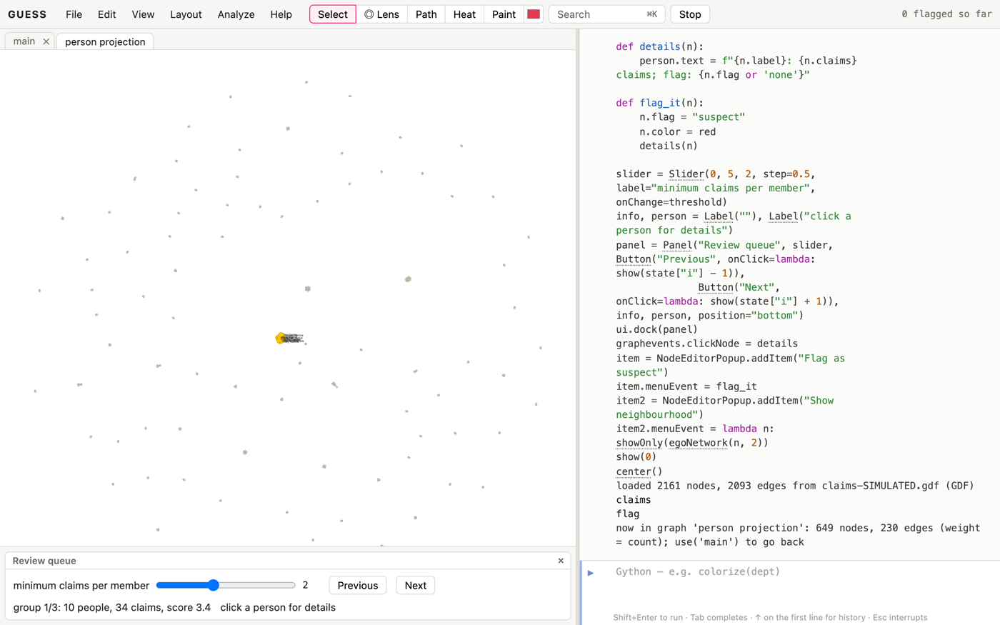

# Why networks?

Fraud, money laundering and organised crime are hard to see in a table.
One claim, one transfer or one company looks normal on its own. The
pattern only appears in the connections:

- the same phone number on six "unrelated" claims;
- a ring of accounts that passes money around and back to where it started;
- a dozen companies with one director;
- an account that collects many small deposits and sends a few large ones.

Investigative network analysis is mostly three moves:

1. **Resolve** duplicate entities, so one person is one node.
2. **Link** entities through what they share.
3. **Score** the groups and patterns that result, so a person can review the
   few that matter.

This book assumes the Kitchen. Its data are **simulated**. Real
investigation data are confidential, and simulated data let the recipes
prove they find what was planted. The people, companies and accounts are
invented.

| file | what it is |
|---|---|
| `claims-SIMULATED.gdf` | An insurance-claims network of 2,161 nodes: people, their phones and addresses, claims (`amount`, `day`), and the doctors and lawyers on each claim. `kind` says which. Planted in it are three fraud rings and 25 people entered twice under name variants. `ring` records what was planted. In real work this column wouldn't exist; it's here so you can check your findings. |
| `transfers-SIMULATED.gdf` | 400 bank accounts and 1,146 transfers (`amount`, `day`), directed from payer to payee. Planted in it are four round trips and one mule account, recorded in `pattern`. |

# Getting oriented

## Look at a multi-type network [Basic]{.level}

**You have** a network whose nodes are different kinds of thing. **You want**
to see what connects to what.

```python
makeFromGDF("claims-SIMULATED.gdf")
colorize(kind)
shapeBy(kind)
legendFor(kind)
[(grp[0].kind, len(grp)) for grp in groupBy(kind)]
```

**How it works.** Investigation data almost always mix entity types:
people and the identifiers they use (phones, addresses, emails, cars,
bank accounts), and the events that tie them together (claims, transactions,
calls). Colour and shape by type first, and count each kind, before any
analysis. Most structure, and most mistakes, come from how the types
connect.

# Resolving entities

## Find duplicate people [Intermediate]{.level}

**You want** to find people entered more than once: typos, nicknames,
reordered names, different formatting.

::: ingredients
**Ingredients:** `claims-SIMULATED.gdf` · `findDuplicates` · `mergeNodes`
:::

```python
makeFromGDF("claims-SIMULATED.gdf")
people = (kind == "person")
pairs = findDuplicates(label, among=people, threshold=0.7, show=False)
len(pairs)
def phones(p): return set(x for x in p.getNeighbors() if x.kind == "phone")
confirmed = [(a, b, sc) for a, b, sc in pairs if phones(a) & phones(b)]
len(confirmed)
mergeNodes(confirmed)
```

**How it works.** `findDuplicates(field)` compares names after
normalising them: case, accents and punctuation removed, words sorted (so
"Pell Shawn" matches "Shawn Pell"), and company suffixes and titles (Ltd,
Inc, Mr) dropped. It scores each pair from 0 to 1 and returns the pairs
above `threshold` for review. It never merges anything itself. Here it
finds 2,405 pairs at 0.7. Most are *namesakes*, different people with
similar names, which is exactly what happens in real data. Requiring
a second piece of evidence (a shared phone) leaves 25 pairs, which are
exactly the 25 planted duplicates.

`mergeNodes(pairs)` then merges each pair. The second node's edges move to
the first (parallel edges combine their weights), the first node's empty
fields are filled from the second, `aliases` records the other names, and
`merged` counts how many records the node now stands for. It's one undo
step.

**Pitfalls.**

- **Never merge on a name alone.** A false merge invents a connection that
  no one made, and in an investigation that's an accusation. Merge on
  agreement of independent identifiers (phone, date of birth, address),
  keep the `aliases`, and keep the undo.
- **Lower the threshold to find more, then filter.** At 0.85 the name
  match finds only 17 of the 25 duplicates, because initials and reordered
  names score lower. Find broadly, then confirm strictly.

# Shared identifiers

## Link people by what they share [Intermediate]{.level}

**You want** groups of people tied together by shared phones and
addresses.

```python
makeFromGDF("claims-SIMULATED.gdf")
project(kind, "person")
removeDisconnected()
recompute()
rows = groupStats(component, top=6)
```

**How it works.** `project(kind, "person")` links two people when they
share a neighbour: here, a phone or an address (claims belong to one
person each). After removing people who share nothing, each connected
component is a group bound by shared identifiers. `groupStats(field)`
profiles every group: size, internal and boundary edges, density, and
conductance (how sealed off it is). The largest groups here have 10, 8,
7 and 6 members. Three of those four are the planted rings, and the
other is an ordinary extended family at one address. Structure finds
the candidates, but it can't tell a ring from a family.

## Score the groups [Intermediate]{.level}

**You want** to rank groups by how suspicious they are, using what the
network doesn't show directly: the claims behind them.

```python
makeFromGDF("claims-SIMULATED.gdf")
addNodeField("claims", INTEGER, 0)
addNodeField("doctors", VARCHAR, None)
addNodeField("lawyers", VARCHAR, None)
addNodeField("days", VARCHAR, None)
for p in (kind == "person"):
    cs = [c for c in p.getNeighbors() if c.kind == "claim"]
    p.claims = len(cs)
    p.doctors = ";".join(sorted(set(d.label for c in cs for d in c.getNeighbors() if d.kind == "doctor")))
    p.lawyers = ";".join(sorted(set(d.label for c in cs for d in c.getNeighbors() if d.kind == "lawyer")))
    p.days = ";".join(str(c.day) for c in cs)
project(kind, "person")
removeDisconnected()
recompute()
def profile(members):
    docs = set(d for p in members for d in (p.doctors or "").split(";") if d)
    laws = set(d for p in members for d in (p.lawyers or "").split(";") if d)
    days = [int(d) for p in members for d in (p.days or "").split(";") if d]
    span = max(days) - min(days) if days else 0
    n = sum(p.claims for p in members)
    score = n / len(members) * (2 if len(docs) == 1 else 1) * (2 if len(laws) == 1 else 1) * (2 if span <= 31 else 1)
    return n, len(docs), len(laws), span, score
for rw in groupStats(component, show=False)[:6]:
    print(rw["size"], profile(rw["members"]))
```

**How it works.** Before projecting, each person is given fields
summarising their claims: how many, which doctors, which lawyers, which
days. The projection copies the fields along. Then each group is profiled,
and the profile becomes a simple score: claims per member, doubled if the
group uses a single doctor, a single lawyer, or files everything within a
month. The three rings stand out at once. Each files 17 to 34 claims
within 25 days through one doctor and one lawyer. The family has 5 claims
over 216 days, through four doctors.

**Pitfalls.** A score is a way to order the review queue, not a verdict.
Every ingredient here has an innocent explanation (families do share
doctors), and real schemes adapt to known rules. Prefer scores whose
parts an investigator can read and challenge over a black box.

# Money flows

## Follow the big money round in circles [Intermediate]{.level}

**You want** round trips: money that leaves an account and comes back
through others, which disguises where it came from.

::: ingredients
**Ingredients:** `transfers-SIMULATED.gdf` · `subgraph` · `findCycles`
:::

```python
makeFromGDF("transfers-SIMULATED.gdf")
len(findCycles(6))
subgraph(amount > 10000, "big money")
loops = findCycles(8)
for c in loops: print(c.annotation)
```

**How it works.** `findCycles(maxLength)` lists the directed cycles of up
to `maxLength` accounts. In a busy network many cycles occur by chance:
there are 155 short ones among the 400 accounts. `subgraph(amount > 10000)`
keeps only large transfers and the accounts they join (20 accounts, 19
transfers). In that graph the only cycles left are the four planted round
trips, of 3, 4, 5 and 6 accounts. Each loop's amounts shrink a little at
every hop (a fee skimmed each time), and the hops run on consecutive
days. Both are checks to apply to any cycle you find.

**Variations.** `showTime(day, field)` with a time window on the edges, or
`colorBy(day, ...)`, shows whether a loop's transfers follow each other
in time, as a real round trip must.

## Find the mule [Intermediate]{.level}

**You want** accounts that collect many small payments and pass the money
on in a few large ones.

```python
makeFromGDF("transfers-SIMULATED.gdf")
addNodeField("small_in", INTEGER, 0)
for n in g.nodes:
    n.small_in = sum(1 for e in n.getInEdges() if 800 <= e.amount < 1000)
for n in sortBy(small_in)[-3:]: print(n.name, n.small_in, n.indegree, n.outdegree)
mule = sortBy(small_in)[-1]
showOnly(egoNetwork(mule))
mule.color = red
```

**How it works.** A money mule's signature is *fan-in, fan-out*: many
senders, few recipients, the money passing straight through. Deposits
just under a reporting threshold are *structuring*. This recipe counts,
for each account, the incoming transfers between 800 and 1,000. Most
accounts have none or one or two. One stands out with 26 such deposits
from 26 different senders, and three large transfers out. `egoNetwork` shows its neighbours.

# Case study

## Case study: from claims to a referral [Intermediate]{.level}

An investigation is a sequence of narrowing steps, each one reviewable.
Here is the whole path for the claims data in one place:

```python
makeFromGDF("claims-SIMULATED.gdf")
def phones(p): return set(x for x in p.getNeighbors() if x.kind == "phone")
pairs = findDuplicates(label, among=(kind == "person"), threshold=0.7, show=False)
mergeNodes([(a, b, sc) for a, b, sc in pairs if phones(a) & phones(b)])
ss("resolved")
addNodeField("claims", INTEGER, 0)
for p in (kind == "person"): p.claims = sum(1 for c in p.getNeighbors() if c.kind == "claim")
project(kind, "person")
removeDisconnected()
recompute()
suspects = [rw for rw in groupStats(component, show=False) if sum(p.claims for p in rw["members"]) >= 2.5 * rw["size"]]
[(rw["size"], sum(p.claims for p in rw["members"])) for rw in suspects]
```

Resolve duplicates (with a saved state to return to). Give each person
their claim count, link people by shared identifiers, and keep only groups
filing at least 2.5 claims per member. Exactly the three rings remain
(the smallest files 17 claims among 6 people).
For a referral, export each group's subgraph from the resolved network
(`use("main")`, `subgraph(...)`, `exportPDF`) with its profile. The steps
above, saved with `history()`, are the method section of the report.

# Capstone

## Capstone: an investigator's workbench [Advanced]{.level}

**The problem.** A claims investigator works through a review queue. For
each suspicious group they want to see the group in context, read its
profile, drill into one person, and flag or clear them. This recipe builds
that workbench inside GUESS:

- a ranked queue of groups, with a slider for the minimum score;
- buttons to step through the queue;
- a profile that updates for each group;
- a click on a person shows their claims;
- right-click items to flag a person or expand their neighbourhood;
- a legend and a status bar showing progress.

```python
makeFromGDF("claims-SIMULATED.gdf")
addNodeField("claims", INTEGER, 0)
addNodeField("flag", VARCHAR, None)
for p in (kind == "person"): p.claims = sum(1 for c in p.getNeighbors() if c.kind == "claim")
project(kind, "person")
_ = removeDisconnected()
recompute()
forceAtlas2Layout()
queue = sorted(groupStats(component, show=False), key=lambda rw: -sum(p.claims for p in rw["members"]) / rw["size"])
state = {"i": 0, "min": 2.0}

def score(rw): return sum(p.claims for p in rw["members"]) / rw["size"]
def in_queue(): return [rw for rw in queue if score(rw) >= state["min"]]

def show(i):
    q = in_queue()
    if not q:
        info.text = "no group above the threshold"
        return
    state["i"] = i % len(q)
    rw = q[state["i"]]
    g.nodes.color = "210,210,210"
    g.nodes.size = 6
    g.nodes.labelvisible = false
    rw["members"].color = orange
    rw["members"].size = 16
    rw["members"].labelvisible = true
    info.text = (f"group {state['i'] + 1}/{len(q)}: {rw['size']} people, "
                 f"{sum(p.claims for p in rw['members'])} claims, score {score(rw):.1f}")
    StatusBar.setStatus(f"{len(flag == 'suspect')} flagged so far")

def threshold(v):
    state["min"] = float(v)
    show(0)

def details(n):
    person.text = f"{n.label}: {n.claims} claims; flag: {n.flag or 'none'}"

def flag_it(n):
    n.flag = "suspect"
    n.color = red
    details(n)

slider = Slider(0, 5, 2, step=0.5, label="minimum claims per member", onChange=threshold)
info, person = Label(""), Label("click a person for details")
panel = Panel("Review queue", slider, Button("Previous", onClick=lambda: show(state["i"] - 1)),
              Button("Next", onClick=lambda: show(state["i"] + 1)), info, person, position="bottom")
ui.dock(panel)
graphevents.clickNode = details
item = NodeEditorPopup.addItem("Flag as suspect")
item.menuEvent = flag_it
item2 = NodeEditorPopup.addItem("Show neighbourhood")
item2.menuEvent = lambda n: showOnly(egoNetwork(n, 2))
show(0)
center()
```



**How it works.**

- **The queue.** The work happens in the person network linked by shared
  identifiers (the shared-identifiers recipe), with each person's claim
  count copied along. `queue` holds every group, ranked by claims per
  member. `state` keeps the reviewer's place and the slider's threshold,
  and `in_queue()` is the queue above that threshold.
- **The controls.** `Slider`, `Button` and `Label` build the controls, and
  `Panel` and `ui.dock` put them below the graph. Moving the slider calls
  `threshold`. The buttons call `show`, which greys out everyone else,
  enlarges and labels the group, and rewrites the profile line.
- **Clicks and menus.** `graphevents.clickNode = details` runs on every
  click on a node. `NodeEditorPopup.addItem` adds the two right-click
  menu items, and `StatusBar.setStatus` keeps the flag count in view.

**Variations.**

- `exportApp()` saves the workbench as a page that a colleague can open
  with the same data and controls.
- Add a `Dropdown` of doctors to review by provider, or a second slider
  over `day` with `showTime` to replay a ring's activity.
- A `Checkbox` that hides cleared groups.
