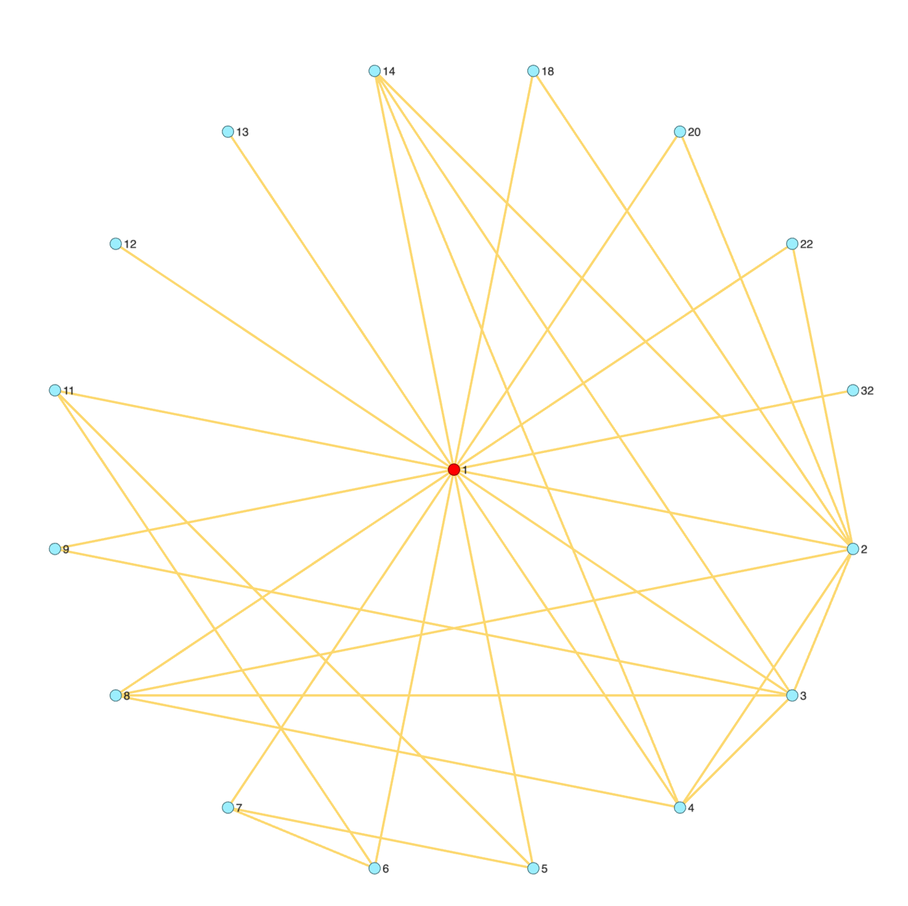
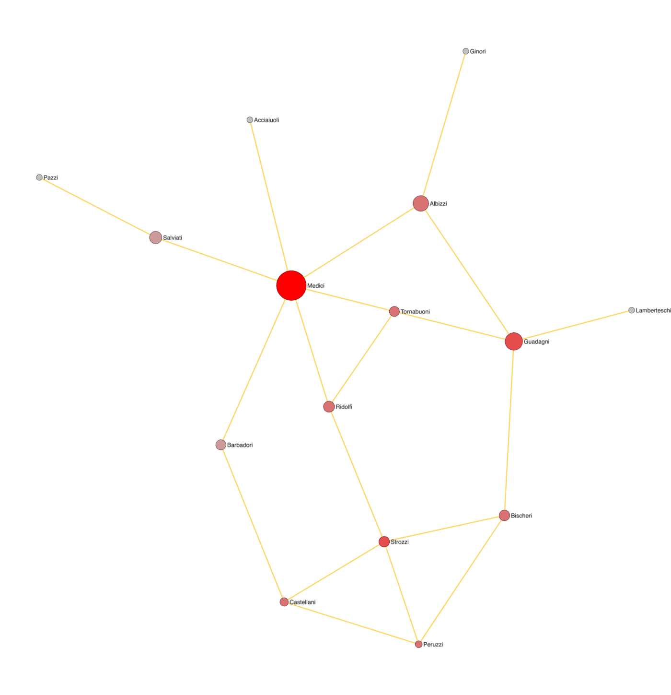
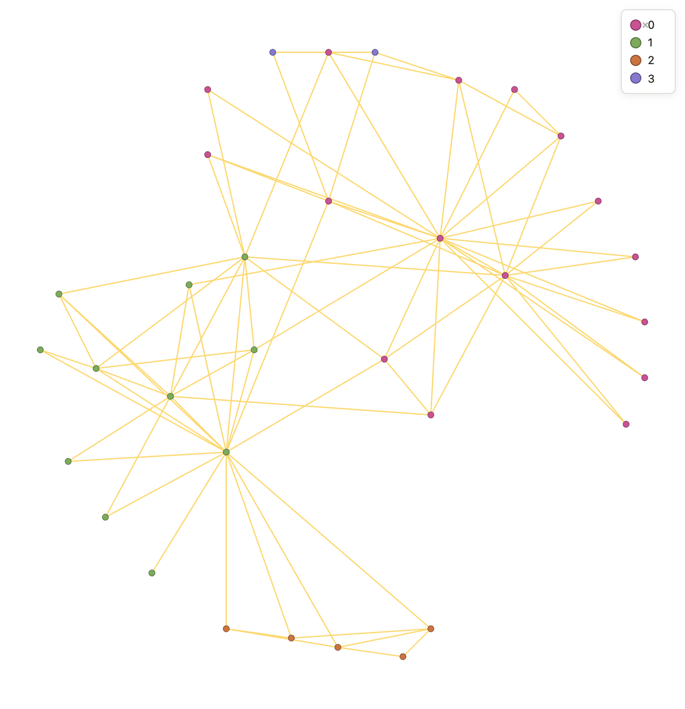
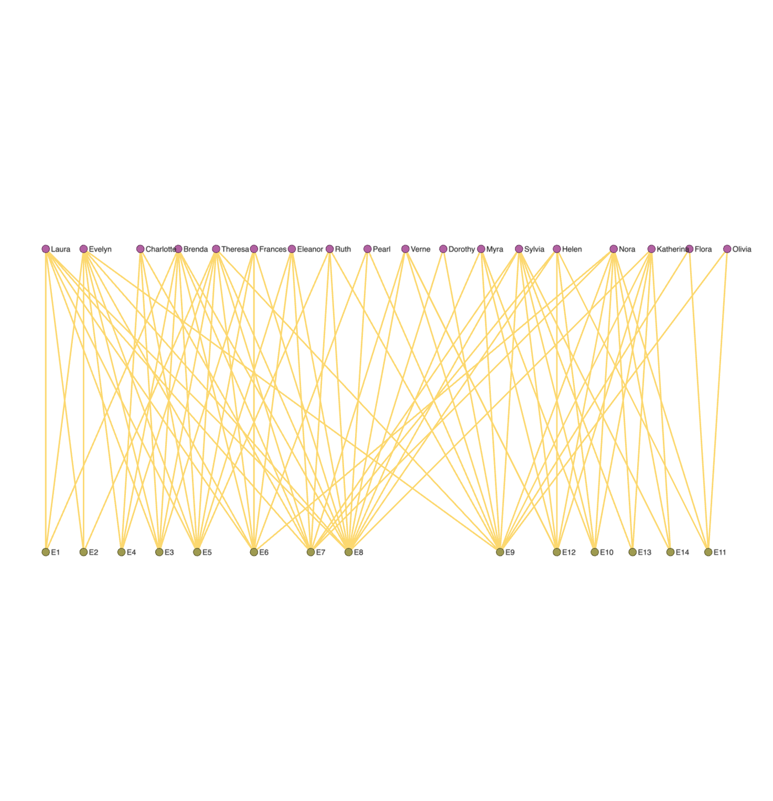
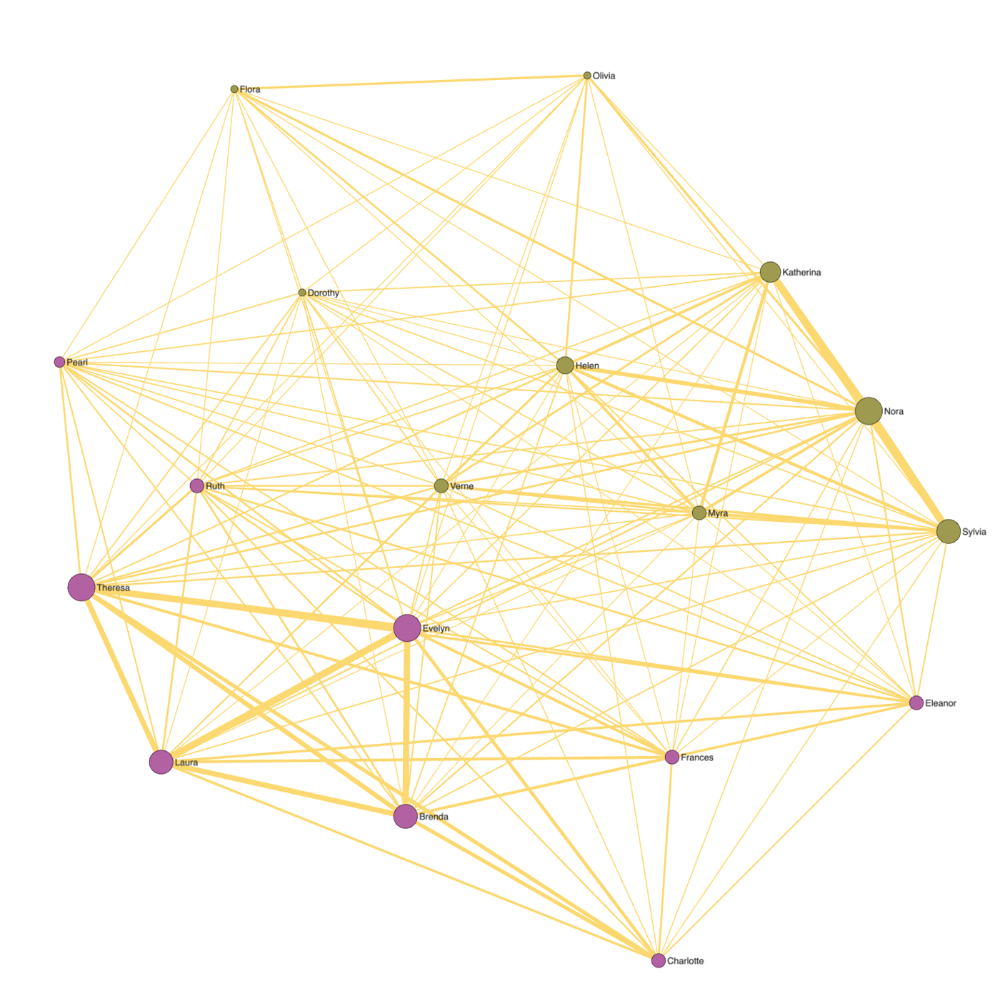
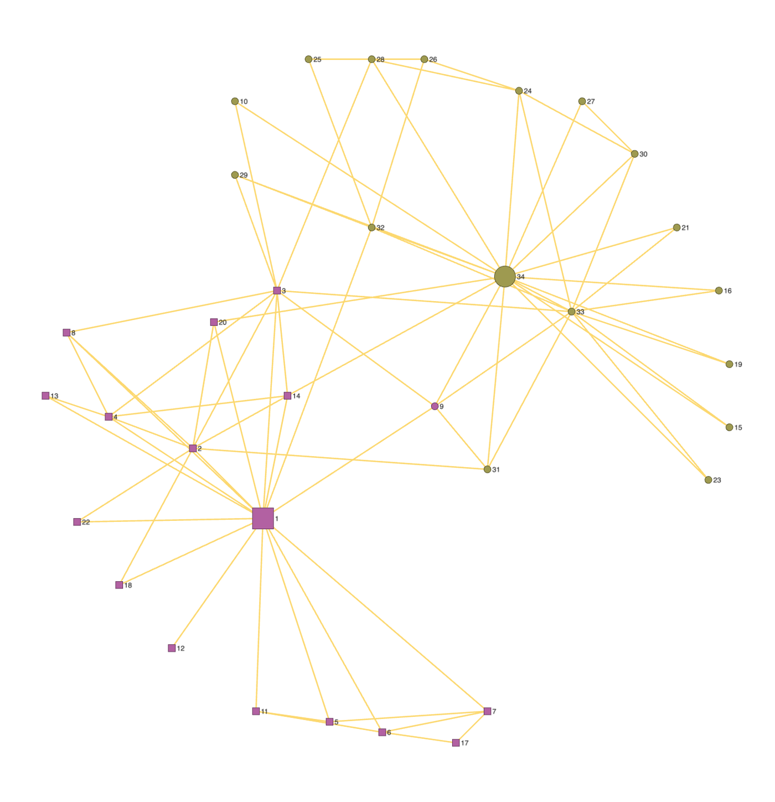
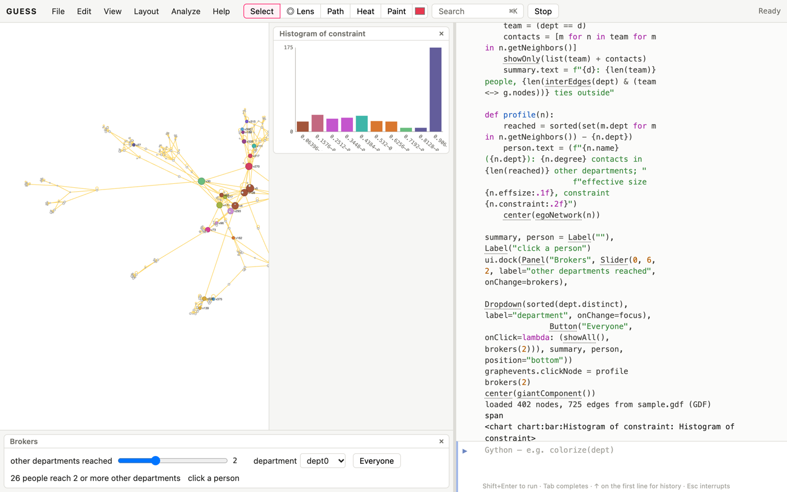

# Why networks?

Social network analysis studies people (or teams, firms, countries) through
their relations: who advises, befriends, marries, cites or trades with whom.
The questions are old. Who holds power? Who connects groups that otherwise
don't talk? Do people cluster with others like them? Do roles exist that
different people fill in the same way? What the network adds is that the
answers depend on *patterns of ties*, not just on each person's attributes.

This book assumes the Kitchen (*The GUESS Kitchen*) for loading, querying
and drawing. Its data, in the cookbooks' `data` folder, are classic
small networks whose results you can compare with the literature:

| file | what it is |
|---|---|
| `karate.gdf` | Zachary's karate club: 34 members of a university club that split in two after a dispute between the instructor (`m1`) and the club's officer (`m34`). `club` says which side each joined. Edge `weight` is the number of contexts in which two members met. |
| `florentine.gdf` | Marriage ties among 15 leading families of Renaissance Florence (Padgett). |
| `southern-women.gdf` | Davis, Gardner and Gardner's two-mode data: 18 women and the 14 social events (`E1`–`E14`) each attended. `kind` is `woman` or `event`. |
| `adamic-glance.gdf` | Links among 40 influential US political blogs in 2004, with each blog's `leaning`. Directed. |
| `sample.gdf` | GUESS's own example: an organisation of 402 employees in departments (`dept`), with communication frequency (`freq`) on the ties. |

Network data has two shapes. In *sociocentric* (whole-network) data, every
tie in a bounded group is recorded, as in the karate club. In *egocentric*
data, each respondent describes their own contacts and the ties among them.
Most recipes work on both; ego recipes work on either.

# Ego networks

## Draw one person's world [Basic]{.level}

**You have** a whole network. **You want** to see it from one member's point
of view: their contacts (alters) and how those contacts are tied to each other.

::: ingredients
**Ingredients:** `karate.gdf` · `egoNetwork` · `subgraph`
:::

```python
makeFromGDF("karate.gdf")
ego = egoNetwork(m1)
subgraph(ego, "m1's world")
radialLayout(m1)
rescaleLayout(700, 700)
m1.color = red
labelBy(label)
alters = ego.difference([m1])
len(alters), len(alters <-> alters)
```



**How it works.** `egoNetwork(node, depth)` is the node plus everyone within
`depth` steps (1 by default). `subgraph` opens it as a graph of its own
(`use("main")` goes back), so the layout arranges only the ego network.
`showOnly(ego)` would instead hide everything else in place.
`alters <-> alters` is the set of ties among
the contacts. The instructor has 16 contacts with 18 ties among them out
of 120 possible, so his contacts mostly don't know each other: he is the
hub that holds his side of the club together.

**Variations.** `egoNetwork(m1, 2)` adds friends of friends. For egocentric
survey data, load each respondent's network as its own graph (`newGraph`, then
`use` to switch between them) or keep them in one graph with an `ego` field.

## Ego density and effective size [Basic]{.level}

**You want** numbers that summarise an ego network, to compare people.

```python
makeFromGDF("karate.gdf")
alters = egoNetwork(m34).difference([m34])
ties = len(alters <-> alters)
possible = len(alters) * (len(alters) - 1) / 2
ties / possible                         # ego density
m34.effsize, m34.constraint
```

**How it works.** *Ego density* is the share of possible ties among the
alters that exist: high when the alters form a closed group, low when the
ego bridges otherwise separate people. Burt's *effective size* (`effsize`)
counts alters minus their redundancy: 10 contacts who all know each other
are effectively fewer than 10. *Constraint* (`constraint`) is high when an
ego's contacts are few and tied to each other, which leaves the ego no
alternatives. Both are built-in node fields, computed for every node on
first use, so `sortBy(constraint)[:5]` gives the least constrained people.

# Centrality and power

## Which kind of central? [Basic]{.level}

**You want** to know who is important, and to understand why the measures
disagree.

```python
makeFromGDF("karate.gdf")
for n in sortBy(betweenness)[-5:]:
    print(n.label, n.degree, round(n.betweenness, 1), round(n.eigenvector, 3))
```

**How it works.** Each measure models a different idea of importance.
*Degree* is activity: how many ties. *Betweenness* is control: how often a
node lies on the shortest paths between others, so its removal would
lengthen them. *Closeness* is reach: how few steps to everyone.
*Eigenvector* centrality is status: ties to people who are themselves well
tied. The instructor and the officer top every list here. Further down
the lists differ. Member `m32` has only 6 ties but almost the betweenness
of `m33`, who has 12, because `m32`'s friends are on both sides of the club.

**Pitfalls.** Betweenness and closeness assume things flow along shortest
paths. Gossip, which wanders, is better modelled by `rwbetweenness`
(random-walk betweenness) or `pagerank`.

## The Medici: power from position [Intermediate]{.level}

**You have** the Florentine marriage network. **You want** to see why one
family dominated without having the most of anything.

::: ingredients
**Ingredients:** `florentine.gdf` · `betweenness` · `scatterLayout`
:::

```python
makeFromGDF("florentine.gdf")
kkLayout()
sizeBy(betweenness, 10, 50)
colorBy(degree, lightgray, red)
labelBy(name)
Medici.degree, Strozzi.degree
round(Medici.betweenness, 1), round(Strozzi.betweenness, 1)
```



**How it works.** The Medici have six marriage ties, the Strozzi four, but
the Medici lie on nearly half of all shortest paths between families. They
married into families that weren't tied to each other, so other families
reached each other through them. This is Padgett's classic argument:
the Medici's power came from bridging, not from size.

**Variations.** `scatterLayout(degree, betweenness)` with labels on puts
each family at its degree (x) and betweenness (y). Families far above the
diagonal are brokers.

# Brokerage and structural holes

## Find the brokers between groups [Intermediate]{.level}

**You have** an organisation with formal departments. **You want** the people
who connect departments.

::: ingredients
**Ingredients:** `sample.gdf` · `interEdges` · `constraint` · `cutNodes`
:::

```python
makeFromGDF("sample.gdf")
crossing = interEdges(dept)
crossing.color = red
addNodeField("ndepts", INTEGER, 0)
for n in g.nodes: n.ndepts = len(set(m.dept for m in n.getNeighbors()))
brokers = (ndepts >= 3)
brokers.color = orange
sortBy(brokers, constraint)[:5]
len(crossing), len(brokers)
```

**How it works.** A *structural hole* is a gap between two groups with no
direct ties. People who span it see information from both sides early and
can broker between them. This recipe stores, for each person, how many
departments their contacts belong to (`ndepts`). Among those spanning three
or more, the least constrained are the strongest brokers. `cutNodes()` gives
the extreme case: people whose departure would disconnect part of the
organisation.

**Pitfalls.** A tie across a hole is valuable only if the groups differ in
what they know. Check that the groups are meaningful before celebrating the
brokers.

# Cohesive subgroups

## Cores, cliques and cohesive blocks [Intermediate]{.level}

**You want** the tight-knit groups inside a network.

```python
makeFromGDF("karate.gdf")
frLayout()
colorBy(coreness, lightgray, red)
[sorted(n.label for n in c) for c in largestCliques()]
cohesiveBlocks()
```

**How it works.** A *clique* is a group where everyone is tied to everyone:
the strictest definition, and brittle (one missing tie breaks it). A
*k-core* relaxes it: everyone has at least *k* ties inside the group.
`coreness` gives each member's deepest core, so colouring by it shows the
club's dense centre. *Cohesive blocks* (Moody and White) are nested groups
that stay connected after removing any *k*−1 members, so they catch groups
held together by many independent paths.

## Communities and the split they predict [Basic]{.level}

```python
makeFromGDF("karate.gdf")
frLayout()
louvainClusters()
colorize(modularity_class)
shapeBy(club)
compareClusters(modularity_class, club)
```

**How it works.** Community detection finds groups denser inside than
between. Here, colour is the found community and shape is the side each
member actually joined after the split. The two largely coincide: the
fault line was visible in the friendships before the club broke up. See
the case study for a sharper version.

# Roles and positions

## Find structurally equivalent members [Advanced]{.level}

**You want** *roles*: sets of people tied in the same way to the same
others, whether or not they're tied to each other. Leaders who share the
same followers, or followers who share the same leaders, are examples.

::: ingredients
**Ingredients:** `karate.gdf` · `blockmodel` · `collapseBy`
:::

```python
makeFromGDF("karate.gdf")
frLayout()
blockmodel(4)
colorize(position)
legendFor(position)
```



**How it works.** `blockmodel(k)` compares every pair of members' tie
profiles (whom they're tied to) by correlation and groups the most
similar into *k* positions, stored in `position`. The printed *image
matrix* gives the density of ties from each position to each other. A
dense diagonal cell means a cohesive position. A dense off-diagonal cell
with a sparse diagonal means a role that serves another, such as followers
who all tie to the same leaders but not to each other. In the karate club,
two large positions follow the two sides. A third position, members 5, 6, 7,
11 and 17, is a satellite of the instructor: tied to him and to each other
but to almost no one else. A fourth is the pair 25 and 26, who share the
same few officer-side contacts.

**Variations.** `collapseBy(position)` draws the reduced graph: one node per
position. Try several *k*: there is no single right number, only
more or less useful simplifications.

**Pitfalls.** Communities and positions answer different questions. A
position can hold people with no ties to each other at all (the followers
of one leader), and a community can mix leaders and followers.

# Homophily and mixing

## Do like link to like? [Basic]{.level}

**You have** a network and an attribute. **You want** to know whether ties
stay within groups.

::: ingredients
**Ingredients:** `adamic-glance.gdf` · `assortativity` · `mixingMatrix`
:::

```python
makeFromGDF("adamic-glance.gdf")
colorize(leaning)
interEdges(leaning).color = gray
assortativity(leaning)
mixingMatrix(leaning)
```

**How it works.** `assortativity(field)` is near 1 when ties stay within
values, 0 when they mix at random, and negative when they cross values.
`mixingMatrix` shows the counts behind it. For these 40 blogs the
assortativity is about 0.29: positive, but 210 of the 706 links cross
sides. These are the most prominent blogs, which watched and answered each
other. Adamic and Glance's study of many more blogs found the two sides
far more separated.

**Pitfalls.** Homophily has two explanations that the network alone can't
separate: people choose similar others (*selection*), or tied people grow
alike (*influence*). Telling them apart needs data over time.

# Directed ties

## Reciprocity, triads and status [Intermediate]{.level}

**You have** directed ties (advice, citation, links). **You want** to know
how often they're returned and whether they form a hierarchy.

```python
makeFromGDF("adamic-glance.gdf")
reciprocity()
mutualEdges().color = red
triadCensus()
sortBy(authority)[-3:], sortBy(hub)[-3:]
```

**How it works.** *Reciprocity* is the share of directed ties returned.
The *triad census* counts the 16 kinds of three-node configuration.
Many transitive triads (A→B, B→C, A→C) and few cycles (A→B→C→A) suggest
a ranking. Many cycles suggest exchange among equals. Among the blogs, 61% of
links are returned, and transitive triads outnumber cycles 455 to 29: a
pecking order, not a ring. `authority` and
`hub` (HITS) split status into being pointed to by good hubs (authorities)
and pointing to good authorities (hubs).

# Two-mode networks

## People and the events they attend [Intermediate]{.level}

**You have** a two-mode (bipartite) network: people and the groups,
events or organisations they belong to. **You want** to see it, and then
to study the people through what they share.

::: ingredients
**Ingredients:** `southern-women.gdf` · `bipartiteLayout` · `project`
:::

```python
makeFromGDF("southern-women.gdf")
bipartiteLayout(kind)
colorize(kind)
labelBy(name)
```



**How it works.** `bipartiteLayout(field)` draws the two kinds of nodes in
two rows and orders each row to reduce crossings, so groups of women who
attend the same events cluster together.

## Project onto one kind [Intermediate]{.level}

```python
makeFromGDF("southern-women.gdf")
project(kind, "woman", method="newman")
frLayout()
sizeBy(affiliations, 8, 30)
sizeBy(weight, 1, 8)
louvainClusters(); colorize(modularity_class)
labelBy(name)
```



**How it works.** `project(kind, "woman")` makes a new graph of just the
women, tying two when they attended an event together, and switches to it
(the two-mode graph stays: `use("main")` goes back). Every edge stores
`shared`, the number of events in common, and `weight` according to
`method`:

| method | weight | use when |
|---|---|---|
| `"count"` | the events shared | events are similar in size |
| `"jaccard"` | shared ÷ events either attended | some people attend everything |
| `"newman"` | each shared event adds 1/(its size − 1) | big events say less about a tie than small ones |

`affiliations` is each woman's number of events. The communities found
in the projection recover the two cliques that Davis and the Gardners
described.

**Variations.** `project(kind, "event")` gives the dual: events tied by the
women they share, which shows how the social calendar hung together.

**Pitfalls.** Projection makes dense, clique-ridden networks (everyone at one
event becomes a clique), so degree and clustering in the projection are
inflated. Compare with the two-mode graph, and prefer weighted measures.

# Case studies

## Case study: the karate club split [Intermediate]{.level}

Zachary watched a university karate club for two years, during which a
dispute between the instructor and the club's officer split it in two. He
asked whether the split could be predicted from the friendships before it.

```python
makeFromGDF("karate.gdf")
frLayout()
(m1, m34).color = red
(m1, m34).size = 30
labelBy(label)
```

First, look: the instructor (`m1`) and the officer (`m34`) sit at the
centres of two loosely joined halves.

```python
fl = minCut(m1, m34)
fl
```

Zachary's own prediction was a minimum cut: the fewest friendship ties
that, removed, separate the two leaders. `minCut(a, b)` returns those ties.

```python
addNodeField("side", VARCHAR, None)
for n in g.nodes:
    closer = len(shortestPath(n, m1)) <= len(shortestPath(n, m34))
    n.side = "Mr Hi" if closer else "Officer"
compareClusters(side, club, method="ari")
louvainClusters(resolution=0.6)
compareClusters(modularity_class, club, method="ari")
colorize(club)
shapeBy(modularity_class)
```



**Reading it.** A naive rule (each member follows whichever leader is fewer
steps away) gets an adjusted Rand index of 0.67 against the real split. It
misplaces members 25, 26 and 32, who are close to the instructor in steps
but bound to the officer's side by their friends. Louvain at a coarse
resolution (two communities) does better, at 0.88, and gets exactly one
member wrong: `m9`. Three of his five friends were on the officer's side,
yet he followed the instructor. Zachary's explanation is one no network
holds: he was close to his black-belt examination, and staying with the
instructor protected years of training. Report the mistakes, not just the
score.

## Case study: marriage, money and the Medici [Intermediate]{.level}

```python
makeFromGDF("florentine.gdf")
kkLayout()
labelBy(name)
heatMap(Medici)
for n in sortBy(betweenness)[-4:]:
    print(n.name, n.degree, round(n.betweenness, 1), round(n.constraint, 2))
```

The heat map colours families by marriage distance from the Medici. Eleven
of the other fourteen families are within two steps, and several reach
each other only through them. Their constraint is the lowest of any family, because their
in-laws weren't in-laws of each other. Now remove them and see what's left:

```python
ss("with")
remove(Medici)
recompute()
colorize(component)
graphStats()
```

`recompute()` matters here. Computed fields such as `component` and
`betweenness` are calculated the first time they're used and kept, so
after editing the graph, recompute them. Without the Medici the network
falls into three pieces: the Acciaiuoli alone, the Pazzi and Salviati
together, and the other eleven. Their marriages were the glue of the
elite, which is why marrying into them was worth so much. `ls("with")`
brings them back.

## Case study: the formal and the informal organisation [Advanced]{.level}

Every organisation has two structures: the chart (departments, reporting
lines) and the network of who actually talks to whom. Where they differ
is where coordination happens, or fails.

```python
makeFromGDF("sample.gdf")
colorize(dept)
louvainClusters()
compareClusters(modularity_class, dept)
mixingMatrix(dept, show=False)["dept4"]
```

The found communities agree with departments fairly well (normalized
mutual information about 0.75, where 1 is identical), but Louvain finds 44
communities for 21 departments: departments contain several working
groups. `mixingMatrix(dept)[d]` shows where one department's ties go.

```python
assortativity(dept)
subgraph(freq > 100, "heavy ties")
assortativity(dept)
```

`subgraph(freq > 100, "heavy ties")` opens a graph of just the 367 heavy
communication ties and the people they join (`use("main")` goes back). If assortativity by department rose there,
departments would be where the real work happens. If it fell, the
important work would cross department lines. Here it barely moves (0.77
to 0.76): heavy and light ties follow the chart alike. The exceptions are
the brokers (*Find the brokers between groups*): the few people whose
heavy ties cross departments.

# Capstone

## Capstone: finding the brokers in an organisation [Advanced]{.level}

**The problem.** An organisational consultant wants to find the people
who connect departments, and to understand each one's position. Who are
they? Which departments do they bridge? How redundant are their contacts?
This recipe builds a broker finder on the sample organisation:

- people are coloured by department and sized by how many departments
  their contacts span;
- a slider sets the minimum span to count as a broker, and the others fade;
- a drop-down focuses on one department and its outside ties;
- a click on a person shows their brokerage profile and highlights their
  ego network;
- a chart shows how constraint is distributed.

```python
makeFromGDF("sample.gdf")
forceAtlas2Layout()
colorize(dept)
addNodeField("span", INTEGER, 0)
for n in g.nodes: n.span = len(set(m.dept for m in n.getNeighbors()) - {n.dept})
sizeBy(span, 4, 26)
plotHistogram(constraint)

def brokers(v):
    g.nodes.labelvisible = false
    picked = (span >= int(v))
    g.nodes.color = "215,215,215"
    colorize(dept)
    (span < int(v)).color = "225,225,225"
    picked.labelvisible = true
    summary.text = f"{len(picked)} people reach {int(v)} or more other departments"

def focus(d):
    team = (dept == d)
    contacts = [m for n in team for m in n.getNeighbors()]
    showOnly(list(team) + contacts)
    summary.text = f"{d}: {len(team)} people, {len(interEdges(dept) & (team <-> g.nodes))} ties outside"

def profile(n):
    reached = sorted(set(m.dept for m in n.getNeighbors()) - {n.dept})
    person.text = (f"{n.name} ({n.dept}): {n.degree} contacts in {len(reached)} other departments; "
                   f"effective size {n.effsize:.1f}, constraint {n.constraint:.2f}")
    center(egoNetwork(n))

summary, person = Label(""), Label("click a person")
ui.dock(Panel("Brokers", Slider(0, 6, 2, label="other departments reached", onChange=brokers),
              Dropdown(sorted(dept.distinct), label="department", onChange=focus),
              Button("Everyone", onClick=lambda: (showAll(), brokers(2))), summary, person, position="bottom"))
graphevents.clickNode = profile
brokers(2)
center(giantComponent())
```



**How it works.**

- **The measure.** `span` counts, for each person, the departments their
  contacts belong to beyond their own: the raw material of brokerage (the
  brokerage recipe).
- **The slider.** It recolours and relabels so that only people above
  the threshold stand out. It doesn't hide anyone, so the brokers stay in
  context.
- **The drop-down.** It shows one department and everyone its members are
  tied to, with a count of the department's ties outside.
- **The click.** It reports the person's Burt measures, `effsize` and
  `constraint` (the ego-network recipe), and zooms to their ego network.
- **The chart.** `plotHistogram(constraint)` shows the distribution in a
  panel, so you can see where a given person falls.
