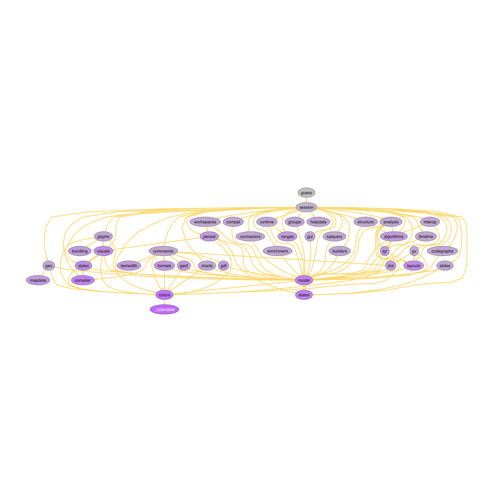
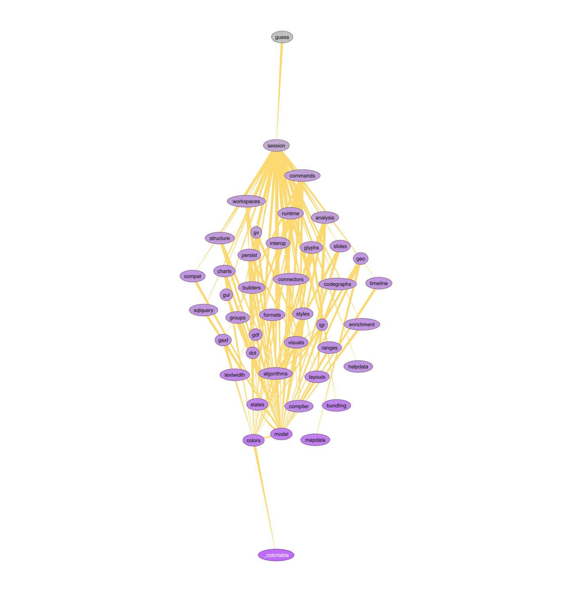
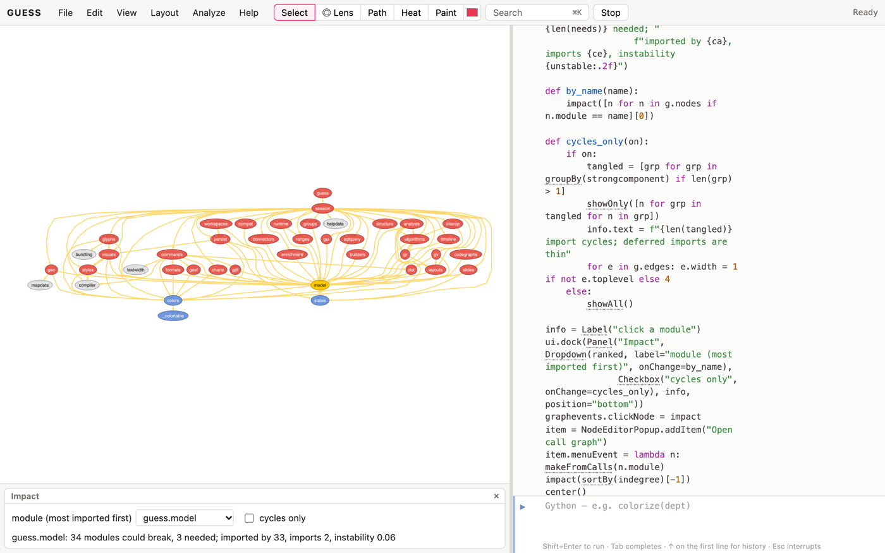

# Why networks?

Software is built from parts that depend on each other: modules import
modules, functions call functions, services call services, packages
require packages. Most architecture questions are network questions:

- What depends on what, and in which direction?
- Are there cycles, and are they dangerous?
- If I change this module, what could break?
- Which parts does everything rely on, and which are safe to change?
- Is the code organised the way its folders say it is?

This book assumes the Kitchen for loading, querying and drawing. It
analyses Python code, which GUESS can read without running it. The same
recipes work on any dependency graph you can export, for example as DOT
from tools for other languages. Its data are in the cookbooks' `data`
folder:

| file | what it is |
|---|---|
| `networkx-imports.gdf` | The module import graph of the networkx package, version 3.7: 288 modules and 784 import links (importer → imported). |
| `guess-imports.gdf` | GUESS's own Python package: 42 modules and 106 import links, a snapshot taken while writing this book. |

Both were made with `makeFromImports` (first recipe). They're snapshots
so that the numbers in this book stay true. Run the command on the
installed packages to see their current state.

# Getting code in

## Read a package's import graph [Basic]{.level}

**You have** a Python package (installed, or a folder of source). **You
want** its modules and who imports whom.

::: ingredients
**Ingredients:** an installed package or a source folder · `makeFromImports`
:::

```python
makeFromImports("networkx")
sizeBy(lines, 3, 30)
dotLayout()
```

**How it works.** `makeFromImports(target)` parses every `.py` file of a
package (by name, such as `"networkx"`, or a folder or file path) without
running it. It makes a node per module and an edge from each module to
each module of the same package it imports. Nodes get `module` (the dotted
name), `package` (the parent package), `depth`, `lines`, `functions` and
`classes`. Edges get `weight` (the number of import statements) and
`toplevel` (false when the import happens only inside a function, a
*deferred* import). `level=2` merges modules into their subpackages for a
bird's-eye view, `external=true` adds the outside packages imported, and
`tests=true` includes test modules. In the browser, the packages GUESS
ships with (networkx, numpy, igraph) and GUESS itself (`"guess"`) can be
read the same way.

**Variations.** For other languages, most ecosystems have a tool that
writes the dependency graph as DOT, and `makeFromDOT` opens it. Function
call graphs come from `makeFromCalls` (*Call graphs*, below).

# Structure

## Draw the layers [Basic]{.level}

```python
makeFromGDF("guess-imports.gdf")
labelBy(label)
g.nodes.labelpos = "inside"
fitNodesToLabels()
dotLayout()
colorBy(generation, lightgray, purple)
```



**How it works.** Laid out top to bottom with `dotLayout()`, an import
graph shows the system's layers: modules at the top import, and modules
at the bottom are imported. `generation` is each module's topological
level, from 0 for modules nothing imports (here only the package itself)
downwards. Cycles are broken for the layout, and the edges that close
them point upwards. In GUESS, the data model (`model`) and the colour
table (`colors`) are at the bottom, imported by nearly everything, and the
session at the top ties the parts together.

**Layers without breaking cycles.** `generation` needs the cycles broken
first. `rankNodes()` instead gives every module a height directly, a
*rank*, chosen so that imports point downhill as often as possible (the
SpringRank method: each import pulls the importer one unit above the module
it imports). Cycles are no problem: the modules in one just end up at
nearly the same height.

```python
makeFromGDF("guess-imports.gdf")
labelBy(label)
g.nodes.labelpos = "inside"
fitNodesToLabels()
rankNodes()                               # 0.97: the share of imports that point down
orderedLayout(rank, axis="y", inverted=True)
colorBy(rank, purple, lightgray)
```



`rankNodes` stores the height in the field `rank` (0 at the bottom) and
returns the share of edges that point down: 97% here, so GUESS is close to
strictly layered. The package `guess` is at the top (3.9), then the
session (2.9) and the commands; the colour table, the map data, `colors`
and `model` are at the bottom. Only 3 of the 106 imports point up, and they
are the ones to look at: `algorithms` → `igr`, `model` → `states` and
`visuals` → `styles`. All three are imports made inside a function, the
usual way to avoid a circular import. `orderedLayout` fixes each module's height by its rank and spreads
them sideways.

## Which modules does everything depend on? [Basic]{.level}

```python
makeFromGDF("guess-imports.gdf")
addNodeField("instability", DOUBLE, 0)
for n in g.nodes:
    ca, ce = n.indegree, n.outdegree
    n.instability = ce / (ca + ce) if ca + ce else 0
for n in sortBy(indegree)[-5:]: print(n.module, n.indegree, n.outdegree, round(n.instability, 2))
```

**How it works.** `indegree` counts the modules that import a module (its
*afferent coupling*, in Robert Martin's terms) and `outdegree` the modules it
imports (*efferent coupling*). Martin's *instability* is outdegree ÷
(indegree + outdegree). Near 0, a module is depended on but depends on
little: it's hard to change (everything relies on it) but has little
reason to change. Near 1, a module depends on others but nothing depends on
it, so it's easy to change. Healthy code points dependencies towards stable
modules. `guess.model` is imported by 33 of GUESS's 42 modules, and its
instability is close to 0, as a data model's should be.

# Cycles

## Find the import cycles [Intermediate]{.level}

```python
makeFromGDF("guess-imports.gdf")
cycles = [grp for grp in groupBy(strongcomponent) if len(grp) > 1]
[sorted(n.module for n in grp) for grp in cycles]
for grp in cycles:
    for e in (grp <-> grp): print(e.node1.module, "->", e.node2.module, "deferred" if not e.toplevel else "")
```

**How it works.** `strongcomponent` groups modules that can reach each
other by following imports: every group of two or more is a cycle (two
modules that import each other, or a longer loop). Python tolerates an
import cycle when at least one import in it runs late, inside a function,
after both modules have loaded. A cycle of only top-level imports can fail
at start-up depending on which module is imported first. GUESS has three
two-module cycles (`algorithms`–`igr`, `model`–`states` and
`styles`–`visuals`). In each, at least one direction is deferred, so all
three are safe. `feedbackEdges()` lists a small set of edges whose removal
would break every cycle: the places to refactor first.

# Change impact

## What could a change break? [Basic]{.level}

**You want** to know, before changing a module, which other modules could
be affected.

```python
makeFromGDF("guess-imports.gdf")
affected = ancestors(guess_model)
affected.color = red
guess_model.color = orange
len(affected), len(g.nodes)
```

**How it works.** An edge runs from importer to imported, so the modules
that can be affected by a change to `model` are its *ancestors*: everything
that imports it, directly or through others. Here that's 34 of 42 modules.
Change it carefully and test widely. `descendants(m)` goes the other way:
everything `m` needs, which is what you must ship or mock to test it alone.

## Who controls access to whom? [Advanced]{.level}

```python
makeFromGDF("guess-imports.gdf")
dominatorTree(guess_session)
sorted(set(n.idom for n in g.nodes if n.idom))
```

**How it works.** In the graph reached from `session`, a module's
*immediate dominator* (`idom`) is the last module that every import path
from `session` to it must pass through. Modules that dominate others are
gatekeepers. Here most modules are dominated by `session` itself (it
imports them directly), and a few are reached only through `commands`,
`colors`, `geo` or `glyphs`. That's a map of which modules load which,
useful when deciding what to load lazily.

# Organisation

## Does the code follow its folders? [Intermediate]{.level}

```python
makeFromGDF("networkx-imports.gdf")
remove(module == "networkx")
leidenClusters()
compareClusters(leiden_class, package)
colorize(leiden_class)
```

**How it works.** The folders (packages) are the intended structure, and
the communities of the import graph are the actual one: groups of modules
that import each other more than they import the rest. `compareClusters`
scores the agreement (1 = identical). For networkx it's about 0.65:
broadly organised by folder, with algorithms that lean on other folders'
helpers. Look at the modules whose community differs from their folder.
They're often misplaced, or a sign that two folders are really one.

**Pitfalls.** The package root distorts everything. Nearly every networkx
module does `import networkx as nx`, which links each module to the root,
so the first step is `remove(module == "networkx")`. The same happens in
any package whose `__init__.py` re-exports its contents.

## A package-level view [Basic]{.level}

```python
makeFromImports("networkx", level=2)
labelBy(module)
sizeBy(lines, 10, 60)
circoLayout()
```

**How it works.** `level=2` merges every module into its two-level parent
(`networkx.algorithms.flow.maxflow` becomes `networkx.algorithms`), giving
a dozen subpackages and the imports between them: the architecture diagram
a newcomer needs, drawn from the code rather than from memory.

# Call graphs

## Map who calls whom in a module [Intermediate]{.level}

```python
makeFromCalls("guess.structure")
sizeBy(indegree, 6, 30)
colorize(public)
labelBy(function)
forceAtlas2Layout()
unused = [n.function for n in g.nodes if n.indegree == 0 and not n.public]
unused
```

**How it works.** `makeFromCalls(module)` makes a node per function and
method, and an edge for each call it can resolve by name: `f()`,
`self.f()`, `Class.f()`. Nodes get `function`, `cls`, `lines`, `params` and
`public` (no leading underscore). The most-called functions are the
module's helpers. Private functions that nothing in the module calls are
candidates for dead code. Here there are three: `_constraint`, `_effsize`
and `_generation`. None of them is dead. They compute the `constraint`,
`effsize` and `generation` fields, and they're listed in a table of
computed fields rather than called. So before deleting a function, check
that it isn't used from outside (`grep`), registered in a table or as a
callback, or called through a variable.

**Pitfalls.** Matching by name is an approximation. Calls through
variables, to other modules or by dynamic dispatch are missed, and two
functions with the same name in different classes can be confused. Treat
the graph as a map for reading code, not a proof.

# Case studies

## Case study: the cycle hidden in `import networkx as nx` [Intermediate]{.level}

```python
makeFromGDF("networkx-imports.gdf")
len(feedbackEdges()), len(strongcomponent.distinct)
root = (module == "networkx")
root[0].indegree
remove(root)
len(feedbackEdges())
max(groupBy(strongcomponent), key=len)
```

At first sight networkx is riddled with cycles: `feedbackEdges()` lists
260 edges to break. Nearly all of them pass through the package root. Its
`__init__.py` imports the subpackages so that users can write
`nx.shortest_path`, and 253 modules import the root back. Remove the root
and only 9 cycle-closing edges remain. Most sit in one knot
of seven modules inside `networkx.utils`, which provides the decorators and
backend dispatching that the rest of the library builds on. The pattern is
typical of convenient top-level APIs. It's harmless at run time, because
Python finishes loading the root before the submodules use it, but it hides
the real structure from naive analysis. Remove the facade before you read
the architecture.

## Case study: GUESS, read by GUESS [Basic]{.level}

```python
makeFromGDF("guess-imports.gdf")
sizeBy(lines, 8, 50)
colorBy(indegree, lightgray, red)
labelBy(label)
dotLayout()
sortBy(lines)[-3:]
```

The book's last recipe is the program reading itself. GUESS's largest
modules are `layouts` (the layout algorithms), `model` (graphs, nodes,
edges and fields) and `session` (the console and the protocol to the
page). Colour by indegree and the foundation is plain: `model` and
`colors` are imported by most of the system, and each command module
(`structure`, `analysis`, `geo`, `builders`…) is imported only by the
session, which installs it. That's the shape you want: new commands, like
the ones added for these cookbooks, can be written without touching
anything that depends on them.

# Capstone

## Capstone: a refactoring impact assistant [Advanced]{.level}

**The problem.** A developer is about to change a module, and wants to
know the blast radius first. What imports it, directly and indirectly?
What does it need? Is it caught in a cycle? This recipe builds the
assistant on GUESS's own import graph:

- modules are laid out in layers;
- a click (or a pick from a drop-down ranked by fan-in) colours everything
  the module could break red, and everything it needs blue;
- a label shows the counts and the module's instability;
- a checkbox shows only the modules caught in import cycles, with the
  deferred imports dashed;
- a right-click opens the module's call graph.

```python
makeFromGDF("guess-imports.gdf")
labelBy(label)
g.nodes.labelpos = "inside"
fitNodesToLabels()
dotLayout()
ranked = [n.module for n in reversed(sortBy(indegree))]

def impact(n):
    g.nodes.color = "225,225,225"
    hurt, needs = ancestors(n), descendants(n)
    hurt.color = "230,90,80"
    needs.color = "110,150,220"
    n.color = orange
    ca, ce = n.indegree, n.outdegree
    unstable = ce / (ca + ce) if ca + ce else 0
    info.text = (f"{n.module}: {len(hurt)} modules could break, {len(needs)} needed; "
                 f"imported by {ca}, imports {ce}, instability {unstable:.2f}")

def by_name(name):
    impact([n for n in g.nodes if n.module == name][0])

def cycles_only(on):
    if on:
        tangled = [grp for grp in groupBy(strongcomponent) if len(grp) > 1]
        showOnly([n for grp in tangled for n in grp])
        info.text = f"{len(tangled)} import cycles; deferred imports are thin"
        for e in g.edges: e.width = 1 if not e.toplevel else 4
    else:
        showAll()

info = Label("click a module")
ui.dock(Panel("Impact", Dropdown(ranked, label="module (most imported first)", onChange=by_name),
              Checkbox("cycles only", onChange=cycles_only), info, position="bottom"))
graphevents.clickNode = impact
item = NodeEditorPopup.addItem("Open call graph")
item.menuEvent = lambda n: makeFromCalls(n.module)
impact(sortBy(indegree)[-1])
center()
```



**How it works.**

- **Blast radius.** `impact` combines the change-impact recipe
  (`ancestors` for what could break, `descendants` for what's needed) with
  Martin's instability, for whichever module is clicked or chosen.
- **The drop-down.** It's ranked by `indegree`, so the most risky
  modules to change come first.
- **The cycles view.** The checkbox reuses the import-cycles recipe,
  showing only modules in a `strongcomponent` of two or more and drawing
  top-level imports thick and deferred ones thin.
- **The right-click item.** It opens the module's call graph with
  `makeFromCalls`, which reads the live source (in place of the
  snapshot). Run `makeFromGDF("guess-imports.gdf")` again to come back.
