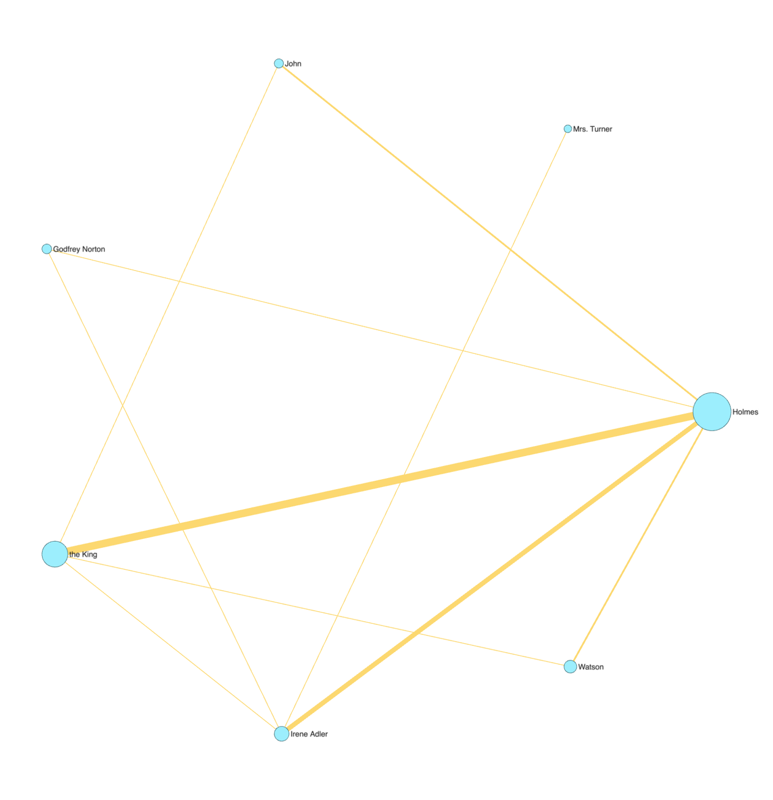
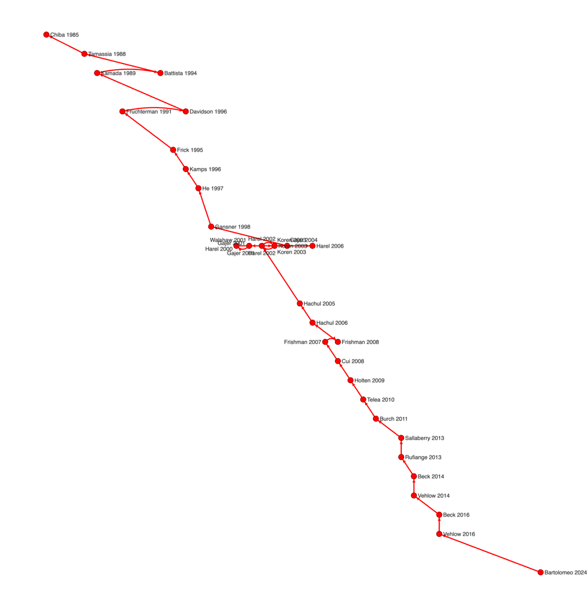
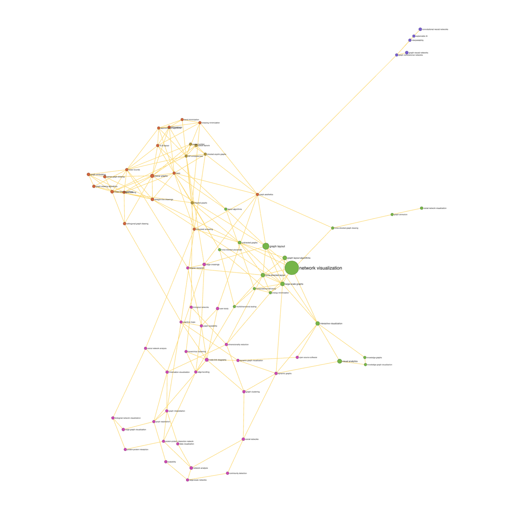

# Why networks?

Texts and the literature about them are full of implicit networks.
Characters share scenes, words share sentences, papers cite papers,
authors write together, and documents share vocabulary. Making these
networks explicit answers questions such as:

- Who is at the centre of a story, and who connects its worlds?
- What are the themes of a corpus, and how do they relate?
- Where did a research field come from, and how is it organised?

This book assumes the Kitchen for loading, querying and drawing. Its data
are in the cookbooks' `data` folder:

| file | what it is |
|---|---|
| `scandal-in-bohemia.txt` | Arthur Conan Doyle's "A Scandal in Bohemia" (1891), the first Sherlock Holmes short story. Public domain, from Project Gutenberg. |
| `vis-papers.gdf` | 1,044 highly cited papers whose titles mention graph drawing, graph layout or network/graph visualisation (1980–2024), with the 4,073 citations among them (citing → cited). Node fields: `title`, `year`, `cites` (citations from anywhere), `firstauthor`, `venue`. From OpenAlex, CC0. |
| `vis-papers-nodes.csv` | the same papers as a node table |
| `vis-paper-authors.csv` | paper, author: one row per authorship |
| `vis-paper-keywords.csv` | paper, keyword, score: OpenAlex's keywords for each paper |

# Networks from text

## Map the characters of a story [Basic]{.level}

**You have** a story. **You want** its cast as a network: who appears with
whom.

::: ingredients
**Ingredients:** `scandal-in-bohemia.txt` · `makeFromText`
:::

```python
cast = {"Holmes": ["Holmes", "Sherlock"], "Watson": ["Watson", "Doctor"],
        "Irene Adler": ["Irene Adler", "Irene", "Miss Adler", "the woman", "Mrs. Norton"],
        "the King": ["King", "Majesty", "Count Von Kramm", "Von Kramm"],
        "Godfrey Norton": ["Godfrey Norton", "Godfrey", "Mr. Norton"],
        "John": ["John"], "Mrs. Turner": ["Mrs. Turner"]}
makeFromText("scandal-in-bohemia.txt", cast)
sizeBy(count, 10, 50)
sizeBy(weight, 1, 10)
labelBy(label)
circleLayout()
```



**How it works.** `makeFromText(file, terms)` splits the text into
paragraphs and links two characters when they're named in the same one.
`weight` counts those paragraphs. Each character is a key in the
dictionary, and its list holds every way the text refers to them, so
"Irene Adler", "Miss Adler" and "the woman" all count for one node. Nodes get
`count` (mentions), `units` (paragraphs) and `first` (the first paragraph
they appear in). The strongest tie is Holmes and the King (8 paragraphs),
then Holmes and Irene Adler (5). The story is about the contest between
them, conducted through a client.

**Variations.** `by="sentence"` uses smaller units, giving fewer, more
intimate links. `window=15` links names within 15 words of each other.
`scatterLayout(first, count)` puts each character at the point where they
enter the story, which gives a rough cast timeline.

**Pitfalls.** Mentions aren't presence. Watson is named only 11 times
because he narrates, as "I". A first-person narrator is everywhere and
nowhere in a co-occurrence network. Pronouns ("he", "she") aren't counted
at all. Treat the network as "who is named together".

## Build a word network [Intermediate]{.level}

**You have** text with no list of names. **You want** its main words and how
they cluster.

```python
makeFromText("scandal-in-bohemia.txt", maxTerms=50, minCount=4,
             stopwords=["cried", "come", "came", "asked", "looked", "know", "see"])
remove(weight < 2)
louvainClusters()
colorize(modularity_class)
sizeBy(count, 6, 30)
labelBy(label)
forceAtlas2Layout()
```

**How it works.** Without `terms`, `makeFromText` takes the `maxTerms` most
frequent words that occur at least `minCount` times, ignoring a built-in
list of common English words (*the*, *of*, *said*…) and any `stopwords`
you add. `remove(weight < 2)` drops pairs that co-occur only once, the
usual first step against a hairball. Communities then group words that
keep company.

**Pitfalls.** In a single short story, frequent words are mostly the story's
furniture (*room*, *door*, *street*), and communities are weak
(modularity around 0.2). Word networks earn their keep on larger corpora
(many abstracts, many speeches), with a domain stopword list and a stricter
weight threshold.

# Citation networks

## Explore a citation network [Basic]{.level}

::: ingredients
**Ingredients:** `vis-papers.gdf` · `indegree` · `pagerank` · `generation`
:::

```python
makeFromGDF("vis-papers.gdf")
removeDisconnected()
for n in sortBy(indegree)[-5:]: print(n.indegree, n.cites, n.label, n.title[:50])
for n in sortBy(pagerank)[-5:]: print(round(n.pagerank, 3), n.label, n.title[:50])
```

**How it works.** Edges run from the citing paper to the cited one, so
`indegree` counts citations *within this set*. `cites` is the paper's
citation count from anywhere, which is much larger. Fruchterman and
Reingold's 1991 force-directed paper is the most cited here. `pagerank`
rewards papers cited by well-cited papers, so it favours foundations: the
annotated bibliography of Di Battista et al. (1994) and Eades's 1984
spring heuristic rank highest. `generation` is each paper's topological
level, counting back through chains of citation.
`removeDisconnected()` drops the 265 papers with no citation links to the
rest of the set.

## Find the main path of a field [Intermediate]{.level}

**You want** the backbone of a field's history: the chain of papers through
which most of its citation paths run.

```python
makeFromGDF("vis-papers.gdf")
removeDisconnected()
mp = mainPath()
showOnly(mp)
g.edges.visible = false
mp.visible = true
scatterLayout(year, generation)
mp.color = red
labelBy(label)
g.nodes.labelpos = "outside"
optimizeLabels()
```



**How it works.** `mainPath()` performs main path analysis (Hummon and
Doreian). For every citation it counts how many chains from the newest
papers back to the oldest pass through it (its *search path count*,
stored as `spc`, a share of all such chains). Then it follows the
heaviest links. `showOnly(mp)` keeps the path's papers, and
`mp.visible = true` (after hiding every edge) keeps only its citations.
`scatterLayout(year, generation)` lays it out as a timeline: year across,
citation depth up. Here the path runs from Chiba et al. (1985) and Tamassia
et al. (1988) through Kamada–Kawai (1989) and Fruchterman–Reingold (1991)
to the multilevel methods of 2000–2006 (Walshaw, Harel and Koren,
Hachul and Jünger). It then turns to edge bundling (2008–2010, including
Holten's force-directed bundling), then to the visualisation of dynamic
graphs (2011–2016), and ends at a 2024 review of how layout algorithms are
evaluated. That's the field's arc from drawing small graphs to drawing
large and changing ones.

**Variations.** `sizeBy(spc, 1, 10)` (before `showOnly`) widens edges by
their path count, showing the main path and its strongest tributaries.

**Pitfalls.** The main path is only as good as the paper set. It can't
pass through work that the search missed. Citation cycles (papers citing
each other's preprints) are ignored, so check `feedbackEdges()` if the
path looks odd.

## Name the research fronts [Intermediate]{.level}

**You want** the field's subareas, each with a name.

```python
makeFromGDF("vis-papers.gdf")
removeDisconnected()
leidenClusters()
kw = readSets("vis-paper-keywords.csv", item="paper", set="keyword")
for grp in groupBy(leiden_class)[:6]:
    best = enrichment(grp, kw, show=False)[0]
    print(len(grp), best["set"], sortBy(grp, indegree)[-1].label)
```

**How it works.** Communities in a citation network are groups of papers
that cite each other: research fronts. `enrichment` names each one by its
most over-represented keyword (*Biology: Find modules and name them*),
and the most cited member makes a good exemplar. The fronts found here
are force-directed layout (around Fruchterman–Reingold), node-link
diagrams and surveys (around Di Battista et al.'s book), planar and
linear-time algorithms, aesthetics and symmetry (around Purchase's
readability studies), hierarchical and Graphviz-style layout (around
Gansner et al.), and dynamic network visualisation.

# Co-authorship and keywords

## Who writes with whom? [Intermediate]{.level}

**You have** a table of papers and their authors. **You want** the
collaboration network.

::: ingredients
**Ingredients:** `vis-paper-authors.csv` · `makeFromTwoMode` · `project`
:::

```python
makeFromTwoMode("vis-paper-authors.csv", "paper", "author")
crowded = [n for n in g.nodes if n.kind == "paper" and n.degree >= 20]
len(crowded)
for p in crowded: remove(p)
project(kind, "author")
removeDisconnected()
for n in sortBy(affiliations)[-5:]: print(n.label, n.affiliations, n.degree)
```

**How it works.** `makeFromTwoMode(file, "paper", "author")` reads one
row per authorship as a two-mode network: paper and author nodes, with
`kind` saying which. `project(kind, "author")` then links authors who
wrote together (*SNA: Project onto one kind*). `affiliations` is each
author's number of papers in the set. Peter Eades, Stephen Kobourov and
Roberto Tamassia have the most.

**Pitfalls.** One paper with 25 authors adds 300 ties to the projection,
and swamps the collaboration structure. Here, four such papers turn out to
be atmospheric science: the title search for "force-directed" matched
"direct ... forcing". Look at the outliers before projecting. They're
where data problems hide. Removing papers with 20 or more authors fixes
both problems.

## Map the keywords [Intermediate]{.level}

```python
makeFromTwoMode("vis-paper-keywords.csv", "paper", "keyword")
project(kind, "keyword", method="jaccard")
remove(affiliations < 8)
remove(weight < 0.05)
showOnly(giantComponent())
louvainClusters()
colorize(modularity_class)
sizeBy(affiliations, 12, 60)
labelBy(label)
labelSizeBy(affiliations)
forceAtlas2Layout()
```



**How it works.** Projecting papers × keywords onto the keywords links
two keywords when papers share them. Jaccard weights (shared papers ÷
papers with either) keep a ubiquitous keyword like "network visualization"
(382 papers) from linking to everything. Removing rare keywords (in fewer
than 8 papers) and weak links leaves 86 keywords. The 73 that stay connected
form a thematic map whose communities are the field's topics. Filter
first, then keep the largest component, since each removal can strand
more nodes.

# Similarity

## Link documents with similar content [Intermediate]{.level}

**You have** documents described by features (keywords, term counts,
measurements). **You want** each document linked to the ones most like it,
whether or not they cite each other.

::: ingredients
**Ingredients:** `vis-paper-keywords.csv`, `vis-papers-nodes.csv` · `makeFromSimilarity`
:::

```python
makeFromSimilarity("vis-paper-keywords.csv", features="keyword", values="score", k=4)
makeFromCSV("vis-papers-nodes.csv")
leidenClusters()
kw = readSets("vis-paper-keywords.csv", item="paper", set="keyword")
for grp in groupBy(leiden_class)[:5]:
    print(len(grp), enrichment(grp, kw, show=False)[0]["set"])
```

**How it works.** `makeFromSimilarity` turns a table into a network:
each row (here, each paper) is linked to its `k` most similar rows. The
table can be *wide* (one column per feature) or, as here, *long*, with one
row per paper, keyword and score (`features=` and `values=` name the
columns). `method` chooses the similarity:

| method | similar when | use for |
|---|---|---|
| `"cosine"` (default) | profiles point the same way | term weights, keyword scores |
| `"correlation"` | values rise and fall together | expression profiles, time series |
| `"jaccard"` | the same features are present | yes/no data |
| `"euclidean"` | values are close | measurements on one scale |

`threshold=0.5` links every pair at least that similar instead of the top
`k`, and `mutual=true` keeps only pairs that are in each other's top `k`.
`makeFromCSV` then adds titles and years from the node table.

**Pitfalls.** A k-nearest-neighbour network links every node to *k* others,
even an outlier with no real neighbours, so look at the weights
(`plotHistogram(weight)`). A threshold network leaves outliers isolated,
which is often more honest.

# Knowledge graphs

## Query Wikidata [Intermediate]{.level}

**You want** a network from a public knowledge graph, here "influenced by"
links among philosophers.

```{.python .norun}
q = """SELECT ?source ?sourceLabel ?target ?targetLabel WHERE {
  ?source wdt:P106 wd:Q4964182; wdt:P737 ?target .
  ?target wdt:P106 wd:Q4964182 .
  SERVICE wikibase:label { bd:serviceParam wikibase:language "en". }
} LIMIT 400"""
makeFromSPARQL(q)
sizeBy(indegree, 6, 40)
labelBy(label)
g.nodes.labelpos = "outside"
forceAtlas2Layout()
```

**How it works.** `makeFromSPARQL(query)` runs a SPARQL query (on Wikidata
unless you give another endpoint) whose rows bind `?source` and `?target`.
`?sourceLabel`/`?targetLabel` become labels, and any other variables
become edge fields. In Wikidata, `P106` is occupation, `Q4964182` is
philosopher and `P737` is "influenced by", so edges run from each
philosopher to their influences. The most cited influences are Aristotle,
Marx, Plato, Hegel and Descartes.

**Pitfalls.** Knowledge graphs are incomplete in uneven ways: famous,
Western and recent subjects are better covered. `LIMIT` also truncates
silently. Read the result as "what Wikidata records", and check the
total count with a `COUNT(*)` query.

# Case studies

## Case study: the contest in "A Scandal in Bohemia" [Basic]{.level}

```python
cast = {"Holmes": ["Holmes", "Sherlock"],
        "Irene Adler": ["Irene Adler", "Irene", "Miss Adler", "the woman",
                        "Mrs. Norton"],
        "the King": ["King", "Majesty", "Count Von Kramm", "Von Kramm"],
        "Godfrey Norton": ["Godfrey Norton", "Godfrey", "Mr. Norton"]}
makeFromText("scandal-in-bohemia.txt", cast)
[(n.label, n.first, n.units) for n in sortBy(first)]
```

The `first` field gives the order of entrances. Irene Adler is named in
the third paragraph (Watson's frame: she is "the woman"), long before the
King appears (paragraph 47), and Godfrey Norton comes last. Holmes is tied
to both the King and Irene Adler, and Norton only to her. The King and
Irene Adler, whose quarrel is the story, are never named in the same
paragraph, though he spends pages telling her story. In dialogue, speakers
are rarely named, so the paragraphs where he speaks about her don't
mention him. A co-mention network shows who is *named* together. Here
that means the plot runs through Holmes, but conversations don't show up.
For a play, where every speech is labelled with its speaker, link speakers
by scene instead.

## Case study: how graph drawing grew up [Advanced]{.level}

```python
makeFromGDF("vis-papers.gdf")
removeDisconnected()
leidenClusters()
mp = mainPath()
addNodeField("decade", INTEGER, 0)
kw = readSets("vis-paper-keywords.csv", item="paper", set="keyword")
names = {}
for grp in groupBy(leiden_class)[:8]:
    names[grp[0].leiden_class] = enrichment(grp, kw, show=False)[0]["set"]
for n in g.nodes: n.decade = n.year // 10 * 10
for d in (1980, 1990, 2000, 2010):
    fronts = sorted(groupBy(decade == d, leiden_class), key=len)[-3:]
    top = [(names.get(f[0].leiden_class, "other"), len(f)) for f in reversed(fronts)]
    print(d, len(decade == d), top)
```

This puts the pieces together. Each research front is named by its top
keyword, and the papers of each decade are counted by front. In the 1980s
and 1990s the largest front is algorithmic ("linear-time algorithms":
planar and orthogonal drawing), with layout second. By the 2000s, the
force-directed "network visualization" front and the "node-link diagrams"
front have caught up. In the 2010s node-link work (bundling, surveys,
evaluation) leads. Overlay the main path (`mp.color = red`), which moves
through the same fronts in the same order. One citation network and three
recipes (communities, their names, the main path) give a defensible short
history of a field. Check it against what its practitioners say, of
course.
