# 1. GUESS features

GUESS is a tool for exploring graphs: social networks, citation networks,
communication logs, biological pathways, anything with nodes and edges. You
look at the graph, and you talk to it in a language built for the job. That
was the idea in 2006 and it hasn't changed. What has changed is everything
underneath: GUESS now runs in a web browser, there is nothing to install,
and the language is Python 3.

This tool is/includes:

- **Gython**, Python 3 extended with operators for selecting and changing
  nodes and edges. `(freq > 100).color = red` colours every edge whose `freq`
  field is over 100. `(dept == 'dept4') - (dept == 'dept9')` gives the edges
  between two departments. These are real Python expressions, so you can store
  them in variables, loop over them and write functions around them.
- **A zoomable view** of the graph. You can pan, zoom, hover for details, and
  select with clicks, boxes and lassos. Drags can mean something: after a
  circle layout, dragging a node reorders the ring.
- **A console made of cells.** Every command you run stays on the screen and
  can be edited, re-run, undone and redone. Output that mentions nodes or edges
  is linked back to the graph.
- **Fields and queries.** Nodes and edges carry properties (fields). You query
  them, map them to colour, size, shape and labels, chart them, and run SQL
  over them.
- **Analysis**: centrality measures computed on demand, communities
  (Louvain, edge betweenness, bicomponents), shortest paths, filters, and
  random graph generators.
- **Layouts**: ForceAtlas2, GEM, Fruchterman–Reingold, Kamada–Kawai, MDS,
  Sugiyama (layered), radial, circle, tree, hive plots, scatter plots by field,
  and overlap removal.
- **States and animation.** Save the graph as a named state, change things,
  and *morph* smoothly between states. Ranges and a timeline let you look at
  graphs that change over time.
- **Many formats in and out**: GDF (the GUESS format), GEXF (Gephi), GraphML,
  GML, Graphviz DOT, Pajek, UCINET DL, CSV, URLs, SPARQL endpoints (e.g.
  Wikidata), NDEx and Neo4j. Out: GDF, GEXF, GraphML, GML, CSV, PNG, JPG, GIF, SVG, PDF, PostScript/EPS,
  WebM movies, notebooks and HTML reports.
- **Interface building.** Panels, buttons, sliders and timers are a few lines
  of Gython. Package a graph and its interface as an *app*: a link that opens
  straight into your interactive figure.
- **Help everywhere**: a searchable command and example index, signature
  hints as you type, a guide to every mouse gesture, and error messages that
  point at the line and suggest the name you probably meant.

This tool isn't:

- A replacement for Gephi, Cytoscape, UCINET, Pajek or networkx. GUESS is for
  *exploring*: looking, asking, changing, and looking again. It does a fair
  amount of analysis, and when you need more it's still Python.
- A tool for enormous graphs. Tens of thousands of nodes are fine. Millions
  are not what it's built for.

\newpage

# 2. Getting started

## 2.1 Opening GUESS

GUESS is a web page. Open its address in a current browser (Chrome, Edge,
Firefox or Safari) and wait a few seconds. The first visit downloads the
Python runtime, which takes a little while. After that it's cached, and
GUESS also works offline. When it's ready, the sample graph appears and the
console says `loaded 402 nodes, 725 edges`.

Nothing you load leaves your computer. Files you open are read by the page
itself, and your work is autosaved in the browser. If you close the tab and
come back, the graph, the history and the display are where you left them.
Python variables you defined are not kept, but the commands that made them
are in the history. *File → Start fresh* forgets all of it (the saved
session, the history, your settings) and starts again with the sample graph.

The data files used by the GUESS cookbooks are there too: open them by name,
e.g. `makeFromGDF("karate.gdf")`. Each is downloaded the first time it's used.

If you want to run your own copy, on a laptop with no network or on your
group's web server, see [Deploying GUESS](#deploying-guess).

## 2.2 The window

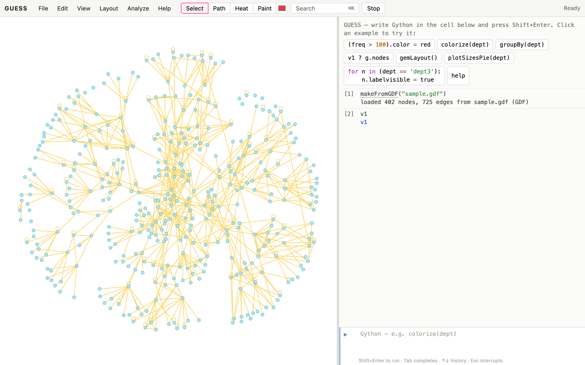

The window has three parts:

- **The graph** (left). This is where you look, hover, click and drag.
- **The console** (right). Commands go in the working cell at the bottom. Each
  command you run becomes a numbered cell above it, followed by its output.
  You can drag the divider between the graph and the console. On a narrow
  screen the console moves below the graph.
- **The menu bar** (top): *File*, *Edit*, *View*, *Layout*, *Analyze* and
  *Help*, then the click tools (*Select*, *Lens*, *Path*, *Heat*, *Paint*,
  *Cluster* and a paint colour), a *Search* box, *Stop*, and a status line.

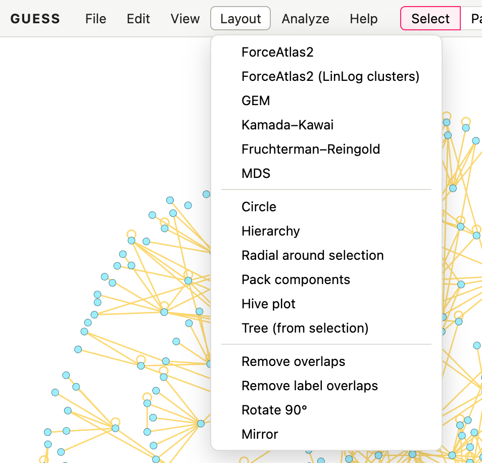{width=70%}

Most menu items simply run a Gython command and show it in the console. This
is deliberate. If you lay out the graph from the *Layout* menu, the console
shows `forceAtlas2Layout()`, and the next time you can type it, change its
options, or put it in a script.

## 2.3 Finding help

There are several ways in:

- **Help → Take the tour**, or `demo()` in the console, is a guided tour for
  newcomers. In 17 steps it goes from selecting nodes, through colouring,
  charts, centrality, communities and paths, to a what-if analysis, an Altair
  chart, a contagion model and a small app. Each step explains one idea and
  shows its code. *Run it* runs the code as a normal console cell (*Edit
  first* lets you change it), and a note then says what to look for.
  `demo(9)` starts at step 9; `demo("advanced")` at the advanced steps.
- **The code box's hint** suggests `demo()` on your first visit. After that
  it shows, in turn, short commands that work on the graph you have open,
  using its own fields and names: `colorize(club)` on the karate club,
  `plotHistogram(freq)` on the sample graph.
- **Help → Help and examples** (or **F1**) opens a panel with two tabs. *Commands &
  examples* is a searchable list of every command and a set of worked
  examples; click an example to put it in the console. *Mouse & gestures*
  explains, with pictures, everything the mouse does.
- **Search** (or **Cmd/Ctrl+K**) is a command palette. Type a few letters to
  find commands, examples, menu actions, nodes and fields.
- `help(colorize)` in the console prints the documentation of a command.
  `help()` alone opens the help panel.
- Hovering over a command name in the console shows its documentation. Typing
  `colorize(` shows its signature, and **Tab** completes names.
- When something goes wrong, the error names the line and, for misspelled
  names, the name you probably meant. Click *details* for the full Python
  traceback.
- **Help → Manual** opens this manual in a new tab, as a web page, PDF, EPUB
  or Word file. **Help → GitHub** opens the project's page, with the source
  code and issue tracker.

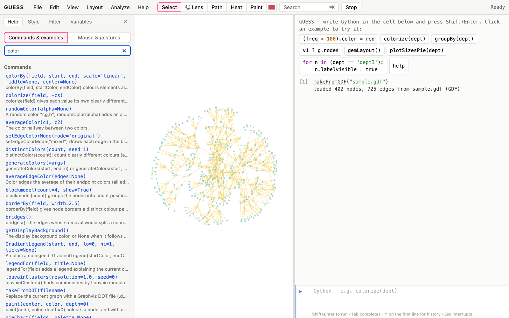{width=85%}

\newpage

# 3. Tutorial

Let's start with a simple example. The sample graph that GUESS opens with
(`sample.gdf`) has about 400 nodes and 700 edges. It represents a corporate
communication network. Each node is an employee with a department (the
`dept` field). Each edge is communication between two employees, and its
`freq` field is the number of messages. If you've replaced the sample with
something else, *File → Sample graph* brings it back.

First, some basics. Try moving around in this space:

- Drag the background to pan. Scroll or pinch to zoom. Double-click the
  background to fit the whole graph.
- Hover over a node or edge to see its fields. Hovering an edge also rings its
  two endpoints, so you can see where it goes.
- Click a node to focus on it and its neighbours. Click again, or press Esc,
  to clear. Double-click a node to zoom to it.
- Drag a node to move it.

Now click in the working cell at the bottom of the console. You're talking to
a Python 3 interpreter. Type `2+2` and press **Shift+Enter** (or
Cmd/Ctrl+Enter). It answers 4. Plain **Enter** adds a new line, so longer
code is easy to write:

```python
def fact(a):
    if a == 1:
        return 1
    else:
        return a * fact(a - 1)

fact(5)
```

Press Shift+Enter and you get 120. Through the console you can also control
what you see. Type `center` and press Shift+Enter: the display zooms to fit
all the nodes. Commands that take no arguments don't need the parentheses.

Nodes can be selected by name or by a query on their properties. For example,
try `(v5, v6).color = red`. Nodes 5 and 6 turn red. Every node is a variable
named after it, and assigning to a field of a group of nodes assigns it to
each one. Nodes in the sample have a department, so

```python
(dept == 'dept5').color = black
```

makes everyone in department 5 black. `dept == 'dept5'` is a query: it
returns the set of nodes whose `dept` is `dept5`. Try typing just
`dept == 'dept5'`. The console lists the nodes. Hover over one in the output
and it lights up in the graph; click it and the view zooms to it.

Edges are accessed in a slightly different way. Edges are named by their
end points. `(v67 - v76).color = red` changes the edge between person 67 and
76 to red. You can also find edges by query. Edges here have a `freq` field,
so if we wanted to hide edges where the communication frequency was under 100
we would type:

```python
(freq < 100).visible = false
```

The `-` operator means an edge in either direction. If the graph had directed
edges (this one doesn't) you could also write `v67 -> v76` and `v67 <- v76`.
`v67 <-> v76` means an undirected edge, and `v67 ? v76` means any edge at all.

The last way to get at edges is through node sets. Let's say we only care
about the communication between departments 4 and 9.

1. Let's hide everything: `g.nodes.visible = false`.
2. Then show only the nodes in departments 4 or 9:
   `((dept == 'dept4') | (dept == 'dept9')).visible = true`.
3. Colour the edges between the two departments:
   `((dept == 'dept4') - (dept == 'dept9')).color = red`. This finds all the
   nodes in department 4 and all the nodes in department 9, then all the
   edges between them (in this case only one).
4. Colour the edges inside department 9 blue:
   `((dept == 'dept9') - (dept == 'dept9')).color = blue`.

Because the language is Python, we could have made this simpler with some
intermediate variables. The following gives the same result:

```python
g.nodes.visible = false
dept4 = (dept == 'dept4')
dept9 = (dept == 'dept9')
(dept4, dept9).visible = true
(dept4 - dept9).color = red
(dept9 - dept9).color = blue
center()
```

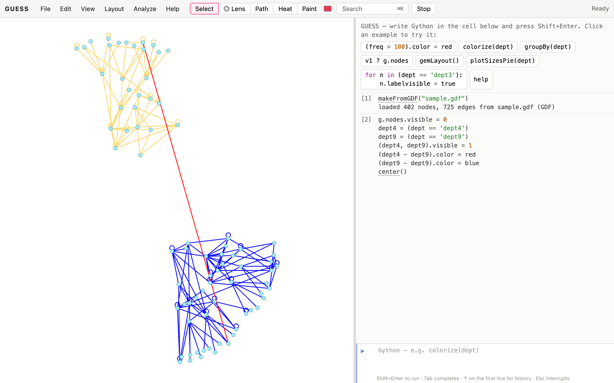

Made a mess? Press **Cmd/Ctrl+Z** (when the cursor isn't in the code cell),
choose *Edit → Undo*, or type `undo()`. Each command is one step, and
undone cells are struck through in the console. Redo brings them back.

GUESS also has analysis commands that simplify common tasks. First, let's
put things back: `g.nodes.visible = true`, `g.edges.color = dandelion` and
`g.nodes.color = cornflowerblue` (the defaults). Now type `density()`. This
calculates the density of the graph (0.009).

Other commands do more interesting things. `colorize(dept)` gives each
department its own colour, chosen to be as different from each other as
possible. `colorBy(freq, blue, red)` colours the edges along a range from
blue to red by their frequency.

Let's try something a little more interesting:

```python
colorize(dept)
deptg = groupBy(dept)
xy = Legend()
for d in deptg: xy.add(d[0], d[0].dept)
```

`groupBy(dept)` returns a set of sets, one for each department. `Legend()`
makes an empty legend. The last line goes through the departments and adds a
"prototype" node from each, the first one, to the legend, along with its
department's name. (The one-liner `legendFor(dept)` does the same thing.)

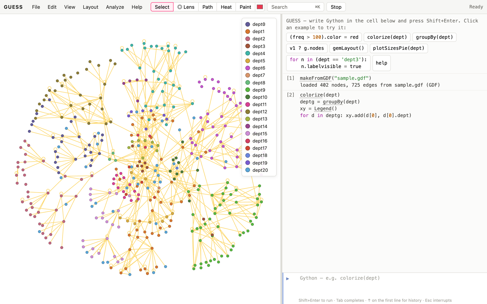

This is standard Python, and any Python tutorial will help you with the
general language. The rest of this manual is about the parts that are
particular to GUESS.

\newpage

# 4. Getting your data in

There are three ways to get a graph into GUESS:

1. **Open a file.** Use *File → Open…*, or drag a file onto the window.
2. **Fetch it from the web.** Load a URL, query a SPARQL endpoint, or load an
   NDEx network or a Neo4j query.
3. **Build it in code.** Use `addNode`, `addEdge` and the random graph
   generators.

## 4.1 Opening files

*File → Open…* (or drag and drop) understands these formats:

| extension | format | command |
|---|---|---|
| `.gdf` | GUESS data file (section 4.2) | `makeFromGDF("f.gdf")` |
| `.gexf` | Gephi | `makeFromGEXF("f.gexf")` |
| `.graphml`, `.xml` | GraphML | `makeFromGraphML("f.graphml")` |
| `.gml` | GML (networkx, igraph, yEd, Cytoscape) | `makeFromGML("f.gml")` |
| `.dot`, `.gv` | Graphviz DOT | `makeFromDOT("f.dot")` |
| `.net` | Pajek | `makeFromPajek("f.net")` |
| `.dl` | UCINET DL | `makeFromDL("f.dl")` |
| `.csv`, `.tsv` | edge table, node table, adjacency matrix or list (as Gephi reads them) | `makeFromCSV("edges.csv", "nodes.csv")` |
| `.guess` | a saved GUESS session | `makeFromSession("s.guess")` |
| `.py` | a Gython script (it runs) | `execfile("s.py")` |
| `.png`, `.jpg`, … | an image, for a background or node images | `setBackgroundImage("map.png")` |

Opening a graph replaces the current one completely, its fields included,
so nothing of the old graph lingers (`undo()` brings it back; to keep both,
open the new one in another tab, section 10). Computed fields you were using,
such as `pagerank`, are computed again for the new graph.

An opened file is also copied into GUESS's own file space, so the command
form works on it afterwards. If you dropped `office.gdf` on the window,
`makeFromGDF("office.gdf")` reloads it. *File → Paste data…* takes a table
copied from a spreadsheet.

GML and DOT files bring their layout with them when they have one: GML
`graphics [ x y w h fill type ]` and Graphviz `pos`, `width`, `height`,
`color`/`fillcolor` and `shape` become positions, sizes, colours and shapes.
Every other attribute becomes a field. Nodes in a Graphviz `cluster_*`
subgraph get a `cluster` field, so `colorize(cluster)` shows the clusters.
`makeFromGML` still opens GraphML too, as it did in GUESS 2006.

Loading a graph replaces the current one. To keep several graphs at once,
see section 10.

## 4.2 The GUESS .gdf format

The GDF format is very simple. First we define the nodes and their
properties, then the edges and theirs. The node section starts with a line
like:

    nodedef> name

The `nodedef>` line tells GUESS what is on each of the following lines. In the
simplest case there is one column, the node's name. Names must be unique.
GUESS makes a variable for every node, so names that are valid Python names
(`v1`, `alice`, `gene_42`) are the most convenient. Other names still work,
but you then reach the node with `g.getNodeByName("name with spaces")` instead.

The edge section starts with:

    edgedef> node1,node2

and each line after it names the two endpoints. Here is a complete file:

    nodedef> name
    alice
    bob
    carol
    edgedef> node1,node2
    alice,bob
    bob,carol

Now let's add some properties. Each column after the first is a field: a
name, optionally followed by a type and a default value.

    nodedef> name,dept VARCHAR(32),salary INT default 0,manager BOOLEAN
    alice,sales,52000,true
    bob,sales,48000,false
    carol,engineering,,false
    edgedef> node1,node2,freq INT,directed BOOLEAN
    alice,bob,12,false
    bob,carol,3,true

The types are `VARCHAR` (text, the default if you don't say), `INT`/`INTEGER`
(also `TINYINT`, `SMALLINT`, `BIGINT`), `DOUBLE` (also `FLOAT`, `REAL`,
`DECIMAL`) and `BOOLEAN` (also `BIT`). An empty value takes the default.
Values containing commas go in single or double quotes.

Some field names are special. They control how nodes and edges look and
behave, and you can set them in the file:

| node field | meaning | default |
|---|---|---|
| `x`, `y` | position (if missing, GUESS lays out the graph) | |
| `color` | fill colour (a name or `"r,g,b"` / `"r,g,b,a"`) | cornflowerblue |
| `strokecolor` | outline colour | darker fill |
| `style` | shape: 1 rectangle, 2 ellipse, 3 rounded rectangle, 4–6 the same with the label inside, 7 image, 11 triangle, 12 diamond, 13 hexagon, 14 octagon, `polygon(n)` (all pictured in §7.2) | 2 |
| `width`, `height` | size | 10 |
| `label`, `labelvisible`, `labelcolor` | the label text, whether it's shown, its colour (inside a node: black or white for contrast, unless set) | name, false |
| `labelpos` | where the label goes: `right`, `left`, `above`, `below`, `inside`, or `outside` (GUESS picks a free side; pictured in §12.4) | right |
| `labelsize` | label size as a scale (1 = normal) | 1 |
| `image` | an image file or URL (with style 7) | |
| `visible` | whether it's drawn | true |
| `fixed` | layouts don't move it | false |

| edge field | meaning | default |
|---|---|---|
| `directed` | a directed edge (arrow) | false |
| `color`, `width` | colour and thickness | dandelion, 2 |
| `weight` | used by weighted layouts and paths | 1 |
| `label`, `labelvisible`, `labelcolor`, `labelsize` | as for nodes; edge labels sit on a small background pill at the middle of the edge | |
| `visible` | whether it's drawn | true |

GDF files embedded in old GUESS applets end each line with `;` and are
sometimes written on one line. Both forms load.

## 4.3 Other formats

- **GEXF** (Gephi's format) keeps node attributes, edge attributes, colours,
  sizes and positions. `exportGEXF("g.gexf")` writes it back for Gephi.
- **GraphML** keeps typed attributes (`<key>`) with their defaults.
- **Pajek** `.net` reads vertices (with their coordinates, shapes and colours),
  arcs (directed) and edges (undirected), with weights.
- **UCINET DL** reads the edgelist and full-matrix forms, with labels.
- **GML** (networkx, igraph, yEd, Cytoscape) and **Graphviz DOT** keep their
  attributes and any layout they carry (section 4.1). `exportGML("g.gml")`
  and `exportDOT("g.dot")` write them. `exportDOT` groups nodes into Graphviz
  clusters by a field (`exportDOT("g.dot", clusters="louvain_class")`), and
  `layout=False` leaves positions out so Graphviz lays the graph out itself.
- **CSV** works as in Gephi. An edge table has `Source`, `Target`, and
  optionally `Type` (directed/undirected), `Weight` and `Label`; other columns
  become edge fields. A node table has `Id`, optionally `Label`, and other
  columns. GUESS also recognises adjacency matrices and adjacency lists.
  Opening only a node table adds its columns to the current graph's nodes.
- **Excel** workbooks (`.xlsx`) open the same way: `makeFromExcel("data.xlsx")`
  reads an edge sheet (or a matrix or list), and a node sheet with `Id` when
  there is one; `sheet=` and `nodes=` choose the sheets. `makeFromCSV` hands
  `.xlsx` files to it.
- **Lists in a column.** `makeFromCooccurrence("papers.csv", "authors", ";")`
  links the values that share a cell (co-authors, co-occurring keywords):
  nodes get `count`, edges `weight`. It reads CSV, TSV and Excel.
- **RDF** (Turtle, N-Triples, RDF/XML): `makeFromRDF("data.ttl")`. Resources
  become nodes, labelled by `rdfs:label` or `foaf:name`, with the IRI in
  `uri`; links between resources become edges with the property in
  `predicate`; literal values become node fields. Classes are nodes too
  (`types=false` keeps them as a `type` field).

As in Cytoscape's table import, any columns can hold the edges:
`makeFromCSV("ppi.tsv", source="gene_a", target="gene_b",
interaction="type", weight="score")` (by header, or by number from 0;
`header=false` for a table without one). The interaction type goes in the
edge field `interaction`.

```{.python .norun}
makeFromExcel("network.xlsx", sheet="edges", nodes="people")
makeFromCooccurrence("papers.csv", "authors", ";")
makeFromRDF("foaf.ttl")
```

**Cytoscape's formats.** GUESS opens what Cytoscape opens:

| format | command |
|---|---|
| SIF (simple interaction file) | `makeFromSIF`: the type goes in `interaction` |
| Cytoscape.js JSON (`.cyjs`, Cytoscape's web export) | `makeFromCYJS`; `exportCYJS` writes one for Cytoscape |
| CX and CX2 (NDEx) | `makeFromCX` |
| XGMML (Cytoscape's XML) | `makeFromXGMML` |
| a session (`.cys`) | `makeFromCYS(file)` opens its first network and lists the rest; `makeFromCYS(file, "all")` opens each as its own graph |
| NNF (nested networks) | `makeFromNNF`: `network` says where each node and edge belongs, `nested` which network a node stands for |

Attributes become typed fields, and positions, colours, sizes and shapes
come along; Cytoscape's style mappings don't. A name two nodes share gets the
node's id added, and the original stays as the label.

**Biological formats.**

| format | command |
|---|---|
| PSI-MI TAB (MITAB 2.5–2.7: IntAct, BioGRID, IMEx) | `makeFromMITAB` |
| PSI-MI XML 2.5 and 3.0 | `makeFromPSIMI`: complexes are expanded around their bait (spoke), or to every pair |
| SBML (systems biology models) | `makeFromSBML`: species, and reactions as small grey nodes (`reactions="edges"` for edges instead) |
| BioPAX level 3 (Reactome, Pathway Commons) | `makeFromBioPAX`: a simple network of molecules, after Pathway Commons' rules (`mode="reactions"` keeps the reactions) |
| KEGG KGML, WikiPathways GPML | `makeFromKGML`, `makeFromGPML`: the map as drawn |
| Protein structures (PDB, mmCIF) | `makeFromPDB`: a residue contact network, from a file or a PDB id downloaded from RCSB |

Interaction files name proteins by gene name, with `ident`, `taxid` and
`species`; repeated evidence for a pair becomes one edge with an `evidence`
count, the methods and publications, and IntAct's `miscore`
(`merge=false` keeps every record).

A protein's folded chain is a network too. `makeFromPDB("1ubq.pdb")` (or
`makeFromPDB("1ubq")`, downloaded from RCSB) makes a node per amino acid
and joins residues next to each other along the chain (`kind` "chain")
and residues whose alpha carbons are closer than `cutoff` angstroms (8 by
default; `kind` "contact", with `distance`). Nodes carry `aa`, `seq`,
`chain` and `structure` (helix, strand or coil), and are placed by the
structure's two widest directions.

```python
makeFromPDB("1ubq.pdb")
colorize(structure)
(kind == "chain").width = 3
```

**Any file.** `makeFromFile(name)` picks the reader by extension, or by
content when the extension doesn't say (`.xml`, `.txt`, `.json`), which is
how *File → Open* and dropping a file work. `makeFromURL` does the same for
downloads.

```python
exportCYJS("sample.cyjs")
makeFromFile("sample.cyjs")
```

## 4.4 Data from the web

```{.python .norun}
makeFromURL("https://example.org/network.gexf")         # any supported format
makeFromSPARQL("""
  SELECT ?item ?itemLabel ?linked ?linkedLabel WHERE {
    ?item wdt:P31 wd:Q5; wdt:P737 ?linked .               # people and who influenced them
    SERVICE wikibase:label { bd:serviceParam wikibase:language "en". }
  } LIMIT 300""")
makeFromNDEx("<network uuid>")                          # a network from ndexbio.org
makeFromCypher("MATCH (a)-[r]->(b) RETURN a, r, b LIMIT 500",
               url="http://localhost:7474", user="neo4j", password="...")
```

`makeFromSPARQL` turns each result row into an edge from the first column to
the second (Wikidata is the default endpoint). Columns ending in `Label` name
the nodes, and the remaining columns become fields. `sparql(query)` returns
the rows without building a graph. A server must allow requests from web pages
(CORS) for the browser to reach it; Wikidata and NDEx do.

**Bluesky.** `makeFromBluesky("handle")` builds the follow network of an
account from Bluesky's public API: who it follows (`mode="followers"` or
`"both"` for the other directions), and with `depth=2` who they follow in
turn, up to `maxNodes` accounts. Nodes carry `handle`, `followers`,
`follows`, `posts` and `description`.

**Live streams.** `streamFrom(url)` follows a graph that changes as you watch,
in the format of Gephi's Graph Streaming plugin: one JSON event per line
(over HTTP) or per message (over a `ws://` WebSocket), adding, changing and
removing nodes and edges. Events are applied between commands, new nodes
appear next to a neighbour, and streamed changes are not undo steps.
`stopStream()` stops following.

```{.python .norun}
makeFromBluesky("bsky.app", limit=50)
streamFrom("http://localhost:8080/workspace1?operation=getGraph")   # Gephi's streaming server
# each line: {"an": {"A": {"label": "Alice"}}}  {"ae": {"AB": {"source": "A", "target": "B"}}}
stopStream()
```

## 4.5 Building graphs in code

```python
newGraph("scratch")              # an empty graph in a new tab (section 10)
addNode("ann", color=red)
addNode("bo")
addEdge(ann, bo, weight=3)
addDirectedEdge(bo, ann)
Node.score = 0.0                 # a new node field (Edge.kind = "" for edges)
ann.score = 4.5
```

`addNode` makes a node and a variable with its name. `addEdge` (or
`addUndirectedEdge`) and `addDirectedEdge` connect two nodes. Keyword
arguments set fields. A new field must be made before you assign to it:
`Node.score = 0.0` makes a number field whose default is 0.0 (`0` an integer
field, `""` text, `false` true/false), as does `addNodeField("score",
DOUBLE, 0.0)`. GUESS won't make a new field from a typo: `ann.scroe = 1` is
an error that suggests `score`.

Classic networks from the literature load with `makeSample(name)`:
`karate` (Zachary's karate club, with each member's `club`), `lesmis` (Les
Misérables co-appearances), `florentine`, `davis` (Southern Women, two-mode),
`petersen`, `kite`, `tutte`, `dodecahedron` and `caveman`. `makeSample()`
lists them.

There are also random graph generators: `makeSimpleRandom(nodes, edges)`,
`makeErdosRenyiRandom(n, p)`, `makeBarabasiAlbertRandom(start, add, steps)`,
`makeKleinbergRandom(side, exponent)`, `makeLattice1DRandom(n, toroidal)`,
`makeLattice2DRandom(side, toroidal)`, `makeEppsteinRandom(n, e, r)`,
`makeSimpleDirectedRandom(n, e)`, `makeWattsStrogatz(n, k, p)` (small world),
`makeBarabasiAlbertAging(n, m, aging)` (preferential attachment that fades
with a node's age), `makeGeometricRandom(n, radius)` and
`makePowerlawCluster(n, m, p)`. Each one replaces the current graph.

\newpage

# 5. Manipulating and querying nodes and edges

## 5.1 Nodes, edges and fields

Every node is a variable named after it: `v1`, `alice`. The variable `g` is
the graph. `g.nodes` and `g.edges` are all the nodes and all the edges.
Edges are reached through their endpoints: `v1 - v2`, or `v1 -> v2` if
direction matters.

A **field** is a property that every node (or every edge) has. Fields are
named like variables. `dept` on its own is the department field, and `v1.dept`
is v1's department. Fields come from the file you loaded, from the built-in
set (section 4.2), from commands that add them (`louvainClusters()` adds
`louvain_class`), and from `addNodeField`/`addEdgeField`. The node and
edge fields are listed by `getNodeSchema()` and `getEdgeSchema()`. The
*View → Data table* shows them all.

Fields know a little about themselves:

```python
freq.min, freq.max, freq.avg, freq.sum, freq.median
max(freq)                      # a field is also its list of values
dept.distinct                  # every value, once each
dept.find('eng')               # the nodes whose dept is 'eng' (same as dept == 'eng')
highest(freq, 5)               # the five edges with the highest freq (lowest(...) too)
sortBy(freq, descending=true)  # every edge, highest freq first
groupBy(dept)                  # a set of sets, one per value
groupAndSortBy(dept)           # the same, ordered by value (dept0, dept1, ...)
```

Some node fields aren't stored but computed the first time you use them:
`indegree`, `outdegree` and `totaldegree`, and the network statistics in
section 7.3, such as `pagerank` and `betweenness`.

Names you've defined are yours, but GUESS protects its own names. You can't
overwrite `g`, `dept`, `colorize` or a node's name by accident. Assigning
to one gives an error that says so.

## 5.2 Queries and sets

A **query** compares a field with a value and returns the set of matching
nodes or edges:

```python
dept == 'dept3'                  # nodes
freq > 100                       # edges
totaldegree >= 10
name like 'v1%'                  # SQL-style pattern: % any text, _ one character
dept != 'dept3'
freq > freq.avg                  # compare with a statistic
```

Sets combine with `&` (intersection) and `|` (union), and with `.difference(...)`.
`and`, `or` and `not` do the same on sets, a chained comparison is the
intersection of its parts, and `in` asks for any of several values:

```python
(dept == 'dept1') & (totaldegree > 3)
(dept == 'dept1') and (totaldegree > 3)  # the same
(dept == 'dept1') | (dept == 'dept2')
dept in ('dept1', 'dept2')               # the same
3 < totaldegree <= 6                     # (totaldegree > 3) & (totaldegree <= 6)
not (dept == 'dept1')                    # every other node
g.nodes.difference(dept == 'dept1')      # the same
```

Put each comparison in parentheses when you use `&` or `|`:
`dept == 'dept1' & totaldegree > 3` means something else, and GUESS says so.
In the test of an `if` or `while`, `and`, `or` and `not` keep their usual
meaning (`if s and t:` asks whether both are non-empty).

A tuple or list of nodes also works as a set: `(v1, v2, v3).color = green`.

For a test no comparison can express, `where` keeps the members for which
a function is true, and gives a set:

```python
g.edges.where(lambda e: e.node1.dept != e.node2.dept)   # also interEdges(dept)
```

A query that can't match because of its type, such as `dept == 3` when
`dept` holds text, prints a note saying so instead of quietly returning an
empty set.

**Broadcasting.** Setting a field on a set sets it on every member. Reading
a field from a set gives a list of values:

```python
(dept == 'dept3').color = orange
(dept == 'dept3').size = 20          # size sets width and height together
(dept == 'dept3').labelvisible = true
(dept == 'dept3').totaldegree        # a list, one value per node
(dept == 'dept3').totaldegree.avg    # ... with .avg, .sum, .min, .max, .median, .distinct
```

**Edges between sets.** The edge operators work between nodes and between sets
of nodes:

| expression | gives |
|---|---|
| `a -> b` | edges directed from a to b |
| `a <- b` | edges directed from b to a |
| `a <-> b`, `a - b` | edges between a and b (undirected, or either direction) |
| `a ? b` | any edges between a and b |

So `v1 ? g.nodes` is every edge touching v1, and
`(dept == 'dept1') - (dept == 'dept3')` is every edge between the two
departments.

**From edges to nodes and back.** `.nodes` on a set of edges gives their
endpoints. `.edges` on a set of nodes gives the edges touching them:

```python
(freq > 100).nodes.labelvisible = true     # label everyone in a busy conversation
(dept == 'dept3').edges.color = gray       # every edge touching department 3
v1.getNeighbors()                          # v1's neighbours
```

(`findNodes(set)` and `findEdges(set)` pick out just the nodes, or just the
edges, from a mixed set.)

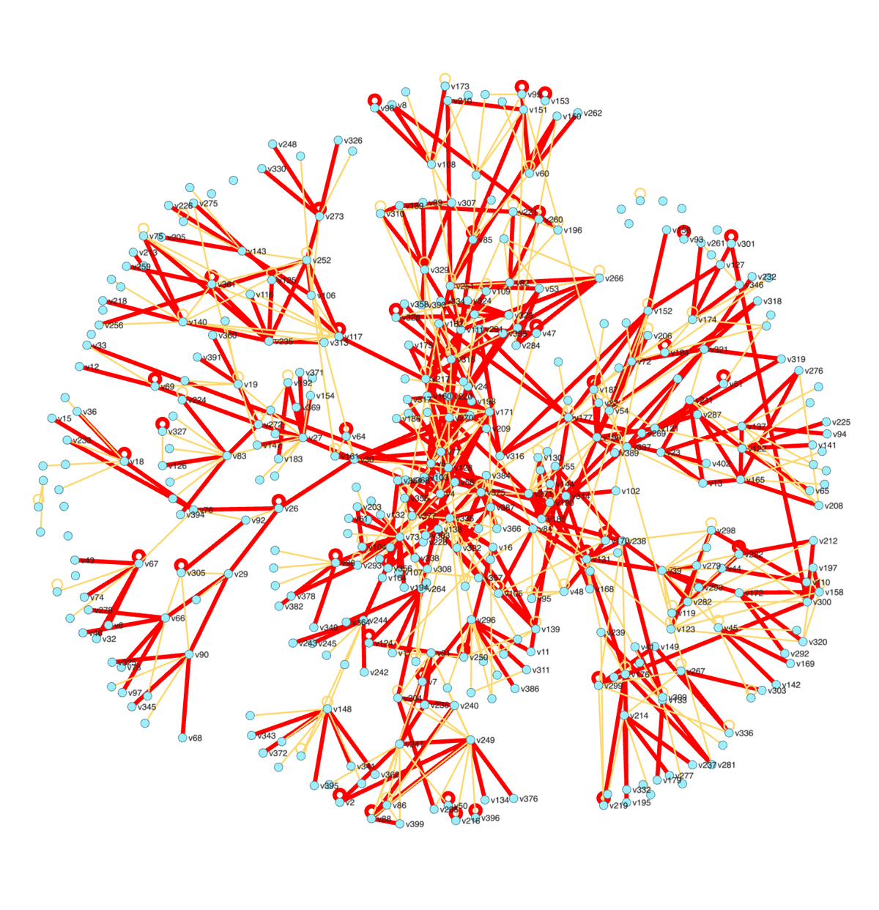{width=75%}

Sets are Python sequences. You can loop over them, take `len(...)`, index them
and slice them:

```python
for n in (dept == 'dept3'):
    n.label = n.name + " (" + n.dept + ")"
len(freq > 100)
```

## 5.3 Visibility

Hidden nodes and edges stay in the graph, so they still show up in queries.
Two rules keep the picture consistent. Hiding a node hides its edges, and
showing an edge shows its endpoints:

```python
(dept == 'dept3').visible = false      # their edges disappear too
(freq > 150).visible = true            # these edges and their endpoints reappear
```

`showOnly(set)` hides everything except the set, and `showAll()` shows
everything again. A set of nodes keeps the edges among them. A set that
includes edges keeps just those edges, so `showOnly(freq > 100)` shows only
the heavy ties and `showOnly(shortestPath(v1, v2))` only the path.
`showOnly(set, induced=true)` keeps every edge among the shown nodes. To take nodes out of the graph rather than
hide them, see section 8.

## 5.4 The selection

What you select with the mouse (section 13) is the variable `sel` in the
console, and `select(...)` selects from code:

```python
select(dept == 'dept2')
sel.color = orange
center(sel)
select()                       # clear it
```

## 5.5 The data table

*View → Data table* (or `table()`) opens a spreadsheet of the nodes or edges
below the graph. `table(dept == 'dept3')` shows just those. You can sort by a
column, filter, and double-click a cell to edit it. An edit is an ordinary
command and can be undone. Selecting rows selects the nodes, and vice versa;
in the edge table, the edges between selected nodes are marked. Hovering a
node anywhere marks its row, and scrolls the table to it.

The filter box takes text or Gython. Text keeps the rows with a matching
cell. A query keeps the rows it gives, and the box turns blue to say it was
read as one:

```{.python .norun}
degree > 5
dept == 'dept1' and degree > 3
sel                     # the selection
hubs                    # any variable holding nodes or edges
```

Queries are re-read as you type and whenever the graph changes. Expressions
with calls, such as `highest(degree, 20)` or `(dept == 'dept1').neighbors`,
run when you press Enter. They run on a scratch copy, so even
`remove(...)` changes nothing. A query for edges typed in the node table
(say `weight > 2`) says how many edges it found, so you can switch tabs.

Right-click a row for the same menu as on the graph: colour, labels, size,
hide, *Select*, *Add to selection (sel)*, *Assign to variable…* and the rest.
When the row is one of several selected rows, the menu acts on all of them.
*Actions ▾* opens the menu for the selected rows or, with none selected, for
every row shown, so a filter followed by *Actions* acts on what it found.

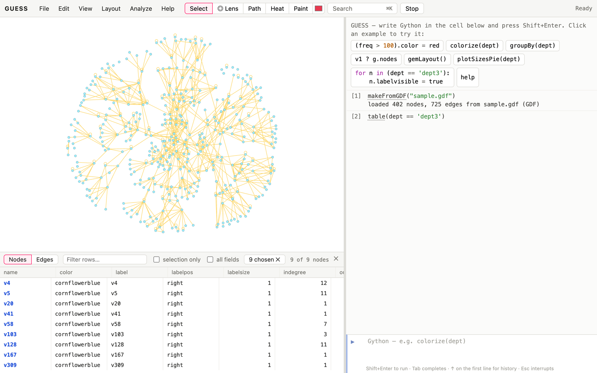

## 5.6 SQL

If you'd rather ask in SQL, `sql(...)` puts the nodes and edges in two tables
and runs your query:

```python
sql("SELECT dept, count(*) FROM nodes GROUP BY dept ORDER BY 2 DESC")
sql("SELECT name FROM nodes WHERE totaldegree > 10")      # a set of nodes
sql("SELECT __edgeid FROM edges WHERE freq > 100")        # a set of edges
sql("UPDATE nodes SET color = 'red' WHERE dept = 'dept3'")
```

A query that returns only `name` (nodes) or `__edgeid` (edges) gives a set,
so it combines with the rest of Gython. Other queries give rows. `UPDATE`s
change the graph. Inserting and deleting rows isn't supported (use
`addNode` and `remove`).

\newpage

# 6. Laying out graphs

A layout command moves the nodes. Layouts animate while they run, and the
*Stop* button or **Esc** stops them where they are. They're all under the
*Layout* menu too, and every layout is one step for undo.

| command | what it does |
|---|---|
| `forceAtlas2Layout()` | Gephi's force-directed layout. Options: `linLog=true` (tighter clusters), `preventOverlap=true`, `gravity=`, `scaling=`, `dissuadeHubs=true`, `edgeWeightInfluence=`, `iterations=` |
| `gemLayout()` | GEM, a fast force-directed layout |
| `frLayout()` | Fruchterman–Reingold |
| `kkLayout()`, `weightedKKLayout()` | Kamada–Kawai (spring distances follow graph distance) |
| `springLayout()`, `weightedSpringLayout(min, max)`, `isomLayout()`, `physicsLayout()` | other force and self-organising layouts |
| `mdsLayout()` | multidimensional scaling of the graph distances |
| `sugiyamaLayout()`, `dagLayout()` | layered drawing for hierarchies |
| `treeLayout(root)` | a tree (`horizontal=true` for left to right) |
| `radialLayout(v1)` | rings around a node by distance |
| `circleLayout()` | a circle; `circleLayout(dept)` makes one circle per group |
| `hiveLayout(axis, position)` | a hive plot (below) |
| `scatterLayout(x, y)` | a scatter plot of two fields |
| `randomLayout()` | random positions |
| `drlLayout()`, `lglLayout()`, `umapLayout()` | for large graphs (igraph, section 7.9): DrL (tens of thousands of nodes, clusters well apart), LGL (grown from a root), UMAP (tight islands) |
| `dhLayout()` | Davidson–Harel: even spacing, few crossings; small graphs |
| `dotLayout(rankdir="TB", clusters=None)` | Graphviz dot: layers with few crossings, long edges routed around nodes; `clusters=dept` keeps groups together |
| `neatoLayout()` | Graphviz neato (stress majorization): distances on screen follow distances in the graph; the best quality up to a few thousand nodes |
| `sfdpLayout()`, `fdpLayout(clusters=)`, `circoLayout()`, `twopiLayout(root)`, `osageLayout(field)` | other Graphviz engines: multilevel force (large graphs), force with cluster boxes, circles, rings around a root, packed groups |
| `graphvizLayout(engine, **attrs)` | any Graphviz engine with any graph attributes, e.g. `graphvizLayout("neato", mode="sgd")` |
| `bipartiteLayout(field)` | a two-mode network in two rows |
| `multipartiteLayout(field)` | one column per value of a field, each ordered to reduce crossings (`vertical=true` for rows) |
| `concentricLayout(field)` | rings by a field's value, the highest in the centre |
| `dualCircleLayout(count)` | the `count` busiest nodes on an inner circle, the rest outside, near the hubs they link to |
| `orderedLayout(field)` | one axis fixed by a field (a year, a step), ForceAtlas2 on the other |
| `circlePackLayout(field, …)` | nodes packed into nested, labelled circles by one or more fields |
| `isometricLayout(field)` | the current layout stacked into tilted layers by a field (the layer is stored in `zlayer`) |
| `hairballLayout()` | the Hairball Buster plot: nodes by degree rank, with a tick under each neighbour |
| `motifLayout()` | structure-aware: rings for cycles, stars for hubs with leaves, grids for nodes with the same neighbours (below) |
| `binPackLayout()` | packs the connected components side by side |
| `removeOverlap()` | separate overlapping nodes while keeping the layout's shape (Graphviz PRISM); works after any layout |
| `noverlapLayout()`, `labelAdjustLayout()` | nudge nodes until they (or their labels) don't overlap |
| `rotateLayout(90)`, `mirrorLayout()`, `rescaleLayout(0.5)`, `translateLayout(dx, dy)`, `moveLayout(x, y)` | transform the current layout; `rescaleLayout(nodes, 1.5)` spreads out just those nodes |

The Graphviz and igraph layouts are loaded in the background a few seconds
after GUESS starts (about 2 MB together). If you run one sooner, GUESS says
so; run it again a moment later.

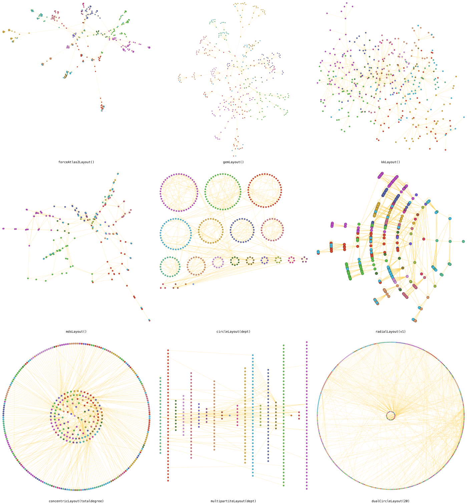

```python
makeSimpleDirectedRandom(30, 45)
remove(feedbackEdges())                   # make it acyclic (section 7.7)
dotLayout()                               # layers, arrows pointing down
colorize(generation)
neatoLayout()
removeOverlap()
makeFromGDF("sample.gdf")                 # back to the sample graph
```

Nodes whose `fixed` field is true stay where they are. So you can pin a few
nodes and lay out the rest around them:

```python
v1.fixed = true
gemLayout()
```

Use `centerAfterLayout(false)` if you'd rather the view didn't re-centre
after every layout.

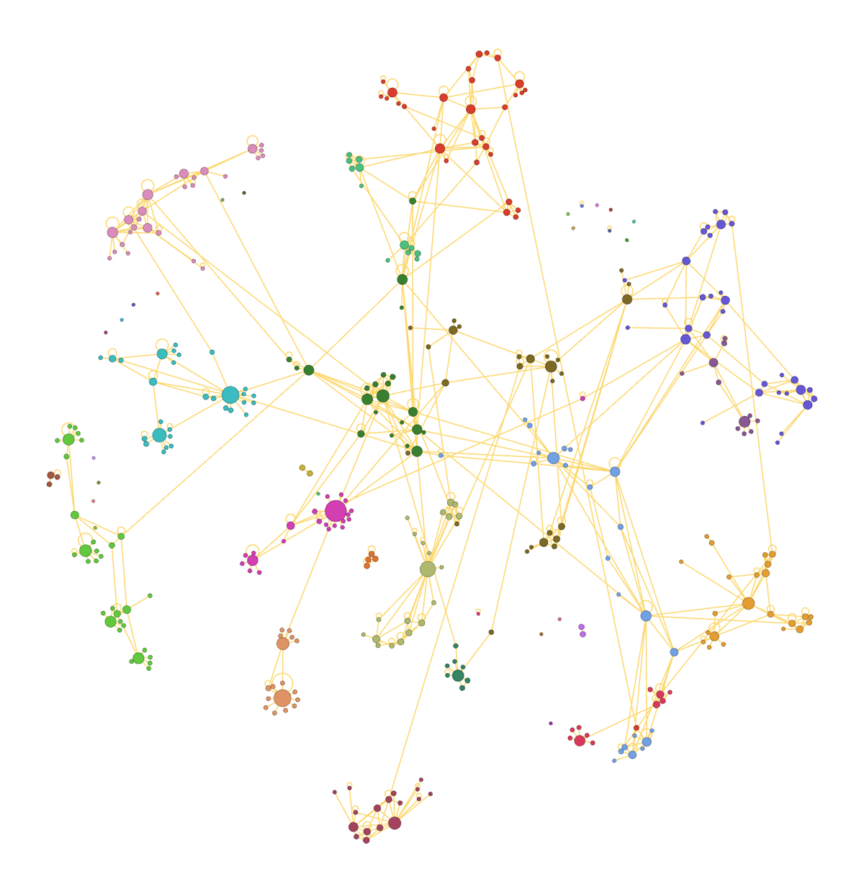{width=80%}

**Hive plots.** A hive plot puts each group on its own axis and places nodes
along the axis by a value. Unlike force-directed layouts, the picture
depends only on the data and not on chance, so two networks can be compared
by their shapes.

```python
hiveLayout(dept, totaldegree)             # an axis per department, ordered by degree
hiveLayout(dept, pagerank, axes=5)        # the 4 largest groups, plus "other"
```

The axes, their labels and the position note are drawn with the graph. They
go away when you run another layout or load another graph.

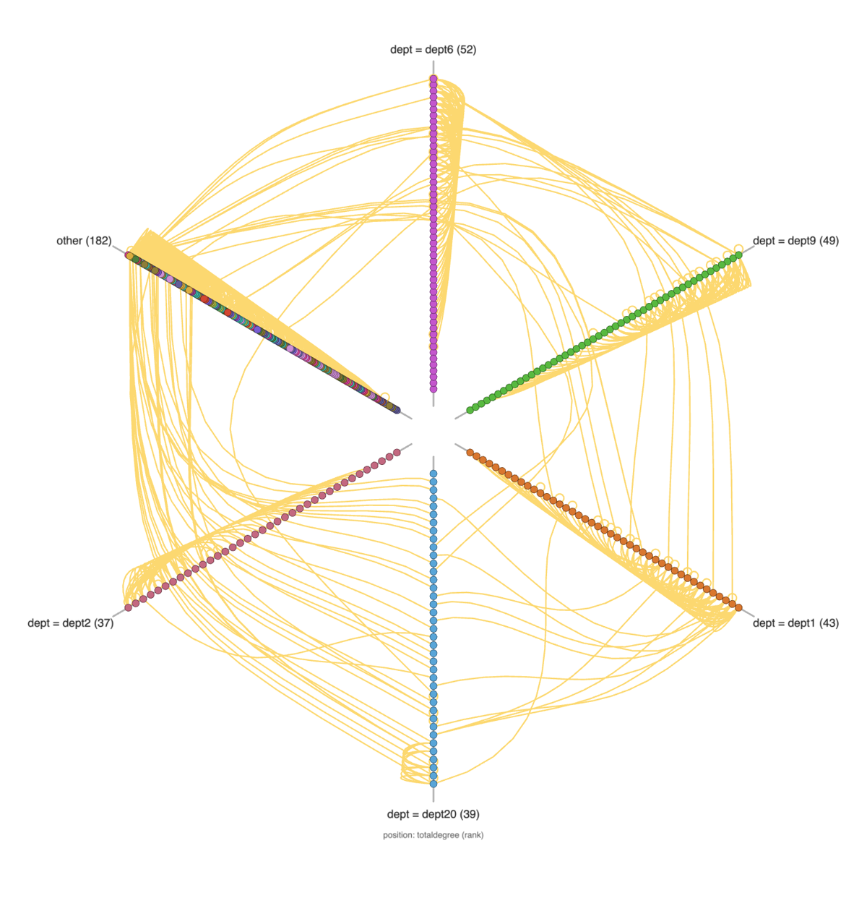{width=75%}

**Scatter plots.** `scatterLayout(betweenness, pagerank)` places nodes by two
fields, with axes. Dragging a node then edits those two fields (section 13).

**Groups, rings and layers.** These place nodes by a field, so the picture
says what the field means:

```python
multipartiteLayout(dept)               # a column per department
concentricLayout(degree)               # the best connected in the middle
circlePackLayout(dept)                 # departments as packed circles
gemLayout()
isometricLayout(dept)                  # the layout as stacked, tilted planes
orderedLayout(degree)                  # x from degree, y untangled by forces
forceAtlas2Layout(gravitySources=[v1, v73])   # two centres of gravity
```

**Structure-aware layout.** Protein interaction networks, and many others,
are full of hubs with dozens of partners that touch nothing else. A force
layout piles those partners into blobs. `motifLayout()` (a port of LUMINA,
the IntAct team's layout) finds four shapes and gives each its own tidy
arrangement: a node and its leaves become a *star* with the leaves in rings,
nodes linked to exactly the same others form a *parallel* grid between them,
*cycles* become circles and *chains* (paths ending in a leaf) small rings.
Each shape is treated as one big node while the whole is laid out by stress
majorization, then the components are turned to fit and packed. The field
`motif` says which shape each node is in, and `outline=true` draws an
ellipse or box around every shape.

```python
motifLayout()
colorize(motif)
motifLayout(outline=true, spacing=40)
removeConvexHulls()
```

`orderedLayout` suits anything with an order, such as citations by year
or events by step, and works like Gephi's Ordered Layout and Event Graph
Layout. `isometricLayout` stands in for 3D views such as Gephi's Network
Splitter 3D: each value of the field gets its own plane. Running it again
with another field starts from the flat layout.

**Old names.** The 2006 names still work. `random()` is the random layout,
and `jfrLayout`, `jkkLayout1`, `jkkLayout2` and `jSpringLayout` are the
JUNG versions of the force layouts. Every command is also a method of `g`,
so `g.gemLayout()` works.

\newpage

# 7. Analysis commands

## 7.1 Clustering and communities

Clustering commands return a set of sets (one per cluster) and, where it
makes sense, add a field so you can colour by it:

```python
louvainClusters()                  # communities; adds the field louvain_class
colorize(louvain_class)
modularity(louvain_class)       # how good the partition is
edgeBetweennessClusters(5)         # remove the 5 most "between" edges; the pieces
weakComponentClusters()            # connected components
biComponentClusters()              # biconnected components
groupsOfSize(dept, 40)             # groups with at least 40 members
```

More algorithms, each storing its result in a field named after it:

| command | finds |
|---|---|
| `chineseWhispersClusters()` | fast, parameter-free communities: each node repeatedly takes its neighbours' most common class (`cw_class`) |
| `mclClusters(inflation=2)` | Markov clustering: random-walk flow sharpened until it stays in clusters; higher inflation, smaller clusters (`mcl_class`) |
| `dbscanClusters()` | nodes close together in the layout, or in any numeric fields, with the rest marked noise (-1) (`dbscan_class`) |
| `mcodeClusters()` | MCODE's dense complexes (Bader & Hogue), best first (`mcode_class`, `mcode_score`) |

```python
chineseWhispersClusters()
colorize(cw_class)
dbscanClusters((degree, pagerank), minPts=5)       # clusters in two fields, not positions
```

**Overlapping communities.** In real networks people belong to several
groups at once. `cliquePercolationClusters(k)` chains cliques of k nodes that
share k-1 of them; `linkCommunities()` clusters the edges instead of the nodes
and cuts where partition density peaks. A node can then be in several
communities: they're listed in a text field (`cpm_classes`, `link_classes`,
as in `"0;3"`) with a count (`cpm_count`, `link_count`). `showOverlaps`
colours each community and draws the nodes in several as pies, one slice per
community; `removePies()` goes back to plain nodes.

```python
cs = cliquePercolationClusters(3)
showOverlaps(cs, hulls=true)
cpm_count > 1                      # the people in more than one community
removePies()
```

## 7.2 Visualizing fields

The quickest way to see a field is to map it to colour, size, a label or a
shape:

```python
colorize(dept)                          # a distinct colour per value
colorBy(betweenness, yellow, red)       # a gradient over a number
colorBy(freq, yellow, red, 'log')       # scales: 'linear', 'log', 'sqrt', 'rank'
sizeBy(pagerank, 5, 40)                 # node size (or edge width) from a number
resizeLinear(totaldegree, 5, 30)        # the 2006 version
labelBy(dept)                           # labels from a field
shapeBy(dept)                           # a shape per value
polygonBy(dept, 3, 8)                   # a regular polygon per value (3 to 8 sides)
borderBy(dept)                          # a border colour per value
legendFor(dept)                         # a legend for the current colours
GradientLegend(yellow, red, betweenness.min, betweenness.max)
```

`polygon(sides)` is the shape code for any regular polygon, as in
`(dept == 'dept1').style = polygon(5)`; `polygonBy(field)` takes the number
of sides from a whole-number field, or gives each value of another field its
own polygon.

{width=90%}

`colorize` and `colorBy` work on node fields and on edge fields (they colour
whichever the field belongs to). `colorize(freq, blue, red)` with two colours
behaves like `colorBy`.

{width=85%}

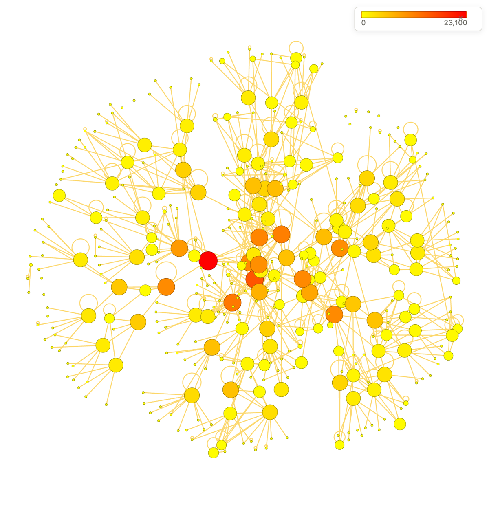{width=75%}

If you'd rather click than type, the **Style panel** (*View → Style panel*)
does the same mappings with menus: pick nodes or edges, a property, a field
and a mapping. It shows the command it runs. You can save a set of mappings as
a named style, and `defineStyle`/`applyStyle` do the same from code:

```python
defineStyle('by dept', ['colorize(dept)', 'legendFor(dept)'])
applyStyle('by dept')
```

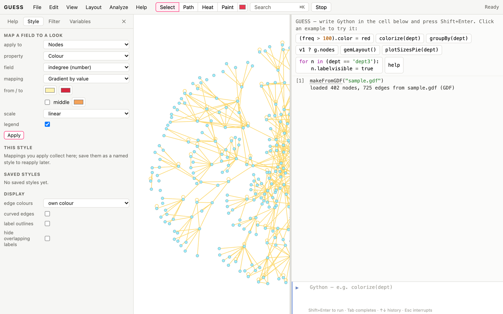

A few more ways to show values on nodes:

```python
pieChart([indegree, outdegree])     # each node becomes a pie of several fields
Node.shares = ''                    # or give each node its own list of values
v1.shares = [12, 21, 12]
pieChart(shares, labels=['A', 'B', 'C'])
pieNeighbors(dept)                  # a pie of the neighbours' departments
removePies()
bundleEdges(dept)                   # bundle edges that run between the same groups
removeBundles()
```

Edge bundling also works without groups. `bundleEdges()` uses MINGLE
(Gansner et al. 2011): edges that run alike merge, level by level, into
bundles that share a trunk, saving "ink". It is fast enough for large graphs.
`bundleEdges(method="fdeb")` is force-directed edge bundling (Holten and van
Wijk 2009): edges attract compatible edges like elastic strands, giving
smooth, organic curves; it suits up to a few thousand edges. Both work best
when many long edges run between the same regions, and `strength=` (0 to 1)
relaxes the bundles toward straight lines. The View menu has both.

```python
bundleEdges()                       # MINGLE
bundleEdges(method="fdeb", strength=0.7)
removeBundles()
```

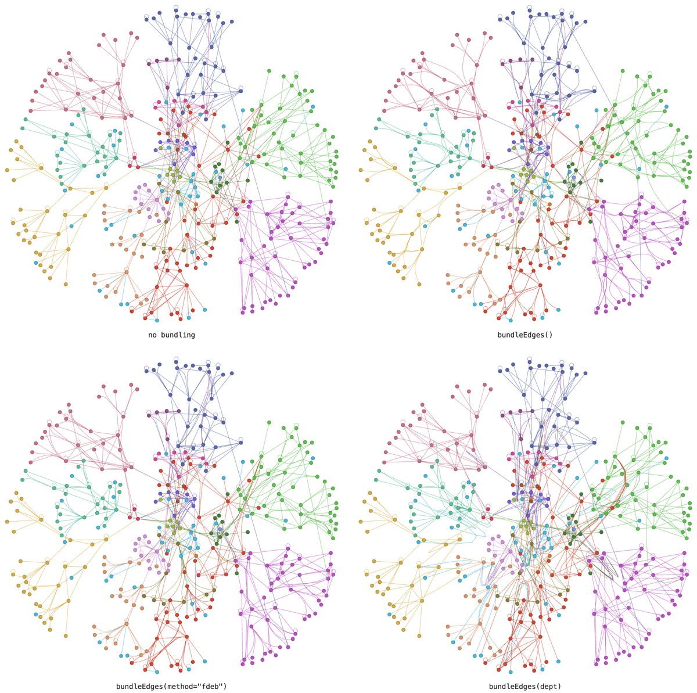{width=85%}

## 7.3 Field, graph, node and edge statistics

These node fields are computed the first time you use them. Use them like any
other field:

| field | meaning |
|---|---|
| `indegree`, `outdegree`, `totaldegree` | degree |
| `degrank` | degree as a fraction of the total degree |
| `strength` | weighted degree (sum of edge weights) |
| `pagerank` | PageRank |
| `hub`, `authority` (`hits`) | HITS scores |
| `eigenvector` | eigenvector centrality |
| `betweenness` | betweenness centrality (also an edge field) |
| `rwbetweenness` | random-walk (current-flow) betweenness |
| `closeness`, `harmonic` | closeness and harmonic centrality |
| `eccentricity` | the greatest distance to another node |
| `clustering`, `triangles` | local clustering coefficient, triangle count |
| `coreness` | k-core number |
| `component`, `strongcomponent` | which (strongly) connected component |
| `constraint`, `effsize` | Burt's structural holes: low constraint and a large effective size mark brokers |
| `generation` | the step in a directed hierarchy (0 = nothing points to it) |
| `katz` | Katz centrality: walks of every length, the longer ones counting less |
| `domain_prestige`, `proximity_prestige`, `rank_prestige` | prestige in directed networks: the share that can reach a node, also rewarding short distances, and being pointed at by prestigious nodes |
| `bridging_coef`, `bridging` | Hwang's bridging coefficient, and betweenness × bridging coefficient (bridging centrality) |
| `wclustering` | clustering weighted by edge weights |

```python
(pagerank > 0.01).labelvisible = true
sortBy(betweenness)[-10:]           # the ten most "between" nodes
```

These fields follow the graph: after you add or remove nodes or edges (or
change edge weights), each is recalculated the next time it's read, once,
however many edits came before. If you assign to one yourself
(`v1.pagerank = 0`) it keeps your values until `recompute(pagerank)`.

Whole-graph measures are commands: `density()`, `diameter()`,
`averagePathLength()`, `averageClustering()`, `transitivity()`,
`assortativity()` (do hubs link to hubs?), `reciprocity()` (directed edges),
`triadCensus()`, and `graphStats()` for a summary. `distance(v1, v2)` is the distance between two nodes on the screen.

A few more commands measure and store:

```python
weightedBridging()                 # wbetweenness and wbridging, heavy edges as short ones
cliques(4)                         # every maximal clique of 4 or more
mds(3)                             # mds1, mds2, mds3: coordinates from graph distances
showOnly(kBrace(2))                # edges whose ends share 2+ neighbours, after pruning
showAll()
```

`geoVectors()` (for nodes with latitude and longitude) stores each edge's
`bearing` and length in `km` and summarises the edges' mean length and their
overall direction.

## 7.4 Paths and filters

```python
shortestPath(v1, v14).color = red         # nodes and edges of a shortest path
v1.unweightedShortestPath(v14)            # the path's edges (2006 form)
v1.dijkstraShortestPath(v14)              # weighted by the weight field
heatMap(v1)                               # colour everyone by distance from v1
showOnly(kCore(3))                        # the 3-core
showOnly(egoNetwork(v1, 2))               # everyone within 2 steps of v1
showOnly(giantComponent())
showOnly(intraEdges(dept))                # edges inside departments
interEdges(dept)                          # edges between departments
showAll()
```

The filters return sets, so they combine with queries:
`showOnly(kCore(3) & (dept == 'dept1'))`. The **Filter panel** (*View →
Filter panel*) stacks filters with sliders and checkboxes, if you'd rather
build them by hand.

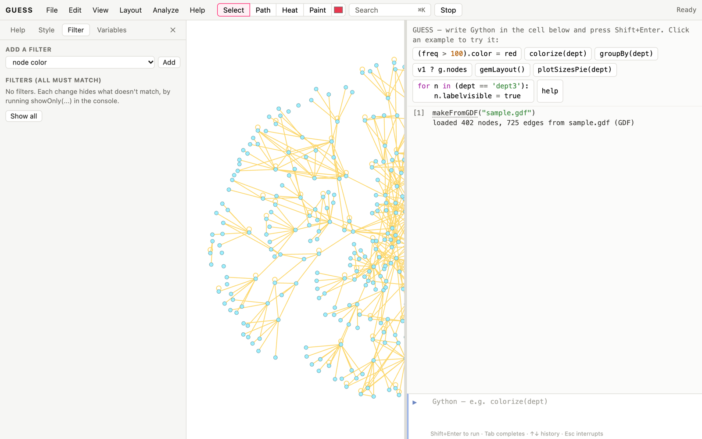

## 7.5 Charts

Charts are linked to the graph. Hover over a bar or a slice and its nodes
light up, along with the console output and table rows that mention them;
click and they're selected (shift-click adds). Drag across several bars of a
bar chart or histogram to select them all at once. Right-click for the element
menu: on a histogram bin or a bar it acts on the bin's query, such as
`(degree >= 0) & (degree < 4.75)`. Hovering a bar also marks the bars of
other charts that share its elements. On a line chart (`spread`,
`robustness`, `extinctions`), pointing shows every series' value at that
step. On the `spread` chart it also highlights who was reached by then, and
a click selects them.

```python
plotSizesPie(dept)           # how many in each department
plotSizes(dept)              # the same, as bars
plotHistogram(pagerank)      # distribution of a number
plotDistrib(totaldegree)     # each value in rank order
plotFrequency(degree)        # the fraction of nodes with each degree, p(k)
```

**Log scales.** Heavy-tailed values such as degree are easier to read on
log axes. `plotFrequency(degree, log=true)` draws p(k) on log–log axes,
where a power law is a straight line; `cumulative=true` plots the fraction
with that value or more, which is smoother in the tail. Pointing at a point
lights up the nodes with that value. `plotHistogram(degree, 10, log=true)`
uses bins of equal width on a log scale and a log count axis, and
`plotDistrib(degree, log=true)` a log value axis.

**Adjacency matrix.** `showMatrix()` draws the network as a matrix, a row
and a column per node with a dark cell for each edge. `order=` a field
sorts the rows by it with lines between the groups, so communities show as
blocks on the diagonal: `showMatrix(order=louvain_class)`. `weight=` shades
cells by an edge field, and `nodes=` draws part of the graph. Cells are
linked like any chart: hover one to highlight its edge and nodes.

**Your own numbers.** `plotLine(points)` draws a line through a list of
`(x, y)` pairs; a dictionary of lists draws one line per series. `log=true`
(or `logX=`/`logY=`) makes the axes logarithmic and `dots=true` marks each
point. A chart with the same `title` replaces the last one, so a loop can
update it:

```python
sizes = [(k, len(kCore(k))) for k in range(1, 6)]
plotLine(sizes, title="k-cores", xlabel="k", ylabel="nodes", dots=true)
plotLine({"degree": [(n.degree, n.betweenness) for n in g.nodes if n.degree]},
         title="Betweenness by degree", log=true, dots=true)
```

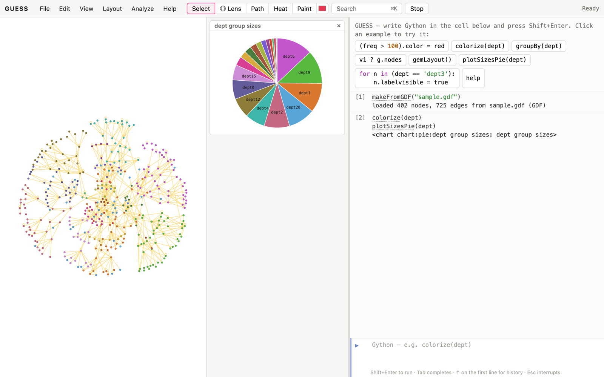

**Live charts.** A chart shows the graph as it was when you made it. Click
*● Live* in its header and it is recomputed after every command that changes
the graph or the display, including undo and the history scrubber.
`liveCharts()` makes every chart live, now and from then on;
`liveCharts(False)` stops them all. Recomputing only redraws the chart: a
command like `spread` that colours nodes when you run it doesn't recolour
them when its chart updates. A chart that can no longer be made (its field
has no numbers left, say) stops being live and says so. Legends made by
`colorize` and `legendFor` follow the colours by themselves.

**Altair charts.** For any other chart, use [Altair](https://altair-viz.github.io).
`nodeData(...)` gives one row per node with the fields you name (all data
fields when you name none), and `edgeData(...)` one row per edge. A cell whose
value is a chart shows it in the dock, like the charts above. `alt` is
imported the first time you use it, which takes a few seconds once.

```python
alt.Chart(nodeData("degree", "pagerank", "dept")).mark_point().encode(
    x="degree", y="pagerank", color="dept", tooltip="name")

alt.Chart(nodeData("dept")).mark_bar().encode(x="dept", y="count()")

alt.Chart(nodeData(dept == "dept3", "degree")).mark_bar().encode(
    alt.X("degree", bin=True), y="count()")
```

Field types come from the graph, so `x="degree"` is a number and `x="dept"`
a category, without `:Q` or `:N`. A chart that uses a field missing from its
data says how to add it.

Altair charts are linked like the others. Each row carries its element's id,
so a point for one node highlights that node, clicking selects it, and
right-clicking opens its menu. Hovering nodes anywhere else fades the other
points. A mark that summarises several nodes stands for the query it was
grouped by: a `count()` bar for `dept == 'dept1'`, or a bin for
`(degree >= 4) & (degree < 6)`. Selections you add with Altair link too:
dragging an `alt.selection_interval()` brush highlights the nodes inside it,
and selects them when you stop. A point selection on a field (a clickable
legend) does the same for the values chosen.

`showChart(chart, title)` shows a chart from inside a script or function.
Running the same cell again redraws its chart in place. Altair charts can be
live too: their `nodeData` and `edgeData` rows are rebuilt from the graph
each time. The *…* menu on a chart saves it as SVG or
PNG. Data frames work too (`import pandas`), but only `nodeData` and
`edgeData` rows link to the graph.

**Word clouds.** `wordCloud(field)` shows the most frequent words of a text
field, sized by how often they occur, with common English words left out
(`stopwords=[...]` adds more). Hovering a word lights up the nodes whose
text contains it; clicking selects them. Like the other charts it can be
live.

```python
wordCloud(dept)
```

## 7.6 Random graph generation

See section 4.5 for the generators. A typical use is to compare a network
with random networks of the same size:

```python
makeErdosRenyiRandom(400, 0.009)
averageClustering()
```

## 7.7 Structure, mixing and comparing partitions

These commands return sets you can colour, hide or show, or a single number:

```python
makeFromGDF("sample.gdf")                 # back to the sample graph
bridges().color = red                     # edges whose removal splits the graph
cutNodes().size = 30                      # nodes whose removal splits it
showOnly(spanningTree(maximum=True))      # the backbone of strongest ties
showAll()
sortBy(constraint)[:5]                    # brokers (structural holes)
assortativity(dept)                       # 1: ties stay in a department; 0: random
mixingMatrix(dept)                        # edges between each pair of departments
louvainClusters()
compareClusters(louvain_class, dept)   # do the communities match departments?
```

`compareClusters` gives normalized mutual information by default (0 to 1);
`method="ari"` (adjusted Rand), `"rand"` and `"vi"` are the alternatives.

For directed graphs such as citations or dependencies, `ancestors(node)` and
`descendants(node)` follow the arrows, the `generation` field gives each node's
step in the hierarchy, `transitiveReduction()` returns the edges that longer
paths already imply (hide them to see the backbone), and `feedbackEdges()`
returns edges that close cycles.

## 7.8 networkx from the console

networkx is loaded with GUESS, so any of its algorithms is one line away.
`toNetworkX()` gives the graph with its fields as attributes (node keys are
node names). `setField` stores a result as a field: a node dictionary, an
edge dictionary, or a list of communities.

```python
import networkx as nx
G = toNetworkX()
setField(nx.average_neighbor_degree(G), "nbrdeg")
setField(nx.community.greedy_modularity_communities(G), "greedy")
colorize(greedy)
```

`fromNetworkX` goes the other way. It turns attributes into fields and uses
`pos` (or `x` and `y`) for positions, with a spring layout when there are
none. Given a name, it opens the graph in a new tab and switches to it; the
tabs above the graph switch back.

```python
fromNetworkX(nx.karate_club_graph(), "karate")
colorize(club)
use("main")                                # back to the first graph
```

## 7.9 igraph: faster statistics and more methods

GUESS also loads igraph, a graph library written in C, a few seconds after
it starts. Once it is there, betweenness, closeness, harmonic, eccentricity,
diameter, clustering, triangles, coreness and components use it. The numbers
are the same and large graphs are many times faster. `useIgraph(false)`
switches back to the networkx and numpy versions, for comparison.

igraph also adds community methods. Each stores its result in a field
(`leiden_class`, `infomap_class`, ...; 0 is the largest community) and prints
the modularity:

| command | method |
|---|---|
| `leidenClusters(resolution=1)` | Leiden: like Louvain, but every community is connected; `objective="CPM"` avoids modularity's resolution limit |
| `infomapClusters()` | Infomap: random-walk flow, best for directed graphs |
| `walktrapClusters(count)`, `fastGreedyClusters(count)` | hierarchies; `cutDendrogram(n)` re-cuts them into n groups |
| `labelPropagationClusters(field)` | very fast; given a field, spreads its values to the nodes without one |
| `eigenvectorClusters()`, `fluidClusters(count)`, `voronoiClusters()` | spectral; exactly `count` groups; around central nodes |
| `spinglassClusters()`, `optimalClusters()`, `cohesiveBlocks()` | small graphs: signed networks; the exact optimum; nested cohesive groups |

```python
makeFromGDF("sample.gdf")
leidenClusters()
colorize(leiden_class)
compareClusters(leiden_class, dept)
similarTo(v1)                              # nodes whose neighbours overlap v1's
predictLinks(5)                            # likely missing edges
evaluateLinks("all")                       # how well each method finds hidden edges
findPattern([("a", "b"), ("b", "c"), ("c", "a")])   # every triangle
minCut(v1, v14)                            # fewest edges separating two nodes
personalizedPagerank(v1)                   # relevance to v1, in the field ppr
largestCliques()
```

Also: `maxFlow(a, b)` (writes an edge field `flow`), `dominatorTree(root)`,
`maxMatching()`, the node field `knn` (average degree of the neighbours),
and two commands that don't need igraph: `simplify()` merges parallel edges,
and `rewire()` makes a degree-preserving random copy in a new tab, to check
whether a pattern is more than chance.

\newpage

# 8. Modifying graphs

Let's take a few nodes out of the graph:

```python
remove(totaldegree == 0)       # remove the isolated nodes
remove(v4)                     # a node takes its edges with it
remove(freq < 10)              # edges can be removed too
```

Removed elements go to `g.deleted`, so `add(g.deleted)` puts everything back.
As in the 2006 version, a removed node keeps its name, so this works:

```python
removeNode(v10)
addNode(v10)
```

`removeComplete(x)` removes something for good (it doesn't go to
`g.deleted`). Undo works either way.

Three field tools: `castField(score, INTEGER)` changes a field's type and
converts its values; `showOnly(readNames("keep.txt"))` keeps the nodes
listed in a file (one name per line); `copyColors("other")` copies node
colours, matched by name, from another graph of the session (section 10).

Other structural commands:

```python
copyNode(v128, 'v128copy', color=red)    # a copy with the same fields
removeDisconnected()        # nodes with no edges
removeLeaves()              # nodes with one edge
removeSelfLoops()
shortcutNodes()             # replace nodes of degree 2 by a single edge
condenseGraph()             # remove leaves and shortcut nodes until nothing changes
```

**Fields.** Declare a new field before you use it. It then has a value on
every node (or edge):

```python
addNodeField("seniority", INTEGER, 0)
addEdgeField("kind", VARCHAR, "email")
v128.seniority = 10
```

The types are `INTEGER`, `DOUBLE`, `VARCHAR` and `BOOLEAN`, as in GDF.

**Grouping.** You can collapse a set of nodes into one *meta-node* and expand
it again. This is useful for showing the structure between groups:

```python
collapseBy(dept)           # one node per department, edges merged
expandAll()
collapse(dept == 'dept3', 'dept3group')
expand(dept3group)
```

A meta-node's size reflects how many nodes it holds, and double-clicking it
expands it.

\newpage

# 9. Output commands

| command | output |
|---|---|
| `exportPNG("g.png")`, `exportJPG(...)`, `exportGIF(...)` | an image of the view |
| `exportPDF("g.pdf")`, `exportPS(...)`, `exportEPS(...)` | an image of the view in a PDF / PostScript page |
| `exportSVG("g.svg")` | the whole graph as vector graphics |
| `exportGDF("g.gdf")`, `exportGEXF(...)`, `exportGraphML(...)`, `exportGML(...)`, `exportDOT(...)`, `exportCSV(...)` | the graph and its fields |
| `exportHTML("g.html")` | one self-contained, interactive web page (below) |
| `exportJSON("g.json")` | graphology JSON for sigma.js and other web libraries (`format="sigma"` for the older sigma format) |
| `exportKML("g.kml")`, `exportSHP("g.zip")` | for Google Earth, and point and line shapefiles for QGIS or ArcGIS, from latitude and longitude fields |
| `saveSession("s.guess")` | everything: graph, fields, states, styles, legends, hulls, view, slides |
| `saveHistory("work.py")` | every command you ran, as a script |
| `startMovie(30, "m.webm")` … `stopMovie()` | a movie of the display |
| `startImages("frames.zip")` … `stopImages()` | every image exported in between, in one zip file (below) |

In a browser, "saving a file" means downloading it, so these files go to your
downloads folder. The *File* menu has the common ones, plus:

- **Export notebook** writes the session as a Jupyter notebook (one cell per
  command).
- **Export report** writes an HTML page with the commands, their output, and a
  picture of the graph.
- **Share link** makes a URL that contains the whole session. Anyone who opens
  it sees your graph as you left it. **Share as viewer** does the same, but
  hides the console.

**Many images from a script.** Each export shows the display at that point
in the script: GUESS waits until the display has caught up, including any
camera move or animation, before taking the picture. So a loop can save one
image per step. Between `startImages` and `stopImages` the images are
collected and download as one zip file, not one download each:

```python
addNodeField('year', INTEGER, 0)
for n in g.nodes: n.year = 1990 + int(n.name[1:]) % 20
startImages("years.zip")
for yr in range(1995, 2010, 5):
    showTime(yr, 'year', 5)
    exportPNG("year_%d.png" % yr)
stopImages()
```

A name used twice gets `-2`, `-3` and so on added. Every export format works,
including `exportSVG`. For a movie of the display as it changes, use
`startMovie(30, "m.webm")` and `stopMovie()`.

**A page anyone can open.** `exportHTML("graph.html")` writes the graph as
one web page with nothing else to install: open it from disk, email it or put
it on any web server. It shows the graph as drawn here (colours, sizes,
shapes, labels, legends, images) and lets the reader pan and zoom, search
for a node, hover to read its fields and click to see its neighbours. It
follows the reader's light or dark setting. `fields=false` leaves the data
fields out; `hidden=true` includes hidden nodes and edges.

```python
exportHTML("organisation.html", title="Who works with whom")
```

`history()` lists every command you've run this session. `log("work.py")`
starts writing commands to a file as you go, and `stoplog()` stops.

\newpage

# 10. Several graphs

Sometimes you want to look at part of a graph on its own, or compare two
graphs. Each graph lives in a tab above the display:

```python
subgraph(dept == 'dept3', 'dept3')        # a copy of these nodes and their edges, in a new tab
subgraph(freq > 100, 'heavy')             # just these edges and the nodes they join
use('main')                               # switch back to the first graph
renameGraph('office')                     # rename the current graph
newGraph('scratch')                       # an empty graph
graphNames()
use('office')
closeGraph('scratch')                     # (not the current one)
```

Clicking a tab switches to it as well. Commands always apply to the current
graph, and `g` always refers to it.

\newpage

# 11. States and animations

A **state** is a snapshot of the graph: which nodes and edges exist, and every
field value. Save one with `ss`, change things, and load it again with `ls`
or animate back to it with `morph`:

```python
ss('before')
colorize(dept)
circleLayout()
morph('before', 2000)       # animate back over 2 seconds
ls('before')                # jump back
getStates()
```

During a morph, nodes and edges that only exist in one of the two states fade
in or out. `setNodeDisappearBy(.2)`, `setNodeAppearAfter(.8)`,
`setEdgeDisappearBy(…)` and `setEdgeAppearAfter(…)` say when, as a fraction of
the morph.

States can be saved under numbers too (`ss(1999)`, `ss(2000)`), which
suits a series of snapshots over time.

To try something and put everything back, use `with scratch():`:

```python
with scratch():
    remove(dept == 'dept1')
    print(len(g.nodes), graphStats())
```

When the block ends, the graph is as it was: the same nodes, edges and
values, and fields made inside the block are gone. Print or keep in
variables what you want to keep.

## 11.1 State-sensitive queries

A field subscripted with a state reads the values in that state:

```python
ss('before')
(freq > 100).color = red
freq['before'] > 100              # the edges that had freq > 100 in 'before'
v1['before'].color                # v1's colour then
g.deleted                         # what's been removed
weight['_deleted'] > 5            # the 2006 form: deleted edges with weight > 5
```

Saved states can't be changed: `v1['before'].x = 20` is an error.

## 11.2 Ranges and time

A state is a whole snapshot. When nodes and edges simply come and go over
time, **ranges** are lighter. Give each element the times it exists:

```python
addRange(v1, "1-5")
addRange(v2, "3,7-9")
Node rcontains 4                 # nodes whose range contains 4
Node roverlaps (2, 5)            # nodes whose range overlaps 2..5
Node rcontained (0, 10)          # nodes whose range lies inside 0..10
getRange(v1)
```

Ranges are closed intervals. "3-5" includes 3 and 5. If your nodes have a text
field called `range` holding ranges like "1-5" (or another text field you name
with `Node.setRangeField(when)`), the range operators use it for nodes without
`addRange`.

Many graphs instead have a number for when each node appeared, such as a year.
`showTime` shows the graph at a moment. Let's give the sample graph a
(made-up) year for each person:

```python
addNodeField('year', INTEGER, 0)
for n in g.nodes: n.year = 1990 + int(n.name[1:]) % 20
showTime(1995, year)            # nodes with year <= 1995 (and their edges)
showTime(1995, year, 5)         # only the last five years
showTime(3)                     # by ranges: only what exists at time 3
```

The **timeline** (*View → Timeline*) gives you a slider and a play button for
the same thing. It finds number fields that look like time and plays through
them.

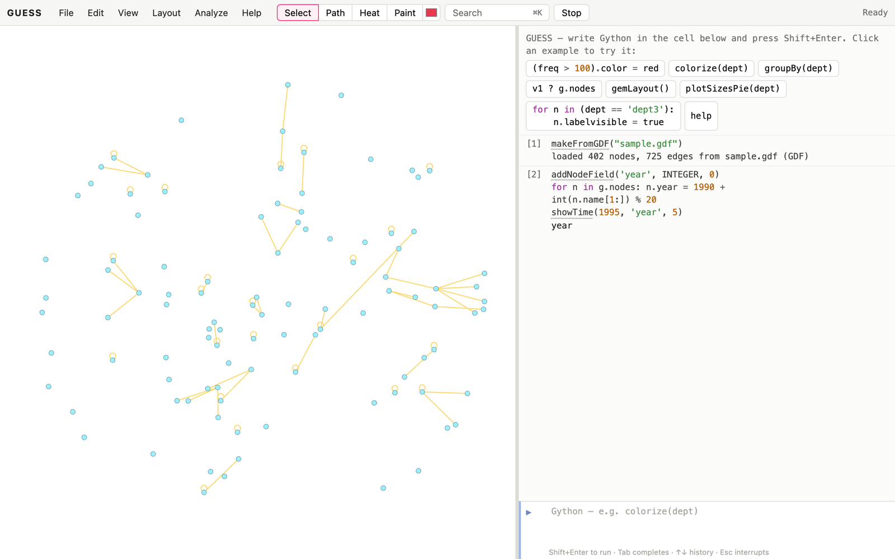

\newpage

# 12. Legends, hulls and the display

## 12.1 Legends

`legendFor(field)` makes a legend for the current colours of a field.
`GradientLegend(start, end, min, max)` makes a colour ramp, and a fifth
argument adds tick marks. For full control, build one yourself:

```python
lg = Legend()
lg.add(v1, "a node")            # a node (as a prototype), a label
lg.add(sortBy(freq)[-1], "busiest")   # edges work too
lg.add(red, "important")        # or just a colour
```

Legends appear at the top right of the display, and they're included in
exports and reports.

## 12.2 Convex hulls

A convex hull shades the area around a group of nodes:

```python
h = createConvexHull(dept == 'dept4', "200,200,255,90")
for d in ('dept4', 'dept6', 'dept9'):
    grp = dept == d
    createConvexHull(grp, averageColor(grp[0].color, white))
removeConvexHull(h)
removeConvexHulls()
```

Hulls follow their nodes when you move them or run a layout.

A group can also be marked by a box or an ellipse: `shape="box"` or
`"ellipse"`, upright or, with `rotate=true`, turned to fit the group (the
smallest box at any angle, and the ellipse around it). `encircle` does this
with a turned ellipse and a colour of its own; `encircleBy` draws one shape
per value of a field. The shape, rotation and padding can be changed later:

```python
e = encircle(dept == 'dept4')                 # a turned ellipse
encircle(dept == 'dept6', "box")              # a turned box
createConvexHull(dept == 'dept9', shape="box", rotate=false)   # an upright box
e.shape = "box"
e.padding = 20
removeConvexHulls()
encircleBy(dept)                              # one ellipse per department
removeConvexHulls()
```

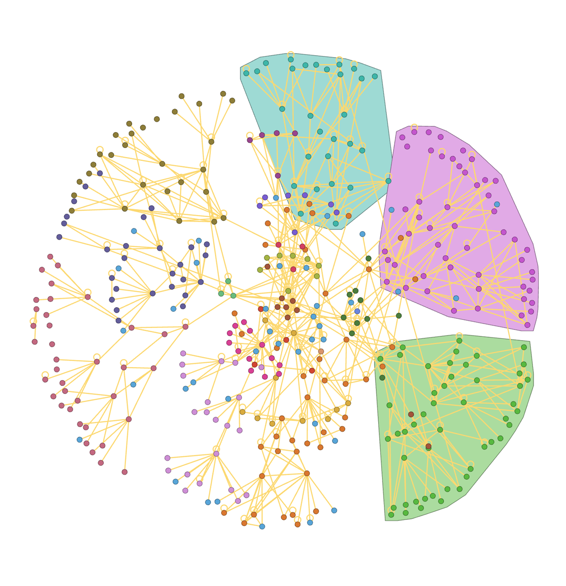{width=75%}

{width=75%}

**Drawing on the display.** `drawLine`, `drawText`, `drawRect` and
`drawCircle` put plain marks on the display, in graph coordinates (the same
as node `x` and `y`; a node's centre is `n.x + n.width/2`,
`n.y + n.height/2`). Lines and shapes go under the graph and text over it;
all of them zoom with the graph, are saved with the session and appear in
exports. Each returns the drawing, and `.remove()` takes it away;
`clearDrawings()` removes them all.

```python
drawLine(0, 0, 400, 0, style="dashed")             # a guide line
drawLine(0, 40, 400, 40, color=red, width=3, arrow=true)
drawText(200, -30, "upstream", size=20)
drawRect(-20, -60, 440, 120, fill="255,220,0,40", lineWidth=0)
c = drawCircle(200, 200, 80, style="dotted")
c.remove()
clearDrawings()
```

`color=` defaults to the theme's text colour; `style=` is `"solid"`,
`"dashed"` or `"dotted"`; `fill=` fills a box or circle (use a colour with
alpha for a translucent one); `anchor=` places text by its `"start"`,
`"middle"` or `"end"`.

## 12.3 The display

- **Theme**: GUESS starts in *Dark*. *View → Theme* switches to *Light* or
  *Automatic* (follows your system), and remembers the choice.
  The graph's background follows the theme, unless you set one with
  `setDisplayBackground(black)`. `setDisplayBackground(None)` follows the
  theme again.
- **Edges**: *View → Curved edges* or `curvedEdges()`.
  `setEdgeColorMode("mixed")` draws each edge in the colours of its two ends.
  Parallel edges between the same two nodes are always drawn as separate
  curves.
- **Labels**: `labelOutlines()` draws labels with a halo so they read on any
  background. `hideOverlappingLabels()` drops labels that would collide,
  keeping the bigger nodes' labels. `edgeLabelsAlong()` turns edge labels to
  run along their edges.
- **Drawing order**: a node or edge whose colour, size, shape, label or
  visibility changes is drawn on top of the others (edges stay under nodes),
  so what you just changed isn't hidden. Moving a node doesn't raise it.
  `raiseChanged(false)` or *View → Bring changed elements to the front*
  keeps the order fixed.
- **Background image**: `setBackgroundImage("map.png", x, y)` puts an image
  under the graph (a map, say), and `removeBackgroundImage()` takes it away.
- **Arrows**: `overrideArrowLength(12)`, `overrideArrowWidth(6)`.

**Line styles and arrowheads.** Each edge has a `linestyle` and, when it is
directed, an `arrowhead`:

```python
g.edges.linestyle = 'dashed'          # every edge; e.linestyle for one
g.edges.arrowhead = 'swept'
lineStyleBy(directed)                 # a style per value, the most common first
arrowheadBy(directed)
```

- `linestyle` is `solid` (the default), `dashed`, `dotted`, `taper` (wide at
  the source, a point at the target, so direction shows without arrows),
  `wave`, `double`, `fuzzy`, `gradient` (the source node's colour fading to
  the target's) or `flow` (dashes moving from source to target; still, if
  your system asks for less motion).
- `arrowhead` is `triangle` (the default), `swept`, `open`, `diamond`,
  `circle`, `tee` or `none`.
- In the *Style* panel, *Line style* and *Arrowhead* give each value of an
  edge field its own style. SVG export draws them all, and flow edges keep
  moving in the SVG. DOT files' `arrowhead` and `style` (dashed, dotted,
  tapered) are read and written.
- Curved, weighted flows: `curvedEdges()`, `g.edges.arrowhead = 'swept'`,
  `sizeBy(weight, 0.5, 7)` and `colorBy(weight, lightgray, '50,70,90')`.

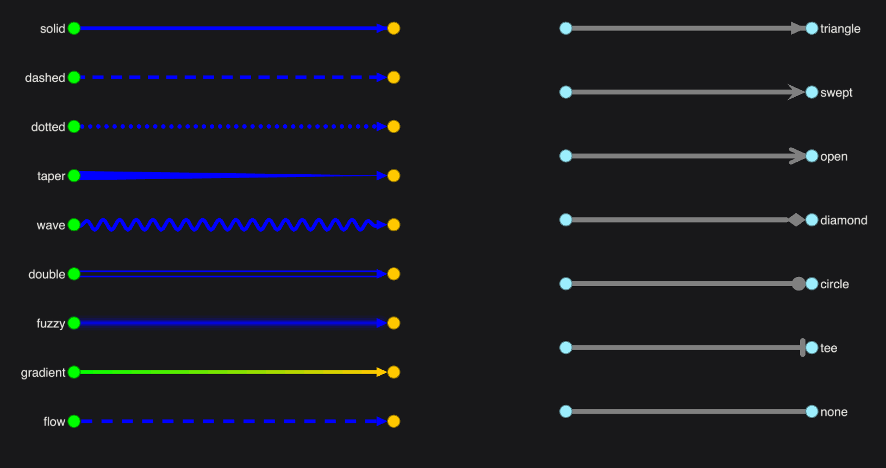

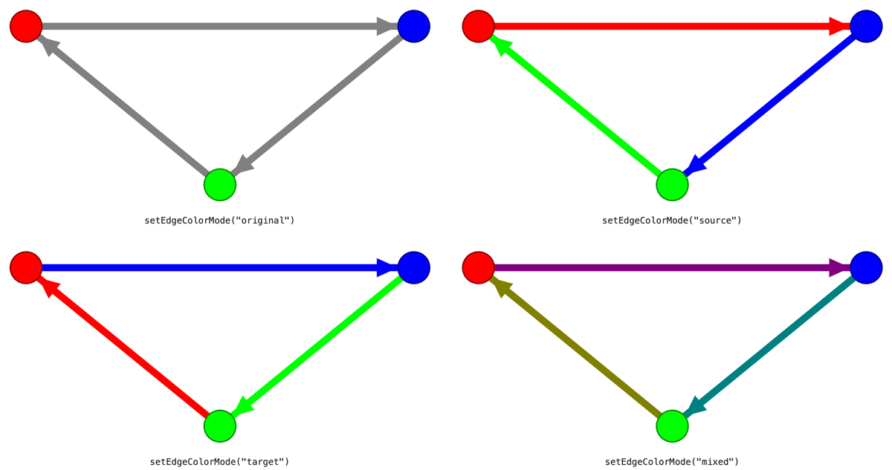{width=70%}

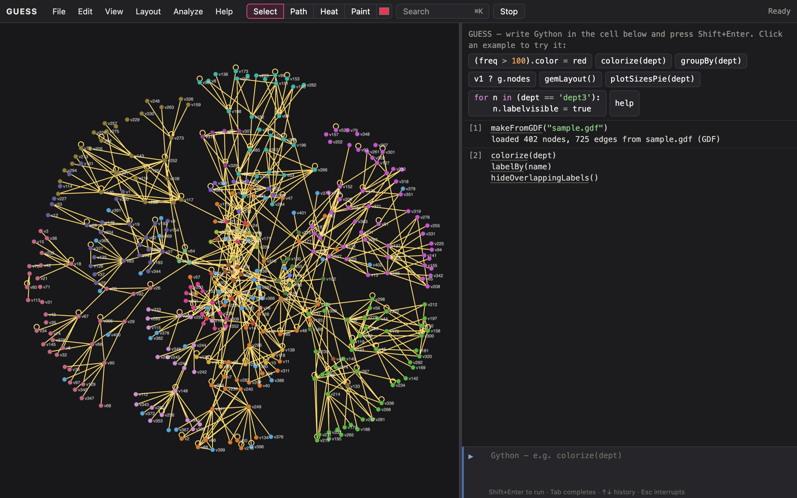

## 12.4 Labels inside nodes, positions and sizes

A node's `labelpos` says where its label goes. `inside` fits the label into
the node: it wraps long labels onto several lines when the node is tall
enough, shrinks the text down to about half size, and finally shortens it
with "…". The text is black or white, whichever reads better on the fill
(unless `labelcolor` is set). Styles 4–6 always put the label inside.
`outside` lets GUESS choose a side for each label, bigger nodes first,
avoiding other nodes and labels.

```python
g.nodes.labelvisible = true
g.nodes.labelpos = "outside"              # a free side for each label
(dept == "dept3").labelpos = "inside"
fitNodesToLabels(dept == "dept3")         # or: grow nodes to fit their labels
labelSizeBy(pagerank, 0.8, 2)             # bigger labels for important nodes
for e in (freq > 150): e.label = str(e.freq)
(freq > 150).labelvisible = true
edgeLabelsAlong()
```

The Style panel sets the same things: map *Label* with a position, or *Label
size* to a number.

{width=55%}

**Finding room for labels.** Labels placed `outside`, and edge labels (which
slide along their edge), are placed to avoid other labels, nodes and edges:

- `labelPlacement("candidates")` (the default) tries 16 positions around each
  node, biggest nodes first, then moves the labels that still collide.
- `labelPlacement("particles")` also searches further out, ring by ring, and
  draws a thin leader line to labels it places away from their node. It keeps
  labels off edges best.
- `optimizeLabels(2)` polishes the positions by simulated annealing for two
  seconds and keeps the result (until the graph is replaced or the method
  changes). The status bar reports how much it improved. Use it before
  exporting a figure.
- `constantLabelSize()` keeps labels the same size on screen as you zoom.
  Each label appears once there is room for it and stays as you zoom further
  in, so zooming in reveals more labels.

On the sample graph with every label shown, placing them `outside` cuts
label overlaps by about two thirds and edges crossing labels by about the
same; particles all but removes the edge crossings.

\newpage

# 13. Direct manipulation

The mouse does more than pan and zoom. *Help → Mouse and gestures* shows all
of this with pictures, and a tip appears the first time a gesture becomes
useful.

## 13.1 Looking

| gesture | does |
|---|---|
| drag the background | pan |
| wheel or pinch | zoom |
| double-click the background | fit the graph |
| hover a node or edge | its label at once, then (after a moment) all its fields; an edge rings its two endpoints |
| click a node | focus on it and its neighbours (click again or Esc to clear) |
| double-click a node or edge | zoom to it |
| hover a node or edge in the console output | highlight it in the graph; click to select and zoom to it |
| hover a node, a table row, a legend row or a chart bar | mark everywhere else it appears: console output, table rows, legend rows and chart bars |

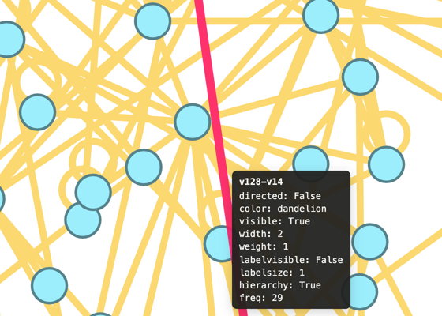{width=60%}

The tooltip comes in two stages: the label straight away, so it doesn't
get in the way as you sweep across the graph, and every field (with the
code that last changed the element) once you stay on it for a moment. To
see some fields at once, pick them in *View → Hover fields…* or name them:

```python
hoverFields(dept, degree)               # node fields; edge fields go to edges
hoverFields(nodes=["dept"], edges=["weight"])
hoverFields()                           # back to the label only
```

Hovering a hidden node or edge somewhere else (the console output, the
table, a chart) draws a ghost of it in the graph, a dashed outline, so you
can see where it is.

## 13.2 Selecting

| gesture | does |
|---|---|
| Shift-drag | box select |
| Alt/Option-drag | lasso select |
| Cmd/Ctrl with a box or lasso | add to the selection |
| Shift-click a node | add it to (or remove it from) the selection |
| Esc, or click the background | clear the selection |
| right-click | a menu for the node, the edge, or the whole selection |
| Delete or Backspace | remove the selected nodes (also *Edit → Delete selected nodes*, or *Delete* in the right-click menu); undo brings them back |

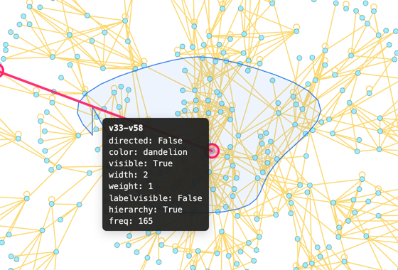{width=60%}

The selection is `sel` in the console (section 5.4). The right-click menu
colours, sizes, labels, hides and removes, and *Assign to variable…* gives
the selection a name you can use in code.

## 13.3 Dragging with meaning

Dragging a node moves it, and the selection moves with it if the node is
selected. Each drag is recorded as an ordinary command, such as
`v12.x = 310.5; v12.y = -42`. It is one undo step, and `history()`,
`saveHistory()`, `log()` and notebook export include it, so a saved
script puts the nodes back where you left them. To keep the console readable,
these commands are hidden. *View → Show node moves in the console* shows
them.

After some commands, a drag also *means* something. GUESS knows
what the arrangement on the screen stands for, so it can turn your drag into
the change you meant:

- **Reordering a circle.** After `circleLayout()`, nodes slide around the
  circle and the others make room. Dropping runs `ringMove(node, position)`.
- **Adding an edge.** Alt/Option-drag from one node to another adds an edge.
- **Editing values.** After `scatterLayout(x, y)`, dragging a node changes its
  two fields.

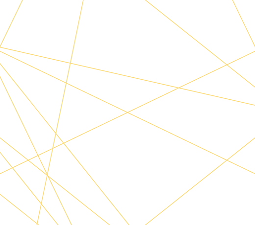{width=60%}

Each of these drops appears in the console as a visible command (for
example `ringMove(v128, 4)`). So you can see what happened, undo it, or
copy it into a script.

## 13.4 The click tools

The tools next to the menus turn clicks into commands:

- **Select** (the default) is everything above.
- **Path**: click two nodes to colour a shortest path between them.
- **Heat**: click a node for a heat map of the distance from it: red near
  it, through violet, to blue for the farthest (grey: unreachable).
- **Paint**: click nodes to paint them with the colour next to the tools.
  Shift-click paints the neighbours too.
- **◎ Lens** (or press **L**, which switches between Select and Lens): an
  excentric labelling lens. A circle follows the pointer, and
  the labels of the nodes under it are listed beside it, each joined to its
  node by a line, in their nodes' colours (Fekete and Plaisant 1999, extended
  by Bertini, Rigamonti and Lalanne 2009). The wheel resizes it and
  Shift+wheel scrolls long lists. A bar chart under it counts the nodes by
  colour. Click to pin it: then click a label to select its node (Shift-click
  adds or removes), click the bars to show only some colours, and *Select N*
  selects everything shown. Esc releases it. Hover popups are off while the
  lens is on. `excentricLens(radius=80,
  autoSize=true)` turns it on from code; with `autoSize` it grows over sparse
  areas and shrinks over dense ones.
- **Cluster**: label clusters by hand. It first asks which field to use:
  `cluster`, or `cluster1`, `cluster2`, … when that is taken. The field is
  made if it doesn't exist. If you name one that already has values, it asks
  whether to clear it (`g.nodes.cluster = None`, undoable) or keep the values
  and add to them. Then
  every lasso you draw puts the nodes it catches in the next cluster: 1,
  then 2, and so on. Type in *next id* to choose a number or a name
  yourself (`a7` is followed by `a8`). Plain drag draws a lasso, shift-drag
  a box, and Space-drag pans. While the tool is on, labelled nodes show in
  their cluster's colour and the rest are grey. The bar counts the clusters,
  the labelled nodes and those left: hover *left* to highlight them, click
  it to zoom to them. A new lasso moves the nodes it catches to the new
  cluster, even if they had one. Untick *relabel* to make it skip labelled
  nodes, so quick lassos can overlap.
  Cmd/Ctrl-drag, or clicking a node, adds to the last cluster. *Colour by
  it* runs `colorize(cluster)`; *Done* or Esc ends the tool.

Each click runs a command in the console (`shortestPath(v1, v14)`,
`heatMap(v3)`, `paint(v5, red)`), so you can edit it and run it again. The
Cluster tool's lassos run `labelCluster(["v1", "v7", …], 3, "cluster")`
as hidden cells, like node drags: they can be undone, and `history()` and
`saveHistory()` include them.

## 13.5 Responding to clicks in code

You can also attach your own code to the mouse:

```python
graphevents.clickNode = lambda n: center([n] + n.getNeighbors())
graphevents.mouseEnterNode = lambda n: setattr(n, 'labelvisible', true)
graphevents.mouseLeaveNode = lambda n: setattr(n, 'labelvisible', false)
```

The events are `clickNode`, `clickEdge`, `shiftClickNode`, `shiftClickEdge`,
`mouseEnterNode`, `mouseLeaveNode`, `mouseEnterEdge` and `mouseLeaveEdge`.
Setting one to `None` turns it off. `vf.defaultNodeHighlights(false)`,
`vf.defaultNodeZooming(false)`, `vf.defaultEdgeHighlights(false)` and
`vf.defaultEdgeZooming(false)` turn off the built-in hover highlight and
double-click zoom. Do this when your own handlers should be the only thing
that happens. `lastClick()` gives the last place clicked, as `(x, y)` in
graph coordinates.

You can add items to the right-click menu, too:

```python
def paintRed(n):
    n.color = red

item = NodeEditorPopup.addItem("Paint red")
item.menuEvent = paintRed
```

`EdgeEditorPopup` adds to the edge menu and `GraphElementPopup` to both. When
several things are selected, the function receives the selection.

\newpage

# 14. The console, history and undo

| key / action | does |
|---|---|
| Shift+Enter, Cmd/Ctrl+Enter | run the cell |
| Enter | a new line |
| Tab | complete commands, fields, nodes and attributes |
| ↑ / ↓ | move between the lines of the code; ↑ on the first line recalls the previous command, ↓ on the last line goes forward again, back to your unsaved code (kept, as are edits to recalled commands) |
| Esc, or *Stop* | interrupt running code |
| Ctrl+L | clear the output |
| Shift+Cmd/Ctrl+F | find in the console output |
| **Edit** on a cell (or double-click its code) | copy it into the working cell |
| **Run again** on a cell | run it again, as a new cell at the bottom |
| **Watch** on a cell | re-run it whenever the graph changes, or when you select nodes on the display (if the code uses `sel`) |
| **Pin** on a watched cell | show its live output in a side panel, which stays in view as the console scrolls; close the panel to put it back |
| `[n]` | fold or unfold a cell's output; hover it to highlight everything that cell changed |
| `;` at the end of a line | don't print its value (`louvainClusters();`) |

*View → Vim keys in the code cell* switches the editor to vim bindings.

Long results print compactly: a set of many groups (`groupBy(dept)`, the
communities from `louvainClusters()`) shows as `21 groups (402 elements):
[dept0: 28] [dept1: 43] …`, each entry linked to its members.

**Code and graph, linked.** The console and the graph point at each other:

- **Output.** Nodes, edges, sets, dicts, f-strings and `dept.distinct`
  values in the output highlight what they stand for. Hover `'dept1'` in
  `dept.distinct` to see the nodes in dept1. An edge prints as `v1–v2`
  (`v1→v2` when directed): hover either name for that node, or the dash or
  arrow between them for the edge.
- **Executed code.** Hover a name or a query in code you've run to see what
  it means *now*: a variable's members, the matches of `degree > 5` (or of
  the whole of `3 < degree < 6`), a node, or a value. Hovering a field shows
  its values and previews colouring by it; nothing is changed. Commands show
  their documentation.
- **Reverse highlighting.** Hovering a node in the graph, a table row, a
  legend row or a chart bar marks the output that mentions it.
- **Which code changed it.** A node's tooltip lists the cells that last
  changed it (`color ← [12] colorize(dept)`). Its right-click menu has *Show
  the code that changed it*.
- **Into your code.** Alt-click a node in the graph, a table row, a legend
  row, a chart bar or anything in the output to insert it at the cursor:
  its name, a query, `sel`, or a short tuple. A larger set is bound to a new
  variable, `picked1`. The right-click menu has *Insert as code*.
- **Earlier graphs.** Output from an earlier graph (before a new file was
  opened, or another graph tab) is greyed out and no longer linked, since
  its elements are gone.

**Undo.** Every command is one step: a layout, a file load, `colorize`, a
node drag, a table edit. *Edit → Undo*, Cmd/Ctrl+Z (when the code cell isn't
focused) or `undo()` reverses the last step, up to 50 steps back. Redo is
Shift+Cmd/Ctrl+Z, Ctrl+Y or `redo()`. Undone cells are struck through until
you redo them. Undo covers the graph, the fields, states, ranges, hulls,
legends, styles and the display. It doesn't cover Python variables you made,
or files you've downloaded.

*Edit → History…* opens the undo history as a list with a slider. Drag the
slider, or click a step, to undo or redo to that point; the graph changes as
you go, and each step you cross is highlighted. Hovering a step highlights
the nodes and edges it changed, and its `[n]` scrolls the console to the
cell. Running a new command after going back discards the steps after it,
as with `undo()`.

**History.** The cells on the screen are the session's history, in the order
you ran them. `history()` lists them and `saveHistory("work.py")` downloads
them as a script that rebuilds your work. Errors have a red bar, and the
line that failed is underlined. Nodes and edges an error names are links,
like printed output: hover to see them, click to select them.

\newpage

# 15. Modifying the interface / expanding GUESS

GUESS can be extended in Gython itself: new commands, panels of controls,
and handlers for the mouse. In 2006 this meant Java Swing. Now it's a few
small Python classes.

## 15.1 Example 1: a simple button

```python
def bigger():
    g.nodes.size = 20

b = Button("Bigger nodes", onClick=bigger)
ui.dock(Panel("Tools", b))
```

`Panel(title, *widgets)` makes a panel, and `ui.dock(panel)` docks it below
the graph (`position="right"` docks it to the right). The widgets are `Button`,
`Label`, `Slider`, `Checkbox`, `Dropdown` and `TextField`.

## 15.2 Example 2: a threshold slider

This slider hides edges whose `freq` is below the threshold, and a label
counts what's left:

```python
lab = Label('')
def hideshow(val):
    g.edges.visible = true
    (freq < val).visible = false
    lab.text = '%d edges visible' % len(Edge.visible == true)

s = Slider(freq.min, freq.max, value=100, label='Minimum frequency', onChange=hideshow)
ui.dock(Panel('Threshold', s, lab))
hideshow(100)
```

`onChange` runs when you let go of the slider. `onSlide` runs continuously
while you drag. (`Edge.visible == true` is a query on the edge field `visible`.
`Node` and `Edge` pick which kind of field when the name is shared.)

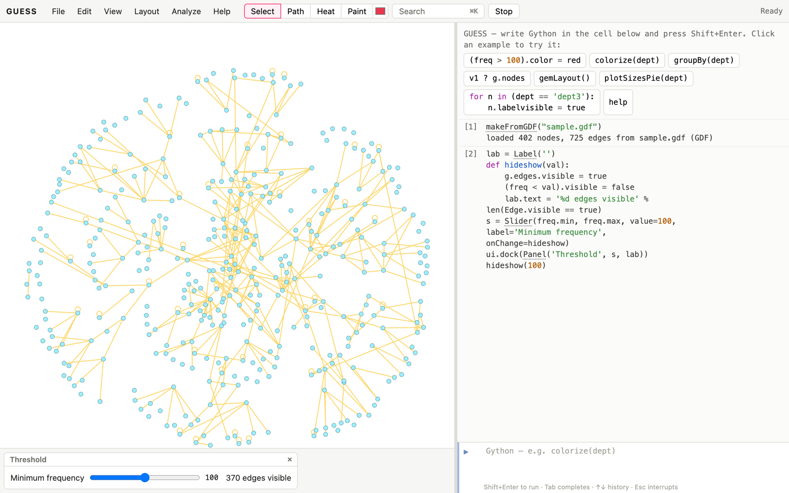

## 15.3 Example 3: a network monitor

A timer runs code every few seconds, for instance to poll for new data:

```python
def tick():
    v = randomColor()
    (dept == 'dept3').color = v

t = every(2, tick)       # every 2 seconds
t.stop()                 # or stopTimers() for all of them
after(5, gemLayout)      # once, in 5 seconds
```

A timer's code runs between your commands, so it never interrupts one. A
handler that takes longer than its interval doesn't pile up behind itself.

## 15.4 Example 4: an app

`exportApp` packages the current session with a script that builds its
interface:

```{.python .norun}
exportApp("threshold.guess", "ui.py")
```

Opening `index.html?load=threshold.guess&app=1` (with the file on the same
server) shows the graph and its panels without the console. *File → Share
as viewer* does the same thing as a single link. This replaces the applets
of 2006. For an app with an interface of its own, see the next section.

## 15.5 Apps

An app is GUESS with its own interface: a script that runs when GUESS
opens, arranging the window for one job, with the console hidden (or
available, as the author chooses). *Help → Example apps* has three, one
for each of the biology, infrastructure and epidemiology cookbooks; their
source is in `web/public/apps/`.

**Running an app.** An app is a small JSON file, its *manifest*, next to
its script:

```{.python .norun}
{
  "guess-app": 1,
  "name": "Interactome Explorer",
  "console": "toggle",
  "theme": "light",
  "data": ["brca1-intact.gdf"],
  "script": "main.gy"
}
```

and `index.html?app=apps/interactome/manifest.json` runs it. `data` files
(relative to the manifest) are copied into the session's folder first,
then the script runs; its setup isn't an undo step. `console` is
`"hidden"` (the default), `"toggle"` (hidden, but Ctrl+` shows it) or
`"shown"`; `theme` is `"light"`, `"dark"` or `"auto"`. Instead of
`script`, short apps can give the code itself as `code`. If the script
stops with an error, the console opens to show it. An app from another
web site asks before it runs. The script is Gython; name it `.gy`
rather than `.py`, since some web servers try to run `.py` files as
programs instead of sending them.

Every app has a *</> Source* button beside its name that shows the script
and the manifest it was built from, highlighted, with *Copy* and
*Download*: a reader can see how it's done and start their own from it.
`Action("source")` puts the same in a menu or toolbar, and `"source": false`
in the manifest leaves the button out.

**Arranging the window.** These commands work in any script or in the
console, so you can build an app interactively:

```python
info = Markdown("### Organisation\nClick a person to see their department.")
ui.layout(
    left=Tabs(Tab("About", info, Label(lambda: f"{len(sel)} selected")),
              Tab("Style", View("style"))),
    bottom=View("table"),
    sizes={"left": 300, "bottom": 200})
ui.toolbar(Action("tools"), "|", Action("fit"), Action("png"))
ui.statusbar(Label(lambda: f"{len(g.nodes)} people"))
ui.menubar(Menu("Analysis", MenuItem("Communities", run="louvainClusters(); colorize(louvain_class)"),
                Action("table")), keep=["File", "Help"])
ui.title("Organisation", "sample data")
```

- `ui.layout(left=…, right=…, bottom=…)` fills the regions around the graph,
  each with a panel, a widget or a list of them; the edges can be dragged,
  and `sizes=` sets them in pixels.
- Containers: `Tabs(Tab(title, …), …)`, `Group(title, …, collapsed=false)` (a
  box that folds), `Row(…)` and `Column(…)`, besides `Panel`.
- `View(name)` places one of GUESS's own views: `"table"`, `"style"`,
  `"filter"`, `"variables"`, `"help"`, `"timeline"` or `"console"`.
- `Markdown(text)` shows formatted notes. `Label` and `Markdown` given a
  function, as in `Label(lambda: f"{len(sel)} selected")`, are live: they
  update after every command and every change of selection.
- `Chart(fn)` puts a chart in a panel instead of the dock: `fn` makes it
  with any plot command (or returns an Altair chart), and runs again after
  every command, so `Chart(lambda: plotFrequency(degree, log=true))` follows
  the graph as an app changes it. Its bars and points are linked to the
  graph like any chart's.
- `ui.menubar(Menu(title, items…), keep=[…])` replaces the menus (keeping
  the ones named). Items are `MenuItem(label, run="code")` or
  `MenuItem(label, onClick=fn)`, `Action(name)` for one of GUESS's own
  commands (`"open"`, `"save"`, `"png"`, `"table"`, `"style"`, `"tool:lens"`,
  `"fit"`, …; `help(Action)` lists them) and `"-"` for a line.
  `ui.menubar()` removes the menus.
- `ui.toolbar(…)` and `ui.statusbar(…)` add a bar under the menus and along
  the bottom: actions, widgets and `"|"`. `Action("tools")` moves the whole
  tool strip into the toolbar.
- `ui.title(name, subtitle)` names the window, and `ui.console("hidden" |
  "toggle" | "shown")` hides or shows the console.

```python
ui.toolbar()
ui.statusbar()
ui.layout()
ui.menubar(keep=["File", "Edit", "View", "Layout", "Analyze", "Help"])
ui.title("GUESS")
```

## 15.6 Code bits

- `execfile("file.py")` runs a script you've opened.
- `openURL(url)` opens a web page.
- `installPackage("name")` installs a pure-Python package from PyPI into the
  page, so you can `import` it.
- Presentations: `addSlide("note")` saves the current view as a slide, and
  *View → Present* steps through them with the arrow keys.
  `showSlide(2)`, `moveSlide(…)`, `noteSlide(…)` and `removeSlide(…)` edit them.

\newpage

# 16. Sharing and deploying

## 16.1 Sessions

`saveSession("work.guess")` (*File → Save*) saves everything about the
graph: the nodes, edges and fields, the states, styles, legends, hulls,
slides, groups, the other graph tabs and the view. Opening the file
restores it. Python variables aren't saved. If you need them, save your
history as a script.

## 16.2 Links

*File → Share link* puts the whole session, compressed, into a URL. Nothing
is uploaded: the graph travels in the link itself, so links to big graphs are
long. *Share as viewer* adds `&app=1`, which hides the console.

## 16.3 Notebooks and reports

*File → Export notebook* writes a Jupyter notebook of your commands.
*File → Export report* writes a self-contained HTML page with the commands,
their output and a picture of the graph. Use it to send someone what you
found.

## 16.4 Deploying GUESS

GUESS is a set of static files, so any web server can host it. From a copy of
the source:

```{.python .norun}
cd web
npm install
npm run bundle             # web/bundle/guess-web-<version>/ and .zip, .tar.gz
npm run bundle -- --offline   # the same, with the Python runtime included
```

Copy the contents of the `guess-web-<version>` folder (or unzip the archive)
to the server. The site includes this manual under `manuals/`, which
*Help → Manual* opens. A normal bundle loads the Python runtime from a CDN the
first time it runs. An `--offline` bundle carries it (about 25 MB more), so it
works with no internet access. The server must send two
headers (`Cross-Origin-Opener-Policy` and `Cross-Origin-Embedder-Policy`) for
the *Stop* button to interrupt running code. The bundle includes a fallback
for servers that can't. `docs/DEPLOY.md` has ready-made settings for Apache,
nginx, Caddy, Netlify and GitHub Pages.

To open a graph straight away, link to `index.html?load=mygraph.gdf`, with the
file next to `index.html`. Add `&app=1` to hide the console.

## 16.5 Working with an AI assistant

An AI assistant that speaks the Model Context Protocol (Claude Desktop,
Claude Code and others) can work in GUESS with you. It runs Gython in your
session, reads a summary of the graph and the command help, and looks at the
view. Everything it runs appears in the console as a cell marked
**assistant**, so you see each step and can undo it.

The bridge is `mcp/guess-mcp.mjs` in the GUESS source, a small Node program
with nothing to install. Add it to your assistant's MCP settings, for example
for Claude Desktop (`claude_desktop_config.json`):

```{.python .norun}
{"mcpServers": {"guess": {"command": "node", "args": ["/path/to/guess/mcp/guess-mcp.mjs"]}}}
```

or for Claude Code: `claude mcp add guess -- node /path/to/guess/mcp/guess-mcp.mjs`.
Then, in GUESS, choose *File → Connect AI assistant* or run
`connectAssistant()`; *● assistant* in the toolbar shows the connection,
and clicking it (or `disconnectAssistant()`) ends it.

The bridge listens only on your own computer (127.0.0.1, port 7777, or
`GUESS_MCP_PORT`) and accepts only GUESS pages: from `localhost` by default,
or the addresses you list in `GUESS_ORIGINS` (for a GUESS you host,
`GUESS_ORIGINS=https://guess.example.org`). The assistant's own service sees
what its tools return: command output, the graph summary and screenshots.

\newpage

# Appendix A. Colors

Colours can be given by name (`red`, `cornflowerblue`), as `"r,g,b"` or
`"r,g,b,a"` strings (0–255), or as `"#rrggbb"`. The names are variables, so
`v1.color = wildstrawberry` needs no quotes. `averageColor(c1, c2)`,
`generateColors(start, end, n)`, `distinctColors(count)` and `randomColor()` make
new colours, and every colour has variations: `red.alpha(80)` (or
`red.alpha(0.3)`) is partly transparent, `red.lighter(0.3)` is 30% of the way
to white, and `red.darker(0.3)` 30% of the way to black. Colours compare by
the colour they mean: `v1.color == red` holds whether the field says `red`,
`"255,0,0"` or `"#ff0000"`, so `color == red` finds every red node.

The named colours are below (case doesn't matter): the ones from 2006 and
the standard web (CSS) colour names. Where a name is in both, such as `green`
or `orange`, the 2006 colour is used, so old sessions look the same; use
`"r,g,b"` for the web version.

<!-- COLOR-TABLE -->

# Appendix B. Gython and Python 3

Gython is Python 3 with these additions:

| addition | meaning |
|---|---|
| `field == value` (and `!=`, `<`, `>`, `<=`, `>=`, `like`) | a query: the set of matching nodes or edges |
| `3 < field < 6`, `field in (a, b)` | the matching set (Python would give a bool or the wrong set) |
| `set.field = value` | sets the field on every member |
| `set.field.avg` (`.sum`, `.min`, `.max`, `.median`) | summaries of the members' values |
| `a & b`, `a \| b`; `a and b`, `a or b`, `not a` | intersection, union and complement of sets (in an `if` test, `and`/`or`/`not` are plain Python) |
| `print(f"... {node} ...")` | the nodes and edges in an f-string stay linked in the output |
| `->`, `<-`, `<->`, `-`, `?` | edges between nodes or sets |
| `Node rcontains x`, `roverlaps`, `rcontained` | range queries |
| `field['state']` | values in a saved state |
| `true`, `false` | the same as `True`, `False` |
| a command name on its own (`center`) | calls it |
| node names, field names, commands, colours | predefined, protected variables |

**Command conventions.**
- **Fields.** An argument that takes a field also takes its name: `sizeBy(degree)` and
  `sizeBy("degree")` are the same. A command with one field argument calls
  it `field`; one with several names them by role (`scatterLayout(x, y)`).
- **Ranges.** Sizes run from `smallest` to `largest`, colours from `start` to
  `end`.
- **Counts.** A number of things to make or return is `count`, and a node
  argument is `node`.
- **Switching things off.** A display mode takes `on=`
  (`curvedEdges(false)`); something drawn on top is removed with a
  matching `remove…` command (`removePies()`, `removeBundles()`,
  `removeConvexHulls()`, `removeLegends()`, `removeMap()`).
- **`name=`** always names what the command creates: a field, a graph or
  a node.

**Names.** GUESS's own names (commands, colours, fields, node names, `g`)
are protected, and assigning to one is an error that says what the name
is. Three exceptions:
- an explicit import replaces a command for the session (`from math import
  log`; `del log` brings the command back);
- a `for` loop variable may reuse a node's name for that cell;
- nodes and fields named after a Python builtin (`len`, `type`) don't hide
  it: use `g.getNodeByName('len')` or `Node.type`.

`a - b` between node sets is the 2006 edge operator (the edges between
them, like `a <-> b`), and `a -= b` does the same. For the nodes in `a`
but not in `b`, use `a.difference(b)` or `a & (not b)`.

Things to know if you're coming from the 2006 version (Jython, i.e.
Python 2):

- `print` is a function: `print(v1)`, not `print v1`.
- `/` always divides exactly (`7/2` is 3.5). `//` is integer division.
- `except (A, B) as e`, not `except (A, B), e`.
- Strings are Unicode. There's no `unicode()`, and `str()` is all you need.
- Java isn't there: `import javax.swing` and friends don't exist (see section
  15 for the widgets that replace them). Neither does the R interface.

# Appendix C. Changes from the 2006 version

Nearly everything in the 2006 manual still works, and its examples run
unchanged except where Python 3 differs. The main differences:

- **Platform.** A web page instead of a Java application. No installation, no
  database files, no start-up dialogs. Work is autosaved in the browser, and
  `.guess` files hold sessions.
- **The console** is made of cells, with history, completion, undo and help.
- **Mouse.** Clicking a node focuses its neighbourhood instead of centring on
  it. Shift-drag selects instead of zooming. Zoom is the wheel or a pinch,
  not a right-drag. The five tool buttons (node, edge, hull and annotation
  editing) are replaced by the click tools and the drag gestures of section 13.
- **Output.** SWF, Java, CGM and EMF export are gone. Use SVG or PDF. Movies
  are WebM instead of QuickTime.
- **Java-only names are gone (2026).** `Types.INTEGER` and `Integer(0)`:
  use `INTEGER` and `0`. `Morpher.setNodeDisappearBy(…)`: use
  `setNodeDisappearBy(…)`. `InfoWindow.details(x)` and `infowindow()`: use
  `table(x)` and `table()`. `getAppletContext().showDocument(url)`: use
  `openURL(url)`. The display object `v`: use `setBackgroundImage(…)`,
  `center(…)` and `lastClick()` (for `v.getLastClickedPosition()`);
  `v.repaint()` isn't needed. `readjustEdges()` and `setSynchronous()` did
  nothing and are gone too.
- **Interface building** uses `Panel`, `Button`, `Slider` and timers instead
  of Java Swing classes, threads and sockets.
- **Not available**: the R interface, applet signing and `jythonc`, the
  Prefuse and TouchGraph front ends, and command-line options. These are
  replaced by links and apps (section 16).
- **Multiple edges.** Any number of edges is allowed between two nodes, not
  just three.
- **Defaults.** Nodes are cornflowerblue ellipses and edges are dandelion, as
  the 2006 code had them (the 2006 manual says blue and green).
- **Names made consistent (2026).**
  - `pieOff()` is now `removePies()`, and `unbundleEdges()` is
    `removeBundles()`. `biComponentCluster()` is gone: use
    `biComponentClusters()`.
  - `addNodeField(name, type, default)` and `addEdgeField(...)` (were
    `fieldName`, `sqlType`, `defaultValue`).
  - `resizeLinear(field, smallest, largest)` and `resizeRandom(...)` (were
    `start`, `end`).
  - `springLayout(iterations=...)` and the other force layouts (was `max`).
  - `moveLayout(x, y)` and `translateLayout(dx, dy)` (were `newX`, `newY`).
  - Keyword arguments named `fld`, `kindField`, `typeField`, `seedField` and
    `lenField` are now `field`, `scatterLayout(xfield, yfield)` is
    `scatterLayout(x, y)`, `minimum=` (motifs, `collapseBy`) is
    `smallest=`, and `k` or `n` (a number of groups or colours) is `count`.

  These only matter when an argument is given by name, as in
  `resizeLinear(degree, start=5, end=30)`.
- **Louvain's field** is `louvain_class`, like `leiden_class` and the other
  methods' (it was `modularity_class`, Gephi's name).
- **Language.** `3 < degree < 6`, `field in (...)`, and `and`, `or` and
  `not` on sets now do what they say (Appendix B). A node or field named
  after a Python builtin (`len`, `type`) no longer hides it.

`docs/MANUAL_COMPARISON.md` goes through the 2006 manual section by section.

<!-- API-REFERENCE -->
